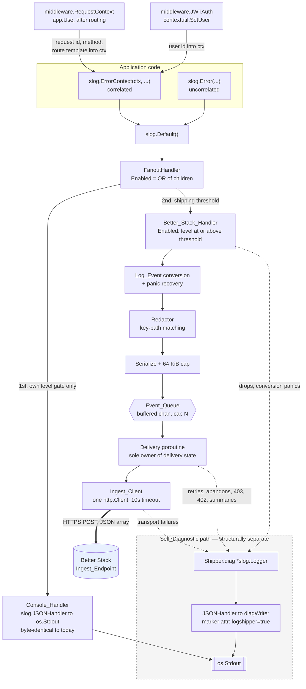
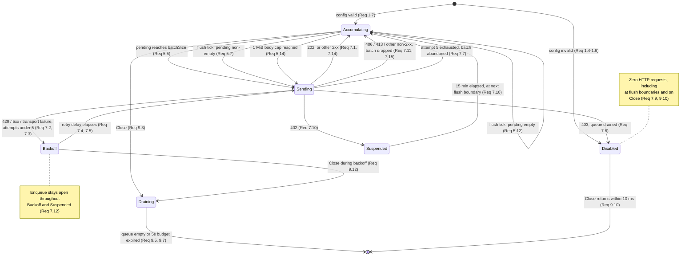

# Design Document

## Overview

This feature forwards ERROR-and-above `log/slog` records to Better Stack over HTTPS by installing an
additional `slog.Handler` at startup. No existing log call site is edited to make forwarding work.

The design rests on four structural decisions, each chosen so that a requirement holds *by
construction* rather than by runtime discipline:

1. **A fan-out handler, with the console child called first.** `slog.SetDefault` receives a handler
   that delegates to the existing `slog.JSONHandler` and to the new `Better_Stack_Handler`. The
   console child is invoked first, and only its own level gate can suppress it — nothing the Better
   Stack path does, including dropping or panicking, can affect console output (Req 1.10, 6.5, 8.6,
   8.9).
2. **Self_Diagnostics are written through a logger that is not `slog.Default()`.** The `Shipper`
   holds its own `*slog.Logger` bound directly to a console-shaped handler. The Better_Stack_Handler
   is not reachable from it. The no-feedback-loop guarantee (Req 8.1, 8.2) is therefore a property of
   the object graph, not of a level check that a future edit could weaken.
3. **A single delivery goroutine owns all mutable delivery state.** Batching, retry, backoff,
   suspension, and drain are sequential within one goroutine, so "no concurrent transmissions"
   (Req 5.15) needs no lock and cannot be violated.
4. **Counters are guarded by one small mutex, never held across I/O.** This yields a genuinely
   atomic multi-counter observation, making the snapshot accounting equality (Req 11.4) definitional
   rather than probabilistic.

`enqueued` is defined as *admitted* records — every record that passed the level filter and for
which shipping was attempted. This single definitional choice is what makes
`enqueued == delivered + dropped + in_flight + queue_depth` hold on every code path, including
records dropped before they ever reach the channel. See [Concurrency Model](#concurrency-model).

### Scope boundary: request correlation is best-effort this iteration

Because `slog.Handler.Handle(ctx, rec)` receives a `context.Context`, the handler reads the request
ID and user ID straight out of the context. No request-scoped logger needs to be threaded through
call signatures. The consequence:

- `slog.ErrorContext(ctx, ...)` call sites get a `request` object automatically.
- `slog.Error(...)` call sites receive `context.Background()` and emit no `request` object (Req 4.7).

This iteration builds the plumbing and migrates zero of the 53 existing call sites. Converting
`slog.Error` to `slog.ErrorContext` is a mechanical follow-on, listed in
[Deferred Work](#deferred-work).

---

## Architecture

### Data flow



The dashed edges into `Shipper.diag` never re-enter `FanoutHandler`. There is no path from any
Self_Diagnostic back to the Event_Queue, so a diagnostic describing a delivery failure produces zero
additional delivery attempts (Req 8.2).

### Package placement

A new top-level `logging/` package. Justification:

- **`configs/` is wrong.** `configs` is a leaf of env accessors plus the Mongo connection. Putting a
  handler, a queue, and a delivery goroutine there would make a widely imported leaf package own
  background goroutines.
- **`notifications/` is wrong.** It is a domain package about user-facing notifications and it
  imports `configs`, `users`, and mongo. Importing it from a logging path used by `main.go` startup
  code invites cycles.
- **`middleware/` is wrong for the core.** `middleware` imports `users`, `jwtutil`, `responses`, and
  `contextutil`. The logging core must stay importable from anywhere, including from `contextutil`.

`logging/` imports **standard library only** — `log/slog`, `net/http`, `encoding/json`, `context`,
`errors`, `io`, `math`, `math/rand`, `net/url`, `runtime`, `slices`, `strconv`, `strings`, `sync`,
`sync/atomic`, `time`, `unicode/utf8`. This satisfies Req 12.6 and makes cycles impossible for the
core.

Import cycle analysis for the two edges that touch existing packages:

| Edge | Direction | Cycle? |
| --- | --- | --- |
| `logging` → `configs` | **not created.** `logging` reads no env var (Req 12.1). `main.go` reads `configs.BetterStack*()` and passes raw strings in. | No |
| `contextutil` → `logging` | `contextutil` currently imports only `echo`. Adding `logging` is safe because `logging` imports stdlib only. | No |
| `middleware` → `logging` | `middleware` already imports `contextutil`; adding `logging` adds no back-edge. | No |
| `main` → `logging`, `configs`, `middleware` | `main` is the top of the graph. | No |

The only existing file that gains an import is `contextutil/contextutil.go`. Verify with
`go build ./...`; `go vet ./...` (the repo's `make lint`) reports import cycles as build errors.

### Integration points in this repo

| Location | Change | Why |
| --- | --- | --- |
| `main.go` startup | Replace `slog.New(slog.NewJSONHandler(os.Stdout, nil))` with the fan-out handler wrapping that exact handler value. | Req 2.5 requires byte-identical console output; reusing the same constructor call guarantees it. |
| `main.go` middleware order | Register `middleware.RequestContext()` via `app.Use` **before** `Logger()` and `Recover()`. | Echo routes before `Use` middleware, so `c.Path()` is populated (Req 4.8). Registering before `Recover` means the `X-Request-Id` header is set even on panics (Req 4.2). Using `app.Pre` would leave `c.Path()` empty. |
| `main.go` recover config | Swap `echomiddleware.Recover()` for `RecoverWithConfig` with `StackSize: 8192`, `DisableStackAll: true`, `DisablePrintStack: true`, and a `LogErrorFunc` that emits one `slog.ErrorContext`. | Echo's default Recover logs through `c.Logger()`, which is Echo's own logger, not `slog` — panics never reach Better Stack today. `DisablePrintStack` prevents a duplicate record (Req 2.6 says *exactly one*). |
| `main.go` shutdown | **New.** `signal.NotifyContext` for SIGINT/SIGTERM, then `app.Shutdown(ctx)`, then `shipper.Close()`, then return. | See below. |
| `configs/env.go` | Add seven `os.Getenv` accessors following the existing one-line convention. | Repo convention; keeps `logging` env-free. |
| `contextutil/contextutil.go` | `SetUser` additionally writes the user ID into the request's `context.Context`. `GetUserID(c)` is unchanged. | `Handle` receives a `context.Context`, not an `echo.Context`. Echo's `c.Set` store is invisible to it. |
| `.env.example` | Add the seven variables with documented defaults (Req 1.13). | |
| `notifications/slack.go` | **No change.** Used as the structural template for `Ingest_Client`: construct body with `encoding/json`, POST with `net/http`, `defer resp.Body.Close()`, return a wrapped error. | Consistency with the existing stdlib-only HTTP sink. |

#### Graceful shutdown does not exist yet

Req 9.1 presumes an Echo graceful shutdown to hook after. There is none: `main.go` ends at
`app.Start(port)` and the repo contains no `signal.`, `Shutdown`, or `SIGTERM` reference. Req 9.1 is
therefore only partly about the Log_Shipper — it also requires adding signal handling:

```go
ctx, stop := signal.NotifyContext(context.Background(), os.Interrupt, syscall.SIGTERM)
defer stop()

go func() {
    if err := app.Start(port); err != nil && !errors.Is(err, http.ErrServerClosed) {
        slog.Error("server failed", "error", err)
        stop()
    }
}()

<-ctx.Done()
shutdownCtx, cancel := context.WithTimeout(context.Background(), 10*time.Second)
defer cancel()
if err := app.Shutdown(shutdownCtx); err != nil {
    slog.Error("graceful shutdown failed", "error", err)
}
shipper.Close() // only after Shutdown returns (Req 9.1)
```

Ordering matters twice: records emitted *during* Echo shutdown must still be enqueued (Req 9.2),
which holds because `Close` has not been called yet; and `Close` must be the last thing before
return so its flush covers those records (Req 9.3).

---

## Components and Interfaces

### FanoutHandler

```go
// logging/fanout.go
type FanoutHandler struct {
    children []slog.Handler
}

func NewFanoutHandler(children ...slog.Handler) *FanoutHandler

func (h *FanoutHandler) Enabled(ctx context.Context, l slog.Level) bool
func (h *FanoutHandler) Handle(ctx context.Context, r slog.Record) error
func (h *FanoutHandler) WithAttrs(attrs []slog.Attr) slog.Handler
func (h *FanoutHandler) WithGroup(name string) slog.Handler
```

- `Enabled` returns true if **any** child is enabled. Returning the console child's answer alone
  would let a future console-level change silence Better Stack.
- `Handle` calls children **in construction order**, invoking each child only when that child's
  `Enabled` returns true. Errors are joined with `errors.Join` and one child's error never prevents a
  later child from running. Construction order in `main.go` puts the console child first.
- `Handle` must not mutate `r`. `slog.Record` is passed by value but shares attribute backing
  storage; any child needing to add attrs calls `r.Clone()` first. This is what preserves Req 2.5
  byte-identity for the console child.
- `WithAttrs` / `WithGroup` fan out to every child and return a new `FanoutHandler` with a freshly
  allocated `children` slice.

**A tension in Req 2.5 worth recording.** Req 2.5 asks for both "every Log_Record of every level" and
byte-identity with the pre-feature `slog.JSONHandler` configuration. Those conflict at DEBUG:
`slog.NewJSONHandler(os.Stdout, nil)` defaults to `LevelInfo`, so DEBUG records produce no output
today. The design treats **byte-identity as the operative constraint** and passes `nil` options
through unchanged, so DEBUG stays suppressed exactly as it is now. This is currently moot — the repo
contains zero `slog.Debug` and zero `slog.Log` call sites (53 records total, all Error, Warn, or
Info). Consequence for `FanoutHandler.Enabled`: with the OR-of-children rule and an ERROR threshold,
a DEBUG record is still reported as disabled, so slog never constructs it and today's behaviour is
preserved bit for bit. Raised as an open question below.

### Better_Stack_Handler

The `slog.Handler` contract is the classic source of subtle bugs here, so the state layout is chosen
to make the contract mechanical.

```go
// logging/handler.go

// attrFrame binds a batch of preformatted attrs to the group path that was open
// when WithAttrs was called. Frames are immutable once constructed.
type attrFrame struct {
    groups []string
    attrs  []slog.Attr
}

type Handler struct {
    shipper *Shipper      // nil is legal: conversion-only handler (Req 12.9)
    level   slog.Leveler
    groups  []string      // currently open groups
    frames  []attrFrame   // preformatted attrs, in add order
}

func NewHandler(s *Shipper, level slog.Leveler) *Handler

func (h *Handler) Enabled(ctx context.Context, l slog.Level) bool
func (h *Handler) Handle(ctx context.Context, r slog.Record) error
func (h *Handler) WithAttrs(attrs []slog.Attr) slog.Handler
func (h *Handler) WithGroup(name string) slog.Handler
```

**`Enabled`** returns `l >= h.level.Level()`. Nothing else — no queue-depth or enabled-state check,
because Req 2.9 and 2.10 define it purely in terms of the threshold. When the Shipper is disabled,
`Handle` discards; `Enabled` still reports the threshold answer so behaviour stays predictable.

**`WithAttrs` / `WithGroup` semantics.** The four rules that matter:

1. **Never mutate the receiver, and never share an appendable slice.** The classic bug is
   `h2.frames = append(h.frames, f)`: if `h.frames` has spare capacity, two sibling handlers derived
   from the same parent write to the same backing array and the second clobbers the first. Every
   derived handler gets `slices.Clip`-ed slices, so any later append reallocates:

   ```go
   func (h *Handler) WithAttrs(attrs []slog.Attr) slog.Handler {
       if len(attrs) == 0 {
           return h // permitted optimization
       }
       h2 := *h
       h2.frames = append(slices.Clip(h.frames), attrFrame{
           groups: slices.Clip(h.groups),
           attrs:  slices.Clone(attrs),
       })
       return &h2
   }

   func (h *Handler) WithGroup(name string) slog.Handler {
       if name == "" {
           return h // required by the slog.Handler contract
       }
       h2 := *h
       h2.groups = append(slices.Clip(h.groups), name)
       h2.frames = slices.Clip(h.frames)
       return &h2
   }
   ```

2. **Attrs are qualified by the groups open when they were added, not by the groups open at
   `Handle` time.** Storing a flat `attrs []slog.Attr` and applying `h.groups` at emit time is
   wrong: `h.WithAttrs(a).WithGroup("g").WithAttrs(b)` must place `a` at `context.a` and `b` at
   `context.g.b`. The `attrFrame.groups` field is what records that.

3. **Record attrs are nested under the groups open at `Handle` time** — `h.groups`, not the groups
   of any frame.

4. **`WithGroup("")` returns the receiver**, and `WithAttrs(nil)` may return the receiver. Both are
   explicit in the `slog.Handler` documentation.

**`Handle`** always returns `nil` and never propagates a panic (Req 8.8):

```go
func (h *Handler) Handle(ctx context.Context, r slog.Record) error {
    if h.shipper == nil || !h.Enabled(ctx, r.Level) {
        return nil
    }
    h.shipper.counters.addAdmitted(1) // "enqueued": admitted for shipping
    defer func() {
        if p := recover(); p != nil {
            h.shipper.counters.addDropped(reasonConversionPanic, 1)
            h.shipper.counters.addConversionPanic(1)
            h.shipper.diagPanic("panic converting log record", p)
        }
    }()
    ev := h.convert(ctx, r)     // may panic on hostile values
    h.shipper.redactor.Apply(ev)
    h.shipper.enqueue(ev)
    return nil
}
```

The `addAdmitted` call precedes conversion deliberately. A conversion panic must increment `dropped`
(Req 8.5), so the matching admission must already be counted or the Req 11.4 equality breaks. See
[Concurrency Model](#concurrency-model).

Per-record attribute handling inside `convert`, following the documented `Handle` rules:

- Skip attrs where `a.Equal(slog.Attr{})`.
- Call `a.Value.Resolve()` to run `LogValuer` (Req 10.8) before any inspection, so redaction sees the
  resolved value (Req 10.9).
- Inline groups with an empty name; drop groups whose attr list is empty after processing.
- Later duplicate keys within one object level overwrite earlier ones, emitted once (Req 3.11) — a
  `map[string]any` per level gives this for free.

### Log_Event conversion

```go
// logging/event.go

// Event is an ordered-key-free representation; encoding/json sorts map keys,
// which makes serialized output deterministic for tests.
type Event struct {
    DT          string         `json:"dt"`
    Level       string         `json:"level"`
    Message     string         `json:"message"`
    Service     string         `json:"service"`
    Environment string         `json:"environment"`
    Truncated   bool           `json:"truncated"`
    Error       *ErrorInfo     `json:"error,omitempty"`
    Source      *SourceInfo    `json:"source,omitempty"`
    Request     *RequestInfo   `json:"request,omitempty"`
    User        *UserInfo      `json:"user,omitempty"`
    Context     map[string]any `json:"context,omitempty"`
}

type ErrorInfo struct {
    Message string   `json:"message"`
    Type    string   `json:"type"`
    Chain   []string `json:"chain,omitempty"`
}

type SourceInfo struct {
    File     string `json:"file"`
    Line     int    `json:"line"`
    Function string `json:"function"`
}

type RequestInfo struct {
    ID     string `json:"id"`
    Method string `json:"method"`
    Path   string `json:"path"`
}

type UserInfo struct {
    ID string `json:"id"`
}

func (h *Handler) convert(ctx context.Context, r slog.Record) *Event
```

Field derivation:

| Field | Derivation | Req |
| --- | --- | --- |
| `dt` | `r.Time.UTC().Format("2006-01-02T15:04:05.000") + "Z"`. The literal `Z` is appended rather than placed in the layout, because Go treats `Z07:00` in a layout as an offset placeholder. | 3.2 |
| `level` | `r.Level.String()` — yields `ERROR`, and `ERROR+2` for offsets above a named level. | 3.3, 2.7 |
| `message` | `r.Message`, empty string permitted. | 3.4 |
| `service` | First 64 chars of resolved service name; `unknown` if empty. | 3.5 |
| `environment` | First 64 chars of `Config.Environment`; `unknown` if empty. | 3.15 |
| `error` | First attr at any level whose resolved value satisfies `error`, in record attr order. Remaining error-valued attrs go under `context` as their `Error()` text. | 3.6 |
| `error.chain` | `errors.Unwrap` repeatedly, outermost first, cap 10; more than 10 sets `truncated`. Emitted only when at least one unwrap succeeds. | 3.7 |
| `source` | From `r.PC` via `runtime.CallersFrames`; `file` is `filepath.Base`. Omitted when `r.PC == 0`. | 3.8, 3.16 |
| `context` | All remaining attrs, group nesting preserved. | 3.9 |
| Reserved keys | An attr whose key equals a reserved top-level key is placed under `context`; the top-level field is untouched. Because `context` is a separate map, this needs no special case. | 3.10 |

`error.Type` uses `fmt.Sprintf("%T", v)`. This is the one place the design reaches for `fmt`, which
is stdlib and permitted.

#### Resolving the two nesting caps (Req 3.9 vs Req 10.10)

The requirements state two depth limits **measured from different origins**. Conflating them would
either over-truncate or leave a subtree uncapped.

Define two quantities:

- **`ctxLevel`** — nesting levels below the `context` object. An attribute that is a direct child of
  `context` is at `ctxLevel = 1`.
- **`rootDepth`** — object edges below the Log_Event root. A top-level field such as `level` or the
  `context` object itself is at `rootDepth = 1`.

Relationship, since `context` is a direct child of the root:

```
rootDepth(v) = ctxLevel(v) + 1        for any v inside context
```

| Cap | Constant | Origin | Rule | Deepest retained, in rootDepth |
| --- | --- | --- | --- | --- |
| Conversion (Req 3.9) | `maxContextDepth = 8` | the `context` object | retain `ctxLevel <= 8`; omit `ctxLevel >= 9` and set `truncated = true` | **9** |
| Redaction (Req 10.10) | `maxRedactDepth = 10` | the Log_Event root | replace values at `rootDepth >= 11` with `[TRUNCATED]`, stop descending, set `truncated = true` | **10** |

**Consequence.** Conversion runs before redaction and guarantees `rootDepth <= 9` anywhere under
`context`. The other subtrees (`error`, `source`, `request`, `user`) are fixed-shape structs with
`rootDepth <= 2`. So on every event produced by the conversion path, the Redactor's depth cap is
**unreachable, with one level of headroom.** It is not dead code: it is a real backstop for
(a) hand-built events passed straight to the Redactor in isolation tests (Req 12.9, P14),
(b) cyclic or hundreds-deep attribute graphs, and (c) any future top-level subtree added without a
conversion-side cap.

**Preventing wrong-axis application.** The two depths are given distinct unexported types, so mixing
them is a compile error rather than an off-by-one:

```go
type ctxLevel int   // nesting levels below `context`; direct child = 1
type rootDepth int  // object edges below the Event root; top-level field = 1

const maxContextDepth ctxLevel = 8
const maxRedactDepth   rootDepth = 10

func appendAttrs(dst map[string]any, attrs []slog.Attr, lvl ctxLevel, ev *Event)
func redactValue(v any, d rootDepth) (any, bool)
```

`appendAttrs` can only compare against `maxContextDepth`; `redactValue` can only compare against
`maxRedactDepth`. `lvl > maxRedactDepth` does not compile. The Redactor enters each top-level field
at `rootDepth(1)`, so `context`'s children start at 2 — exactly `ctxLevel + 1`.

A guard test asserts the relationship rather than the constants, so the invariant survives retuning:

```go
// TestDepthCapsNormalizeConsistently asserts the conversion cap is strictly
// tighter than the redaction cap once both are expressed in rootDepth, so that
// redaction never truncates a value conversion chose to retain.
if rootDepth(maxContextDepth)+1 >= maxRedactDepth+1 { t.Fatal(...) }
```

#### Size cap

Req 3.12 caps a serialized event at 65536 bytes. Algorithm:

1. Serialize. If `<= 65536`, done, `truncated` unchanged.
2. Collect every string value under `context` with its byte length; sort descending.
3. Truncate them in that order, cutting at a UTF-8 boundary via `utf8.DecodeLastRuneInString` and
   appending `…[truncated]`, re-measuring after each.
4. If still over, truncate `message` the same way.
5. Set `truncated = true`.

`dt`, `level`, `service`, `environment`, `error.type`, and all `source` fields are never truncation
candidates (Req 3.17). Their combined worst case is bounded — 64 + 64 for service and environment,
plus small fixed fields — so step 5 always terminates below the cap.

### Redactor

```go
// logging/redact.go
type Redactor struct {
    sourceToken string // compared by equality only (Req 10.11)
}

func NewRedactor(sourceToken string) *Redactor
func (r *Redactor) Apply(ev *Event)

const redactedPlaceholder  = "[REDACTED]"
const truncatedPlaceholder = "[TRUNCATED]"

var sensitiveSubstrings = []string{
    "token", "secret", "password", "passwd", "authorization",
    "api_key", "apikey", "access_key", "private_key",
    "session", "cookie", "jwt", "bearer",
}
```

- Matching is per **key path segment**, lower-cased, using `strings.Contains` — not the joined dotted
  path (Req 10.1). So a group named `auth` containing `id` does not become `auth.id` and match
  nothing spuriously, and conversely a segment `access_key_id` matches on `access_key`.
- Applied to `context`, `error`, `request`, and `user`. `dt`, `level`, `message`, `service`,
  `environment`, `source`, and `truncated` are left alone (Req 10.2).
- A match replaces the whole value with the single string `[REDACTED]` regardless of original type,
  including objects and arrays and everything nested beneath them (Req 10.3). Keys are preserved.
- Any value equal to the Source_Token is replaced (Req 10.11). No content-shape heuristics — no
  `Bearer ` prefix sniffing, no JWT-shape matching.
- Depth cap per the table above. Cycle safety comes from the depth cap alone; no visited-set is
  needed, and `Apply` therefore allocates nothing per node beyond the replacement.

Redaction is applied **after** `LogValue` resolution and **before** serialization and enqueue, so the
Event_Queue never holds an unredacted event (Req 10.9).

Req 10.6 — no personal names, emails, or phone numbers in any record — is a **call-site discipline**,
not something the Redactor can enforce, because it matches on keys only. It stays a review
invariant, asserted by the existing `notifications/activity_test.go` PII test.

### Event_Queue and Shipper lifecycle

```go
// logging/shipper.go
type Shipper struct {
    cfg      Config
    client   *IngestClient
    redactor *Redactor
    clock    Clock
    jitter   Jitter

    queue chan *Event // capacity == cfg.QueueSize

    counters *counters
    diag     *slog.Logger

    state atomic.Int32 // stateEnabled | stateDisabled | stateSuspended

    closeOnce   sync.Once
    closeDone   chan struct{}
    closeResult CloseResult
    closed      atomic.Bool

    flushReq chan flushRequest
}

func NewShipper(cfg Config) *Shipper   // does not start the goroutine
func (s *Shipper) Start()              // starts exactly one delivery goroutine (Req 5.3)
func (s *Shipper) Handler() *Handler
func (s *Shipper) Snapshot() Snapshot
func (s *Shipper) Flush(deadline time.Duration) FlushResult
func (s *Shipper) Close() CloseResult

type FlushResult struct {
    Delivered uint64
    Dropped   uint64
    Drained   bool
}

type CloseResult struct {
    Flushed   uint64
    Discarded uint64
    TimedOut  bool
}
```

`enqueue` is a non-blocking send, which is the whole of Req 5.2, 6.2, and 6.3:

```go
func (s *Shipper) enqueue(ev *Event) {
    if s.closed.Load() || s.state.Load() == stateDisabled {
        s.counters.addDropped(reasonAfterClose, 1) // or reasonDisabled
        return
    }
    select {
    case s.queue <- ev:
    default:
        s.counters.addDropped(reasonQueueFull, 1)
        s.maybeDiagDrop()
    }
}
```

A buffered channel bounds occupancy at exactly `cap` at every instant, including under concurrent
sends, with no lock (Req 6.2). The `default` arm makes the operation wait-free — a few tens of
nanoseconds, far inside the 1 ms bounds of Req 5.2, 5.13, 6.3, 9.4, and 9.11.

`maybeDiagDrop` rate-limits the drop diagnostic to one per 60 s using the injected clock and reports
the *cumulative* count, so suppressed drops are still accounted for (Req 6.4, 6.8).

### Ingest_Client

Structured after `notifications/slack.go`: marshal with `encoding/json`, POST with `net/http`,
close the body, wrap errors.

```go
// logging/ingest.go
type IngestClient struct {
    url   string
    token string
    http  *http.Client // exactly one instance for the process (Req 5.11)
}

func NewIngestClient(url, token string, timeout time.Duration) *IngestClient

// Send transmits one batch. perRequestTimeout allows Close to shorten it (Req 9.6).
func (c *IngestClient) Send(ctx context.Context, batch []*Event, perRequestTimeout time.Duration) SendOutcome

type SendOutcome struct {
    Status     int   // 0 when no response was received
    RetryAfter time.Duration
    Err        error // transport-level failure or timeout
}
```

- Body is a JSON array of events in enqueue order (Req 5.8).
- `Content-Type: application/json`, `Authorization: Bearer <token>` (Req 5.9).
- `http.Client{Timeout: 10s}` with the default transport, so idle connections are pooled and reused
  (Req 5.10, 5.11).
- Response body: `io.CopyN(io.Discard, resp.Body, 4096)` then `resp.Body.Close()`, both **before**
  the caller inspects `Status`, so the connection returns to the pool on every status and every
  attempt (Req 7.16).

### Counters and Snapshot

```go
// logging/counters.go
type DropReason int

const (
    reasonQueueFull DropReason = iota
    reasonAbandonedBatch
    reasonNonRetryable
    reasonConversionPanic
    reasonAfterClose
    numDropReasons
)

type Snapshot struct {
    Enqueued         uint64            // admitted: records that passed the level filter
    Delivered        uint64
    Dropped          uint64
    ConversionPanics uint64
    RetriedBatches   uint64
    AbandonedBatches uint64
    DroppedByReason  [numDropReasons]uint64
    QueueDepth       uint64
    InFlight         uint64
}

type counters struct {
    mu sync.Mutex
    // all fields below guarded by mu
    enqueued, delivered, dropped         uint64
    conversionPanics, retried, abandoned uint64
    inFlight                             uint64
    byReason                             [numDropReasons]uint64
}

func (c *counters) addAdmitted(n uint64)
func (c *counters) addDelivered(n uint64)
func (c *counters) addDropped(reason DropReason, n uint64)
func (c *counters) addInFlight(delta int64)
func (c *counters) snapshot() Snapshot
```

Rationale for a mutex over `atomic.Uint64` is in [Concurrency Model](#concurrency-model).

Every increment saturates rather than wrapping (Req 11.2):

```go
func addSat(dst *uint64, n uint64) {
    if *dst > math.MaxUint64-n { *dst = math.MaxUint64; return }
    *dst += n
}
```

### Clock and Jitter

Every duration in the Shipper comes from these two interfaces. `time.Now`, `time.After`, and
`time.NewTicker` appear nowhere in `logging/` outside the default implementations (Req 12.2).

```go
// logging/clock.go
type Ticker interface {
    C() <-chan time.Time
    Stop()
}

type Clock interface {
    Now() time.Time
    NewTicker(d time.Duration) Ticker
    After(d time.Duration) <-chan time.Time
}

type Jitter interface {
    // Fraction returns a value in [0, 1).
    Fraction() float64
}

func SystemClock() Clock
func RandJitter(seed int64) Jitter // math/rand, stdlib only
func FixedJitter(f float64) Jitter // deterministic tests
```

`dt` needs no clock: it comes from `slog.Record.Time`, which slog sets at the call site.

### Request correlation

```go
// logging/context.go — no echo import, keeps the core dependency-free
func ContextWithRequest(ctx context.Context, id, method, path string) context.Context
func ContextWithUserID(ctx context.Context, id string) context.Context
func RequestFromContext(ctx context.Context) (id, method, path string, ok bool)
func UserIDFromContext(ctx context.Context) (string, bool)

// FromContext is sugar for call sites that prefer a bound logger. It is not
// required for correlation: the handler reads the context directly.
func FromContext(ctx context.Context) *slog.Logger

// NewRequestID returns a process-unique id: a 128-bit process nonce plus a
// monotonic counter, so distinctness within the process is guaranteed rather
// than probabilistic (Req 4.1).
func NewRequestID() string

// ValidRequestID reports whether a client-supplied value is adoptable:
// 1..200 chars, ASCII alphanumeric plus '-' and '_' (Req 4.3).
func ValidRequestID(s string) bool
```

`NewRequestID` format: `hex(16 random bytes from crypto/rand)` + `-` + `strconv.FormatUint(counter, 36)`.
Length 18–30 chars, inside the 8–200 bound, charset compliant.

```go
// middleware/requestlog.go — must be registered with app.Use, not app.Pre
func RequestContext() echo.MiddlewareFunc
```

Behaviour:

1. Read `X-Request-Id`. Adopt byte-for-byte if `ValidRequestID`; otherwise discard silently, generate
   one, and continue without erroring (Req 4.3, 4.4).
2. Set the `X-Request-Id` response header immediately, before calling `next`, so it is present on
   handler responses, on centralized error responses, and on recovered panics (Req 4.2).
3. Read `c.Path()` — the registered route template with parameters unsubstituted (Req 4.8). Empty
   means no route matched; substitute `"<unmatched>"` (Req 4.9).
4. Attach id, method, and path to the request context and call `c.SetRequest`.

The user ID arrives separately, because `JWTAuth` runs later and only on protected groups.
`contextutil.SetUser` gains one line so the value lands in the stdlib context too:

```go
func SetUser(c echo.Context, userID string) {
    c.Set("user_id", userID)                                        // unchanged
    r := c.Request()
    c.SetRequest(r.WithContext(logging.ContextWithUserID(r.Context(), userID)))
}
```

`JWTAuth` already calls `SetUser` before `next(c)`, so every record emitted downstream of
authentication sees the user ID (Req 4.6). Records from public routes emit no `user` object
(Req 4.10).

### Self_Diagnostic

```go
func (s *Shipper) diagf(level slog.Level, msg string, args ...any)
```

Bound to `slog.New(slog.NewJSONHandler(cfg.DiagWriter, nil)).With("logshipper", true)` — a handler
constructed inside the Shipper, never `slog.Default()`. The `logshipper` marker satisfies Req 8.1 and
makes diagnostics filterable in stdout.

**Reconciling Req 8.1 with Req 12.8.** Req 8.1 says diagnostics go through the Console_Handler
(stdout, Req 2.5); Req 12.8 says the writer defaults to stderr when unsupplied. Resolution:
`Config.DiagWriter` is the single source of truth, defaulting to `os.Stderr` when nil. `main.go`
passes `os.Stdout`, so in production the diagnostic logger *is* console-shaped and stdout-bound,
satisfying Req 8.1. The stderr default applies only to Shippers built without wiring, which is the
isolated/test case Req 12.8 addresses. Tests inject a `*bytes.Buffer`.

---

## Data Models

### Configuration

Env reading and validation are separated so the Shipper reads no environment variable
(Req 12.1, 12.14) and validation stays a pure, table-testable function.

```go
// logging/config.go

// RawConfig holds unvalidated strings. main.go fills it from configs accessors.
type RawConfig struct {
    SourceToken  string
    IngestURL    string
    ServiceName  string
    Environment  string
    MinLevel     string
    BatchSize    string
    FlushSeconds string
    QueueSize    string
}

type Config struct {
    Enabled     bool
    IngestURL   string
    SourceToken string
    ServiceName string
    Environment string
    MinLevel    slog.Level
    BatchSize   int
    FlushEvery  time.Duration
    QueueSize   int

    DiagWriter io.Writer // nil => os.Stderr (Req 12.8)
    Clock      Clock     // nil => SystemClock()
    Jitter     Jitter    // nil => RandJitter(seed)
}

// Diagnostic is a deferred Self_Diagnostic. ResolveConfig is pure and returns
// them rather than writing, so validation is testable without a writer.
type Diagnostic struct {
    Level   slog.Level
    Message string
    Args    []any
}

// ResolveConfig is pure: no env access, no I/O, no clock.
func ResolveConfig(raw RawConfig) (Config, []Diagnostic)
```

`main.go`:

```go
raw := logging.RawConfig{
    SourceToken:  configs.BetterStackSourceToken(),
    IngestURL:    configs.BetterStackIngestURL(),
    ServiceName:  configs.BetterStackServiceName(),
    Environment:  configs.AppEnv(),
    MinLevel:     configs.BetterStackMinLevel(),
    BatchSize:    configs.BetterStackBatchSize(),
    FlushSeconds: configs.BetterStackFlushSeconds(),
    QueueSize:    configs.BetterStackQueueSize(),
}
cfg, diags := logging.ResolveConfig(raw)
cfg.DiagWriter = os.Stdout
shipper := logging.NewShipper(cfg)
shipper.EmitStartupDiagnostics(diags) // Req 1.4-1.6, 1.12, 11.9
shipper.Start()

console := slog.NewJSONHandler(os.Stdout, nil) // unchanged from today
slog.SetDefault(slog.New(logging.NewFanoutHandler(console, shipper.Handler())))
```

New `configs/env.go` accessors follow the existing plain-`os.Getenv` convention:

```go
func BetterStackSourceToken() string  { return os.Getenv("BETTERSTACK_SOURCE_TOKEN") }
func BetterStackIngestURL() string    { return os.Getenv("BETTERSTACK_INGEST_URL") }
func BetterStackServiceName() string  { return os.Getenv("BETTERSTACK_SERVICE_NAME") }
func BetterStackMinLevel() string     { return os.Getenv("BETTERSTACK_MIN_LEVEL") }
func BetterStackBatchSize() string    { return os.Getenv("BETTERSTACK_BATCH_SIZE") }
func BetterStackFlushSeconds() string { return os.Getenv("BETTERSTACK_FLUSH_SECONDS") }
func BetterStackQueueSize() string    { return os.Getenv("BETTERSTACK_QUEUE_SIZE") }
```

Note these return raw strings rather than parsed values, unlike `AWSS3MaxUploadBytes()`. That is
deliberate: parsing and clamping live in `ResolveConfig` so every rejection path is unit-testable
without `t.Setenv`, and so validation is not split across two packages.

### Disabled-state and validation decision table

All values are trimmed of leading and trailing whitespace before evaluation.

| Variable | Condition | Resulting state / value | Diagnostic | Req |
| --- | --- | --- | --- | --- |
| `BETTERSTACK_SOURCE_TOKEN` | unset or empty | **disabled** | WARN, names the variable | 1.4 |
| `BETTERSTACK_INGEST_URL` | unset or empty | **disabled** | WARN, names the variable | 1.5 |
| `BETTERSTACK_INGEST_URL` | parse failure, scheme ≠ `https`, or no host | **disabled** | **ERROR**, names the variable, excludes the token | 1.6 |
| both above | valid | **enabled** before the first inbound request | INFO startup summary: threshold, batch size, flush seconds, queue capacity, ingest **host** only | 1.7, 11.9 |
| `APP_ENV` | equals `production`, case-insensitive, **and** state is disabled | disabled | **additional ERROR**: centralized error logging inactive | 1.12 |
| `BETTERSTACK_SERVICE_NAME` | unset, empty, or > 64 chars | `fundis-backend` | none | 1.3 |
| `BETTERSTACK_MIN_LEVEL` | unset or empty | `slog.LevelError` | **none** (explicitly required) | 2.2 |
| `BETTERSTACK_MIN_LEVEL` | `info` / `warn` / `error`, case-insensitive | `LevelInfo` / `LevelWarn` / `LevelError` | none | 2.1 |
| `BETTERSTACK_MIN_LEVEL` | any other non-empty value | `slog.LevelError` | WARN, includes rejected value truncated to 64 chars | 2.8 |
| `BETTERSTACK_BATCH_SIZE` | unset or empty | `20` | none — see interpretation below | 5.4 |
| `BETTERSTACK_BATCH_SIZE` | non-empty, unparseable or outside 1–1000 | `20` | WARN, names the rejected value | 5.4 |
| `BETTERSTACK_FLUSH_SECONDS` | unset or empty | `5s` | none — see interpretation below | 5.6 |
| `BETTERSTACK_FLUSH_SECONDS` | non-empty, unparseable or outside 1–300 | `5s` | WARN, names the rejected value | 5.6 |
| `BETTERSTACK_QUEUE_SIZE` | unset or empty | `1000` | none | 6.1 |
| `BETTERSTACK_QUEUE_SIZE` | non-empty, unparseable or outside 1–100000 | `1000` | WARN, names the variable and the applied capacity 1000 | 6.1, 6.7 |

Startup never exits on a Log_Shipper configuration problem (Req 1.9), and a disabled Shipper is
disabled for the whole process with no re-reads (Req 1.8) and starts no goroutine and issues no HTTP
request (Req 1.11).

**Interpretation, flagged deliberately.** A literal reading of Req 5.4 and 5.6 emits a WARN even when
the variable is unset, since they list "holds an empty value" alongside the invalid cases. The table
above emits no diagnostic for unset/empty, matching the explicit carve-out Req 6.7 makes for
`BETTERSTACK_QUEUE_SIZE` and Req 2.2 makes for `BETTERSTACK_MIN_LEVEL`. Otherwise every default
deployment logs three startup warnings about variables it intentionally left unset. Raised as an
open question below.

### `.env.example` addition

```bash
# Better Stack (Logtail) error log forwarding. Leave BETTERSTACK_SOURCE_TOKEN or
# BETTERSTACK_INGEST_URL empty to disable forwarding entirely; stdout logging is
# completely unaffected either way.
BETTERSTACK_SOURCE_TOKEN=""
# Required when forwarding is enabled. Must be an https URL with a host.
BETTERSTACK_INGEST_URL=""
# Defaults to fundis-backend. Truncated to 64 characters.
BETTERSTACK_SERVICE_NAME=""
# "error" (default), "warn", or "info".
BETTERSTACK_MIN_LEVEL=""
# Max events per HTTP request, 1-1000. Defaults to 20.
BETTERSTACK_BATCH_SIZE=""
# Flush interval in seconds, 1-300. Defaults to 5.
BETTERSTACK_FLUSH_SECONDS=""
# In-memory queue capacity in events, 1-100000. Defaults to 1000.
BETTERSTACK_QUEUE_SIZE=""
```

### Log_Event payload shape, worked from a real call site

The call site is `auth/routes.go:199`, inside `HandleUserRegistration`:

```go
if referralCode != nil {
    if err := referrals.CreatePending(ctx.Request().Context(), referralCode, user.ID); err != nil {
        slog.Error("failed to record referral", "referred_user_id", user.ID, "error", err)
    }
}
```

`referrals.CreatePending` wraps its Mongo failure: `fmt.Errorf("creating referral: %w", err)`
(`referrals/model.go:188`). The route is registered as `g.POST("/register", ...)` on the `/api/v1`
group, so `c.Path()` is `/api/v1/register`.

After the mechanical follow-on adds context (`slog.ErrorContext(ctx.Request().Context(), ...)`), the
delivered Log_Event is:

```json
{
  "dt": "2025-06-14T09:21:44.317Z",
  "level": "ERROR",
  "message": "failed to record referral",
  "service": "fundis-backend",
  "environment": "production",
  "truncated": false,
  "error": {
    "message": "creating referral: (NotWritablePrimary) not primary",
    "type": "*fmt.wrapError",
    "chain": [
      "creating referral: (NotWritablePrimary) not primary",
      "(NotWritablePrimary) not primary"
    ]
  },
  "source": {
    "file": "routes.go",
    "line": 199,
    "function": "backend/auth.HandleUserRegistration"
  },
  "request": {
    "id": "9f2c1a7b4e6d80351c7ae3f0-1f4",
    "method": "POST",
    "path": "/api/v1/register"
  },
  "context": {
    "referred_user_id": "6653f1c2a8de40b1c0a91f77"
  }
}
```

Points this example pins down:

- **No `user` object.** `/register` is a public route with no `JWTAuth`, so no user ID is in the
  context and the object is omitted (Req 4.10). On an authenticated route the same shape gains
  `"user": {"id": "..."}`.
- **`request.path` is the template, not the concrete path.** Here they coincide; on
  `/api/v1/job-requests/:jobRequestId/chats` the emitted value keeps `:jobRequestId` literal, so
  Better Stack groups by route instead of fragmenting per ID (Req 4.8).
- **`error` is lifted out of `context`.** The `error` attr becomes the structured `error` object
  (Req 3.6); `referred_user_id` stays under `context` (Req 3.9).
- **`error.chain` shows the wrap.** Two entries, outermost first (Req 3.7). A non-wrapped error omits
  `chain` entirely.
- **Redaction is a no-op here.** `referred_user_id` contains no sensitive substring. Had the call
  site passed `session_id`, the value would be `[REDACTED]` with the key intact (Req 10.3).
- **`referred_user_id` is an opaque Mongo ID**, not a name, email, or phone — the Req 10.6 discipline.
- **If this record were emitted by unmigrated `slog.Error`**, everything above is identical except
  that `request` is omitted (Req 4.7). That is the visible cost of deferring the call-site migration.

Query patterns this shape enables in the Better Stack UI: `level:ERROR AND environment:production`,
`error.type:"*mongo.CommandError"`, `request.path:"/api/v1/register"`, and
`request.id:"9f2c..."` to pull every line of one failing request.


---

## Delivery State Machine

One goroutine, one state variable. Because the goroutine is the only writer of batching and retry
state, "zero additional HTTP requests while a transmission is in progress" (Req 5.15) needs no lock:
`Send` is a synchronous call inside the loop, so no other transmission can begin.



### Loop skeleton

```go
func (s *Shipper) run() {
    ticker := s.clock.NewTicker(s.cfg.FlushEvery)
    defer ticker.Stop()

    var pending []*Event
    for {
        select {
        case ev := <-s.queue:
            s.counters.addInFlight(1)
            if !s.fits(pending, ev) { // 1 MiB cap (Req 5.14)
                s.transmit(pending)
                pending = nil
            }
            pending = append(pending, ev)
            if len(pending) >= s.cfg.BatchSize {
                s.transmit(pending) // Req 5.5
                pending = nil
            }
        case <-ticker.C():
            if len(pending) > 0 {
                s.transmit(pending) // Req 5.7
                pending = nil
            } // else: zero requests, interval restarts (Req 5.12)
        case req := <-s.flushReq:
            pending = s.drainAndTransmit(pending, req)
        case <-s.closeDone:
            s.finalDrain(pending) // Req 9.3, single attempt, no backoff (Req 9.12)
            return
        }
    }
}
```

`pending` never exceeds `BatchSize`, and at most one batch is in flight, so total retained payload is
bounded by `(QueueSize + BatchSize) × 65536` bytes — exactly Req 6.6, given the per-event 64 KiB cap
from Req 3.12.

Req 5.5's "within 100 ms" is measured from the moment the goroutine observes the count while not
transmitting. When a transmission is in flight, Req 5.15 takes precedence and the batch-size trigger
is deferred until the in-flight batch reaches a terminal state.

`fits` tracks a running serialized size rather than re-marshalling the batch, so the cap check is
O(1) per event: each event's serialized length is computed once at conversion time and cached on the
`Event`. Because every event is at most 65536 bytes and the cap is 1048576, a batch always contains
at least one event (P15).

### HTTP status classification

Applied after the response body has been read and closed (Req 7.16).

| Outcome | Retry? | Counter effects | Diagnostic | Req |
| --- | --- | --- | --- | --- |
| **202** | no | `delivered += n` | none | 7.1 |
| **200–299 other than 202** | no | `delivered += n` | WARN with status | 7.14 |
| **402** Payment Required | no | `dropped += n` (`reasonNonRetryable`) | ERROR: account/quota rejection | 7.10 |
| **403** Forbidden | no | `dropped += n + queued`, state → **disabled permanently** | ERROR: source token rejected | 7.8, 7.9 |
| **406** Not Acceptable | no | `dropped += n` (`reasonNonRetryable`) | ERROR with status and count | 7.11 |
| **413** Payload Too Large | no | `dropped += n` (`reasonNonRetryable`) | ERROR with status and count | 7.11 |
| **429** Too Many Requests | **yes** | `retried += 1` | none per attempt | 7.2, 7.4 |
| **500–599** | **yes** | `retried += 1` | none per attempt | 7.2 |
| **transport failure or 10 s timeout** | **yes** | `retried += 1` | none per attempt | 7.3 |
| **any other status** (1xx, 3xx, other 4xx) | no | `dropped += n` (`reasonNonRetryable`) | ERROR with status | 7.15 |
| **attempt 5 ended retryable** | no | `dropped += n` (`reasonAbandonedBatch`), `abandoned += 1` | ERROR with discarded count and last status or transport category | 7.7 |

On 402 the shipper enters `Suspended` for 15 minutes, transmits nothing (Req 7.10), and resumes at
the first flush boundary after the window. On 403 it drains the channel non-blockingly, counts every
drained event, and never transmits again — including during `Close` (Req 7.9).

No Self_Diagnostic describing an ingest failure ever contains the Source_Token (Req 7.13, 10.4).
Diagnostics naming the endpoint emit scheme, host, and path only, stripping query and userinfo
(Req 10.5) via `url.URL{Scheme, Host, Path}.String()`.

### Retry, backoff, and jitter schedule

```go
func (s *Shipper) retryDelay(attempt int, retryAfter time.Duration) time.Duration {
    base := time.Duration(1<<uint(attempt-1)) * time.Second // 1, 2, 4, 8, 16
    if base > 30*time.Second {
        base = 30 * time.Second                             // Req 7.4
    }
    if retryAfter > 0 {                                     // 429 only
        base = clamp(retryAfter, 1*time.Second, 300*time.Second)
    }
    return base + time.Duration(s.jitter.Fraction()*0.2*float64(base)) // Req 7.5
}
```

| Attempt | Base | With jitter | Req |
| --- | --- | --- | --- |
| 1 → 2 | 1 s | 1.0–1.2 s | 7.4, 7.5 |
| 2 → 3 | 2 s | 2.0–2.4 s | 7.4, 7.5 |
| 3 → 4 | 4 s | 4.0–4.8 s | 7.4, 7.5 |
| 4 → 5 | 8 s | 8.0–9.6 s | 7.4, 7.5 |
| — | capped at 30 s | 30.0–36.0 s | 7.4 |
| 429 with `Retry-After` | clamped to 1–300 s | up to 360 s | 7.4, 7.5 |

The absolute maximum is 300 × 1.2 = 360 s, matching Req 7.5's stated bound. `Retry-After` is honoured
only for 429 and only when it parses as a non-negative integer; a malformed or absent header falls
back to the doubling schedule. The attempt counter is per-batch, starts at 1 after the first
transmission, and never exceeds 5, so one batch appears in at most 5 HTTP requests (Req 7.6).

All waiting uses `s.clock.After`, so tests advance a fake clock instead of sleeping (Req 12.2).
Enqueue remains open throughout backoff and suspension (Req 7.12).

### Close and Flush

```go
func (s *Shipper) Close() CloseResult {
    s.closeOnce.Do(func() {
        if s.state.Load() == stateDisabled {
            s.closed.Store(true)
            close(s.closeDone)
            return // returns within 10 ms, zero requests, zero diagnostics (Req 9.10)
        }
        close(s.closeDone)
        <-s.drainFinished // finalDrain signals here
        s.closed.Store(true) // set last, so records during drain still enqueue (Req 9.4)
    })
    return s.closeResult
}
```

- `sync.Once` gives exactly-once flush; concurrent callers block inside `Do` and every one receives
  the same `closeResult` (Req 9.8). A call after `Close` has returned is one atomic load (Req 9.9).
- `finalDrain` runs with a `s.clock.After(5 * time.Second)` budget that no env var can alter
  (Req 9.5). Per-request timeout is `min(remaining budget, 10s)` (Req 9.6). One attempt per batch,
  zero backoff waits (Req 9.12).
- On budget expiry: discard the remainder, `dropped += remainder`, exactly one ERROR diagnostic with
  the discarded count, return (Req 9.7).
- `s.closed` is stored **after** the drain completes so records emitted during drain are still
  enqueued (Req 9.4); afterwards enqueue drops with `reasonAfterClose` while the console keeps
  writing (Req 9.11).

`Flush(deadline)` is the test-facing sibling (Req 12.4): it sends a `flushRequest` carrying a reply
channel, the delivery goroutine drains and transmits, then reports delivered, dropped, and whether
the queue drained fully. It leaves the Shipper usable, unlike `Close`.

---

## Concurrency Model

### State ownership

| State | Owner | Access discipline |
| --- | --- | --- |
| `pending` batch, attempt count, backoff deadline, suspension deadline | delivery goroutine | never touched by any other goroutine; no synchronization needed |
| `queue` (`chan *Event`) | shared | buffered channel; producers use non-blocking send, consumer is the delivery goroutine alone |
| `counters` | shared | `sync.Mutex`, critical sections of a few field updates |
| `state` (enabled/disabled/suspended) | shared | `atomic.Int32`; written by the delivery goroutine and by startup, read by producers |
| `closed` | shared | `atomic.Bool`; written once by `Close`, read by producers |
| `closeOnce`, `closeDone` | shared | `sync.Once` plus a closed-channel broadcast |
| `cfg`, `client`, `redactor`, `clock`, `jitter`, `diag` | immutable after construction | read-only, no synchronization |
| `Handler.groups`, `Handler.frames` | immutable after construction | every derived handler owns clipped slices; `slog` may call `WithAttrs` concurrently on the same parent |

There is **no package-level mutable state** in `logging/`. Every instance owns its queue, client,
redactor, clock, jitter, and diagnostic writer, so parallel tests can run at least eight independent
Shippers with non-interfering counts (Req 12.7).

### Why a mutex for counters rather than `atomic.Uint64`

Req 11.4 requires every snapshot to satisfy
`enqueued == delivered + dropped + in_flight + queue_depth`.

Independent atomics cannot deliver this. Reading six atomics in sequence permits interleaving: read
`enqueued = 100`, then five events are admitted and delivered, then read `delivered = 105` — the
derived depth is −5. Deriving depth from the other four makes the *equation* trivially true while the
reported depth is nonsense, which is worse than failing loudly.

So `counters` carries a `sync.Mutex`, and `snapshot()` takes it once and copies every field under a
single acquisition. That is a genuinely consistent observation, which is what Req 11.4 asks for.

Cost is acceptable because the threshold is ERROR by default: the mutex is contended only during
error storms, the critical sections contain no allocation, no channel operation, and no I/O, and the
hold time is tens of nanoseconds — orders of magnitude inside the 1 ms bounds of Req 5.2 and 6.3.

**Deadlock freedom by rule:** the counters mutex is never held across a channel send, an HTTP
request, a clock call, or a diagnostic write. Every `counters` method takes the lock, mutates plain
fields, and returns. It is the only lock in the package, so no lock-ordering hazard exists.

### Why `queue_depth` is not `len(s.queue)`

`len` on a channel is a point-in-time read that cannot be made atomic with the counter read. Instead:

```
queue_depth = enqueued - delivered - dropped - in_flight
```

computed inside the same mutex acquisition as the other fields. This is exact given the counting
discipline below, and it makes Req 11.4 definitional.

### The counting discipline that makes the accounting exact

`enqueued` means **admitted** — every record that passed the level filter and for which shipping was
attempted. It is incremented once at the top of `Handle`, *before* conversion. Every admitted event
then reaches exactly one terminal or transient bucket:

| Path | `enqueued` | `dropped` | `in_flight` | derived depth | Balanced? |
| --- | --- | --- | --- | --- | --- |
| conversion panics (Req 8.5) | +1 | +1 `reasonConversionPanic` | — | — | yes |
| queue full (Req 6.3) | +1 | +1 `reasonQueueFull` | — | — | yes |
| enqueue after close (Req 9.11) | +1 | +1 `reasonAfterClose` | — | — | yes |
| sits in the channel | +1 | — | — | +1 | yes |
| dequeued into `pending` or in flight | +1 | — | +1 | −1 | yes |
| delivered 202 | +1 (`delivered` +1) | — | −1 | — | yes |
| batch abandoned after 5 attempts (Req 7.7) | +1 | +1 `reasonAbandonedBatch` | −1 | — | yes |
| non-retryable status (Req 7.11, 7.15) | +1 | +1 `reasonNonRetryable` | −1 | — | yes |
| discarded at close-budget expiry (Req 9.7) | +1 | +1 `reasonAbandonedBatch` | −1 | — | yes |

Had `enqueued` counted only successful channel sends, the three drop-before-enqueue rows would each
break the equality. This is the single most important definitional choice in the design, and the
Req 11.5 per-reason sum equality falls out of the same table.

The one acknowledged exception: once a counter saturates at `MaxUint64` (Req 11.2) the equality can
no longer hold arithmetically. The equality is asserted only while no counter has saturated, which at
ERROR volumes is unreachable.

### Race freedom under `-race`

- The only shared mutable memory is the channel, the atomics, and the mutex-guarded `counters`. All
  three are synchronization primitives the race detector understands.
- Handler state is immutable after construction and every derived handler receives clipped slices, so
  concurrent `WithAttrs` calls on one parent cannot alias a backing array. This is the specific bug
  `-race` would otherwise surface intermittently and confusingly.
- The delivery goroutine's private state is never addressable from another goroutine.
- `Close` publishes via `close(chan)`, which establishes the required happens-before edge with every
  observer of `<-s.closeDone`.

Req 11.12's concurrency test drives concurrent enqueue, delivery, and snapshot goroutines under
`-race` and asserts the accounting equality on every snapshot.

### Latency argument for Req 8.7

The per-record cost on a request goroutine is: one level comparison, one mutex acquire/release,
conversion (bounded by the 64 KiB cap), redaction (bounded by depth 10), one `json.Marshal`, and one
non-blocking channel send. No path performs I/O, waits on a lock held across I/O, or blocks on the
network. Ingest reachability affects only the delivery goroutine, so an unreachable endpoint adds
nothing to request latency beyond this fixed work (Req 8.6, 8.7).


---

## Correctness Properties

*A property is a characteristic or behavior that should hold true across all valid executions of a
system — essentially, a formal statement about what the system should do. Properties serve as the
bridge between human-readable specifications and machine-verifiable correctness guarantees.*

This feature suits property-based testing well: record-to-event conversion, redaction, size capping,
batch assembly, and status classification are pure functions over a large structured input space, and
every one of them runs in-process against an `httptest.Server`, so cost per iteration is low.

The identities of properties 1–16 match the requirements document so the tags stay stable, and
property 17 is new — see the reflection note after the list.

### Property 1: Severity filter is a faithful filter

*For any* sequence of Log_Records, the multiset of Log_Events delivered to the ingest endpoint equals
the multiset produced by applying `level >= Shipping_Threshold` to that sequence, and the level-enabled
check agrees with that predicate for every level.

**Validates: Requirements 2.3, 2.4, 2.9, 2.10**

### Property 2: Conversion round-trips through JSON

*For any* Log_Record, decoding the serialized Log_Event yields `message`, `level`, `dt`, `service`,
and `environment` equal to the corresponding Log_Record field or configured value, and every
non-redacted, non-truncated attribute value recoverable at its expected key path.

**Validates: Requirements 3.1, 3.2, 3.3, 3.4, 3.5, 3.13, 3.15**

### Property 3: Every Log_Record produces valid JSON and never panics the caller

*For any* attribute values — including nil, invalid UTF-8 byte sequences, deeply nested groups,
channel and function values, self-referential structures, and values whose `String` or `LogValue`
method panics — `Handle` returns nil, propagates no panic, and the produced Log_Event parses as valid
UTF-8 JSON.

**Validates: Requirements 3.13, 8.5, 8.8**

### Property 4: Redaction is idempotent

*For any* Log_Event, `redact(redact(event))` equals `redact(event)`.

**Validates: Requirements 10.1, 10.2, 10.3**

### Property 5: Redaction preserves structure

*For any* Log_Event, redaction leaves the set of key paths and the nesting shape unchanged, and
changes only values whose key path has at least one segment matching the sensitive-substring set or
whose value equals the Source_Token.

**Validates: Requirements 10.1, 10.2, 10.3, 10.11**

### Property 6: Batching boundaries do not change the delivered multiset

*For any* sequence of Log_Events and *any* maximum Delivery_Batch size in the range 1 through 100,
against a server that always returns 202, the multiset of Log_Events received across all request
bodies equals the multiset enqueued.

**Validates: Requirements 5.5, 5.7, 5.8, 7.1**

### Property 7: Queue capacity is never exceeded

*For any* burst of concurrent enqueue operations against *any* configured capacity, the number of
Log_Events resident in the Event_Queue never exceeds that capacity at any observation point.

**Validates: Requirements 6.2, 6.3**

### Property 8: Size cap is respected and privileged fields survive it

*For any* Log_Record, including records with multi-megabyte messages and attribute values, the
serialized Log_Event occupies at most 65536 bytes; every event that exceeded the bound before
truncation carries `truncated: true`; every event that underwent no truncation carries
`truncated: false`; and `dt`, `level`, `service`, `environment`, `error.type`, and every `source`
field are byte-identical to their untruncated values.

**Validates: Requirements 3.12, 3.14, 3.17**

### Property 9: Enqueue never blocks on the network

*For any* sequence of enqueue operations against a test server that never responds, total enqueue
duration stays below a bound proportional to the number of operations and independent of server
latency.

**Validates: Requirements 5.2, 5.13**

### Property 10: Close is idempotent

*For any* number of concurrent and sequential `Close` invocations, every invocation returns without
panic and with the same result, and the number of HTTP requests observed equals the number observed
for a single invocation.

**Validates: Requirements 9.8, 9.9**

### Property 11: Status classification determines attempt count

*For any* HTTP status code returned by the ingest endpoint, the transmission-attempt count equals 1
for 202, for every other status in 200–299, for 402, 403, 406, and 413, and for every status outside
200–299 that is neither 429 nor within 500–599; and lies in 2–5 for 429 and for statuses in 500–599.

**Validates: Requirements 7.1, 7.2, 7.3, 7.6, 7.10, 7.11, 7.14, 7.15**

### Property 12: Secrets never appear on the wire

*For any* Source_Token and *any* Log_Records carrying attributes with sensitive key paths, no request
body received by the test server contains the Source_Token or any generated sensitive value, and no
Self_Diagnostic contains the Source_Token.

**Validates: Requirements 7.13, 10.1, 10.2, 10.3, 10.4, 10.11**

### Property 13: Snapshot accounting is exact

*For any* interleaving of enqueue, delivery, drop, and snapshot operations across multiple
goroutines, every returned snapshot satisfies
`enqueued == delivered + dropped + in_flight + queue_depth`, and the sum of the five per-reason
dropped-event counters equals the total dropped-event counter.

**Validates: Requirements 11.1, 11.4, 11.5, 11.12**

### Property 14: Redaction depth cap terminates

*For any* Log_Event — including events whose attribute graphs nest hundreds of levels deep or contain
a cycle — redaction returns without panic and without unbounded recursion, replaces every value at
`rootDepth >= 11` with `[TRUNCATED]`, and sets `truncated: true` for exactly those events containing
such a value.

**Validates: Requirements 10.10**

### Property 15: Delivery_Batch bodies stay under the 1 MiB cap

*For any* sequence of Log_Events of arbitrary sizes and *any* maximum Delivery_Batch size, every
request body received by the test server occupies at most 1048576 bytes and contains at least one
Log_Event.

**Validates: Requirements 5.14, 6.6**

### Property 16: Retry delays stay within the jitter bounds

*For any* sequence of retryable responses, including 429 responses carrying arbitrary `Retry-After`
header values, every observed retry delay lies in the closed interval from the base retry delay to
1.2 times the base retry delay and never exceeds 360 seconds, where the base follows the doubling
schedule capped at 30 seconds or the `Retry-After` value clamped to 1–300 seconds.

**Validates: Requirements 7.4, 7.5**

### Property 17: Handler derivation places attributes at the group path open when they were added

*For any* sequence of `WithAttrs` and `WithGroup` operations applied to a Better_Stack_Handler, the
`context` object of the emitted Log_Event equals the tree produced by a reference model that nests
each attribute batch under the group path open at the moment that batch was added, and record
attributes under the group path open at `Handle` time; and *for any* two handlers derived
independently from the same parent handler, the Log_Event emitted by each contains exactly its own
attributes, with none from its sibling.

**Validates: Requirements 3.9, 3.10, 3.11**

### Reflection notes

- **P7 narrowed.** Its original form also asserted that each discard increments the dropped counter
  exactly once, which P13's accounting equality already implies. P7 is now purely the capacity bound,
  so a failure localizes to the queue rather than to the counters.
- **P15 narrowed.** Its original form also asserted multiset equality, which duplicates P6. P15 is now
  purely the body-size and non-emptiness invariant.
- **P4 and P5 kept separate.** Idempotence and structure preservation are distinct claims about the
  same function; neither implies the other. A redactor that replaced every value with `[REDACTED]`
  would satisfy P4 and fail P5.
- **P17 added.** No property in the requirements document exercised `WithAttrs`/`WithGroup`
  derivation, which is the highest-risk correctness area in a custom `slog.Handler` and the one whose
  failure mode — sibling handlers aliasing a shared backing array — is intermittent and therefore
  exactly what randomized testing catches and example-based testing misses.

---

## Error Handling

The governing rule: a logging failure degrades logging and nothing else. Every failure mode below
terminates locally, and the console output path is never affected.

### Panic recovery in the handler

`Handle` wraps conversion and redaction in a `defer`/`recover`. On a recovered panic it increments
`dropped[reasonConversionPanic]` and `conversionPanics`, writes one Self_Diagnostic with the panic
value truncated to 1024 characters and the stack to 8192 bytes, and returns nil. The partially built
event is discarded; the Event_Queue length and every previously enqueued event are untouched, because
enqueue is the last step and nothing before it mutates shared state (Req 8.5).

`Handle` returns nil on every path and propagates no panic for any input, including nil values,
invalid UTF-8, self-referential values, unsupported types, and values whose `String` or `LogValue`
method panics (Req 8.8). The `recover` sits above the `Value.Resolve()` call, so a panicking
`LogValuer` is contained.

### Panic recovery on the delivery goroutine

`run` is wrapped so a recovered panic discards the in-flight batch, increments
`dropped[reasonAbandonedBatch]` by the batch size, writes one ERROR Self_Diagnostic with the
truncated panic value and stack, and resumes the loop within 1 second (Req 8.3).

A `panicCount` is tracked. On the **5th** recovered panic the Shipper enters disabled state
permanently, starts no replacement goroutine, and writes one ERROR Self_Diagnostic stating that
delivery is permanently stopped (Req 8.4). A repeatedly panicking delivery path is a code defect;
retrying it forever would burn CPU and flood stdout.

### Backpressure degradation ladder

| Condition | Behaviour | Console | Req |
| --- | --- | --- | --- |
| Queue has capacity | event enqueued | full output | 5.2 |
| Queue full | event discarded, `reasonQueueFull`, WARN at most once per 60 s with cumulative count | **full output** | 6.3, 6.4, 6.5, 6.8 |
| Queue drains below capacity | enqueue resumes, counter unchanged for newly accepted events | full output | 6.9 |
| Endpoint unreachable | retries with backoff; queue fills; then the row above | full output | 8.6, 8.7 |
| 402 quota | 15-minute suspension; queue fills; then the queue-full row | full output | 7.10, 7.12 |
| 403 token rejected | permanent disable, queue drained and counted | full output | 7.8, 7.9 |
| 5 delivery panics | permanent disable | full output | 8.4 |
| After `Close` returned | discarded, `reasonAfterClose` | full output | 9.11 |

Every row keeps full console output. Dropping an event from the Better Stack path never suppresses
its stdout record (Req 6.5, 8.9), because the console child runs first and unconditionally in the
fan-out handler.

### Startup failures

No Log_Shipper configuration problem exits the process (Req 1.9). Invalid configuration yields a
disabled Shipper, the diagnostics from the decision table, and, in production, an additional ERROR
stating that centralized error logging is inactive (Req 1.12). A disabled Shipper starts no goroutine
and issues no HTTP request (Req 1.11).

### Periodic health summary

Every 5 minutes on the injected clock, if at least one counter increased since the previous
evaluation, one INFO Self_Diagnostic carries a single snapshot: all counters, all five per-reason
drop counts, queue depth, and in-flight count (Req 11.6). If nothing changed, nothing is written and
no HTTP request is made (Req 11.7). Summaries and startup diagnostics never become Log_Events
(Req 11.8, 8.2) — structurally, because the diagnostic logger is not `slog.Default()`.

---

## Testing Strategy

### Dual approach

- **Unit and integration tests** cover specific examples, wiring, and edge conditions.
- **Property tests** cover universal claims across large input spaces.

The requirements document already identifies the behaviours better served by example-based tests: the
`Authorization` header format, the disabled-state startup path, the `X-Request-Id` response header,
the startup Self_Diagnostic contents, and the periodic counter summary. Those get one to three
representative tests each, not property tests.

### Property-based testing without a PBT framework

Go's standard library has no property-testing framework suited to this work. `testing/quick` exists
but is effectively frozen: it has no shrinking, and generating `slog.Record` values with nested
groups and hostile attribute types requires implementing `quick.Generator` on wrapper types for every
shape, which is more code than the generators themselves. Req 12.6 bars new `go.mod` requirements,
and Go has no test-only dependency scope — a test-only library still lands in `go.mod`.

**Approach: randomized table-driven loops over `math/rand`, seeded deterministically.** This also
matches the existing convention in this repo, where `notifications/activity_test.go`,
`quotations/quotations_test.go`, and `reviews/reviews_test.go` already use table-driven tests tagged
`Property N` with `**Validates: Requirements X.Y**` comments.

Harness:

```go
// logging/pbt_test.go
const pbtIterations = 100 // minimum per property, per the testing standard

// pbtSeed returns a deterministic seed by default so CI is reproducible, with
// FUNDIS_PBT_SEED for exploratory runs. The seed is always logged so a failure
// is replayable.
func pbtSeed(t *testing.T) int64 {
    t.Helper()
    seed := int64(0x5EED)
    if v := os.Getenv("FUNDIS_PBT_SEED"); v != "" {
        parsed, err := strconv.ParseInt(v, 10, 64)
        if err != nil {
            t.Fatalf("invalid FUNDIS_PBT_SEED %q: %v", v, err)
        }
        seed = parsed
    }
    t.Logf("pbt seed = %d", seed)
    return seed
}

// Generators, all driven by an explicit *rand.Rand for reproducibility.
func genRecord(r *rand.Rand) slog.Record
func genAttr(r *rand.Rand, depth int) slog.Attr    // groups, nils, bad UTF-8, panicking LogValuers
func genEvent(r *rand.Rand) *Event
func genHandlerOps(r *rand.Rand) []handlerOp       // WithAttrs / WithGroup sequences, for P17
func genStatus(r *rand.Rand) int                   // biased toward classification boundaries
```

On failure a test logs the offending input as JSON so it can be pasted into a regression table. The
accepted cost of this approach is **no automatic shrinking** — counterexamples arrive at full
generated size and must be minimized by hand. Generators are biased toward boundaries (empty strings,
depth exactly 8/9/10/11, sizes exactly 65535/65536/65537, statuses 199/200/202/299/402/403/406/413/429/499/500/599/600)
so that most counterexamples are small by construction.

Every property test is tagged in the form required by the testing standard:

```go
// Feature: betterstack-error-logging, Property 2: Conversion round-trips through JSON
// **Validates: Requirements 3.1, 3.2, 3.3, 3.4, 3.5, 3.13, 3.15**
func TestProperty2_ConversionRoundTripsThroughJSON(t *testing.T) { ... }
```

### Property test approaches

| Property | Approach | Reference model / oracle |
| --- | --- | --- |
| P1 | Feed a generated record sequence through the fan-out handler into a 202 server; compare delivered multiset. | One-line `filter` over the input slice. |
| P2 | Convert, `json.Unmarshal` into `map[string]any`, walk expected key paths. | The source `slog.Record` itself. |
| P3 | Convert hostile records; assert nil error, no panic, `json.Valid`. | None — crash/validity oracle. |
| P4 | `redact(redact(e))` vs `redact(e)` via `reflect.DeepEqual` on decoded JSON. | Self-comparison. |
| P5 | Collect key paths and shapes before and after; diff value sets. | Independent key-path walker. |
| P6 | Vary batch size 1–100; collect all bodies from the test server; compare multisets. | Input multiset. |
| P7 | Concurrent enqueue burst; sample derived depth from `Snapshot()` in a tight loop. | Configured capacity. |
| P8 | Convert oversized records; assert length, `truncated`, and privileged-field byte-identity. | Untruncated event for the privileged fields. |
| P9 | Test server blocks on a never-closed channel; time N enqueues. | Linear bound; asserted with generous slack to stay non-flaky. |
| P10 | N goroutines call `Close`; count server requests; compare with a single-close run. | Single-close run. |
| P11 | Fake clock, server returns a generated status; count requests. | Classification table from Req 7 as a Go map. |
| P12 | Generated token and sensitive attrs; scan every body and every diagnostic byte slice. | Substring search. |
| P13 | Concurrent enqueue/deliver/snapshot goroutines under `-race`; assert both equalities on every snapshot. | The accounting identity. |
| P14 | Hand-built deep and cyclic events straight to the Redactor, no Shipper (Req 12.9). | Depth-computing walker. |
| P15 | Generated event sizes; assert every body length and non-emptiness. | 1 MiB constant. |
| P16 | Fake clock records every `After` duration; compare against the schedule. | Doubling schedule with clamp. |
| P17 | Apply a generated `WithAttrs`/`WithGroup` sequence; compare `context` against a reference nester. Sibling case derives two handlers from one parent and asserts attribute disjointness. | Independent reference implementation of group nesting. |

### Test infrastructure

Everything runs offline. No test contacts Better Stack and no test requires a token (Req 12.3).

- **`httptest.Server`** as the ingest endpoint, configured per test to return a chosen status, to
  block, or to record bodies. Reached because `Config.IngestURL` is injected, not read from the
  environment (Req 12.1) — no `t.Setenv` needed.
- **`fakeClock`** implementing `Clock`, advanced explicitly. No Log_Shipper test sleeps longer than
  50 ms, and the package adds under 5 seconds of wall-clock time to `make test` (Req 12.2).
- **`FixedJitter`** for deterministic backoff assertions; `RandJitter` with a fixed seed for P16.
- **`bytes.Buffer` as `DiagWriter`** so diagnostics are asserted in memory (Req 12.8).
- **Conversion-only handler** via `NewHandler(nil, level)`, which starts no goroutine and opens no
  connection, for isolated conversion and redaction tests (Req 12.9).
- **Parallel isolation:** at least eight Shippers constructed and exercised concurrently with
  `t.Parallel()`, asserting independent counts, which also guards the no-package-state rule (Req 12.7).

### Example-based tests

| Area | Test | Req |
| --- | --- | --- |
| Config resolution | Table over the full decision table, asserting state, values, and diagnostic levels. Pure function, no `t.Setenv`. | 1.3–1.6, 1.12, 2.1, 2.2, 2.8, 5.4, 5.6, 6.1, 6.7 |
| Disabled startup | Empty token: zero goroutine growth via `runtime.NumGoroutine`, zero connections via a listener that fails the test on accept. | 1.4, 1.11, 12.3 |
| Console byte-identity | Same record through the old handler and through the fan-out handler; compare stdout bytes exactly. | 2.5 |
| Auth header | One request; assert `Authorization: Bearer <token>` and `Content-Type: application/json`. | 5.9 |
| Body drain | Server returns a large body; assert `resp.Body` was read-capped and closed and the connection was reused across attempts. | 7.16 |
| `X-Request-Id` | Valid adopted byte-for-byte; empty, over-length, and illegal-character values replaced without erroring; header present on 200, on error responses, and on recovered panics. | 4.1–4.4 |
| Unmatched route | Request to an unregistered path; assert the `<unmatched>` placeholder with `id` and `method` still present. | 4.9 |
| Route template | Request to `/api/v1/job-requests/:jobRequestId/chats`; assert the template, not the substituted path. | 4.8 |
| Correlation | Two records in one request carry an identical `request.id`; authenticated route carries `user.id`; public route omits `user`. | 4.5, 4.6, 4.10, 4.11 |
| Panic record | Handler panics; assert exactly one ERROR record with truncated panic text and stack, and no duplicate from Echo. | 2.6 |
| Startup diagnostic | Assert threshold, batch size, flush seconds, queue capacity, and ingest host present; token and query string absent. | 11.9, 10.5 |
| Periodic summary | Advance the fake clock 5 min with and without counter change; assert one summary and zero summaries respectively. | 11.6, 11.7 |
| Counter saturation | Seed a counter at `MaxUint64 - 1`, add 5, assert saturation without panic. | 11.2 |
| Close paths | Disabled close under 10 ms with zero diagnostics; budget expiry discards with one ERROR; enqueue after close drops. | 9.7, 9.10, 9.11 |
| Depth cap guard | Assert `maxContextDepth + 1 < maxRedactDepth + 1` in normalized `rootDepth`. | 3.9, 10.10 |
| Regression suite | `go test ./... -v` reports zero failures and zero skips with no edits to pre-existing assertions. | 12.5 |

`make test` runs `go test ./... -v`; the concurrency properties are additionally run under
`go test -race ./logging/...` in CI (Req 11.12).

---

## Traceability

| Component | Requirements satisfied |
| --- | --- |
| `FanoutHandler` | 1.10, 2.5, 6.5, 8.6, 8.9 |
| `Handler.Enabled` | 2.9, 2.10 |
| `Handler.Handle` | 2.3, 2.4, 8.5, 8.8, 9.2 |
| `Handler.WithAttrs` / `WithGroup` | 3.9, 3.10, 3.11 |
| `convert` / `Event` | 3.1–3.8, 3.13–3.17, 2.7, 10.7, 10.8 |
| Size cap | 3.12, 3.14, 3.17 |
| Depth cap normalization | 3.9, 10.10 |
| `Redactor` | 10.1, 10.2, 10.3, 10.9, 10.10, 10.11 |
| `RawConfig` / `ResolveConfig` | 1.1–1.9, 1.12, 1.14, 2.1, 2.2, 2.8, 5.4, 5.6, 6.1, 6.7, 12.1 |
| `configs/env.go` accessors + `.env.example` | 1.13, 1.14 |
| `Shipper.enqueue` / Event_Queue | 5.1, 5.2, 5.13, 6.2, 6.3, 6.4, 6.8, 6.9, 7.12, 9.4 |
| `Shipper.run` (delivery goroutine) | 1.11, 5.3, 5.5, 5.7, 5.12, 5.14, 5.15, 6.6 |
| Status classification + retry | 7.1–7.7, 7.10, 7.11, 7.14, 7.15 |
| 403 permanent disable | 7.8, 7.9 |
| `IngestClient` | 5.8, 5.9, 5.10, 5.11, 7.16, 12.6 |
| `Shipper.Close` | 9.1, 9.3, 9.5, 9.6, 9.7, 9.8, 9.9, 9.10, 9.11, 9.12 |
| `Shipper.Flush` | 12.4 |
| `counters` / `Snapshot` | 11.1–11.5, 11.10, 11.11, 11.12 |
| Self_Diagnostic logger | 8.1, 8.2, 7.13, 10.4, 10.5, 11.6–11.9 |
| Delivery-goroutine panic recovery | 8.3, 8.4 |
| `Clock` / `Jitter` | 7.4, 7.5, 12.2 |
| `middleware.RequestContext` | 4.1, 4.2, 4.3, 4.4, 4.8, 4.9 |
| `contextutil.SetUser` extension | 4.6, 4.10 |
| `logging/context.go` | 4.5, 4.7, 4.11 |
| `main.go` recover config | 2.6 |
| `main.go` shutdown | 9.1 |
| Instance-scoped state | 12.7, 12.8, 12.9, 12.3 |
| Latency isolation | 8.7 |
| Call-site PII discipline | 10.6 |

Requirement 10.6 is the only criterion not enforced by a component. It is a call-site review
invariant, asserted by the existing `notifications/activity_test.go` PII test.

---

## Open Questions

1. **Test-only PBT library.** Req 12.6 bars new `go.mod` requirements, and Go has no test-only
   dependency scope, so `pgregory.net/rapid` would appear in `go.mod` even though no production code
   imports it. The design proceeds without it. If the loss of automatic shrinking proves painful —
   most likely on P2, P3, and P17, where generated inputs are large — is adding `rapid` as a
   test-only requirement acceptable, treating Req 12.6 as governing production dependencies only?
2. **Diagnostics for unset optional variables.** The decision table emits no WARN when
   `BETTERSTACK_BATCH_SIZE` or `BETTERSTACK_FLUSH_SECONDS` is unset, departing from a literal reading
   of Req 5.4 and 5.6, so that a default deployment does not log three startup warnings about
   variables it deliberately left unset. Confirm, or restore the literal behaviour.
3. **Ingest URL.** Req 1.2 makes `BETTERSTACK_INGEST_URL` required with no default. Confirm the value
   for each environment (Better Stack issues a per-source ingesting host) and that it belongs in
   deployment configuration rather than `.env.example`.
4. **`level` below DEBUG.** Req 3.3 specifies rendering only for levels at or above a named level.
   The design uses `slog.Level.String()`, which renders level −1 as `DEBUG-4`-style output. This is
   unreachable while the threshold is ERROR or WARN; confirm the rendering is acceptable.
5. **DEBUG on the console.** Req 2.5 asks for both "every level" and byte-identity with the current
   `slog.JSONHandler(os.Stdout, nil)`, which suppresses DEBUG. The design preserves byte-identity and
   leaves DEBUG suppressed. Moot today (zero `slog.Debug` call sites), but if DEBUG output is wanted,
   the console handler needs explicit `&slog.HandlerOptions{Level: slog.LevelDebug}`, which breaks
   byte-identity for nothing currently emitted. Confirm the preference.

## Deferred Work

1. **Migrate the 53 existing call sites** from `slog.Error`/`slog.Warn` to the `Context` variants so
   they carry `request.id`. Mechanical and reviewable in one pass, but it touches `auth`,
   `jobrequests`, `jobs`, `notifications`, `payments`, `quotations`, and `main.go`, so it is scoped
   separately. Until then, correlated events come only from newly written call sites and from the
   panic recorder. Records from `jobs/scheduler.go` have no request context by nature and will always
   omit `request`.
2. **Retire the Slack error path or define its relationship to Better Stack.**
   `notifications/slack.go` has an unused `SendErrorNotification` covering the same concern. Decide
   whether Better Stack alerting replaces it.
3. ~~**Echo access logs.**~~ Done: `echomiddleware.Logger()` was replaced with
   `middleware.AccessLog()`, which emits one `slog` record per request (INFO for 2xx/3xx/4xx, WARN
   for 5xx) carrying `request.id` and, on authenticated routes, `user.id`. Registered in
   `configureApplicationLoggingMiddleware` between `RequestContext()` and `Recover`. Volume is bounded
   the same way every other record is: only records at or above `BETTERSTACK_MIN_LEVEL` reach Better
   Stack, so raising the threshold above INFO keeps ordinary request traffic out of the shipped
   volume while it still reaches stdout.
