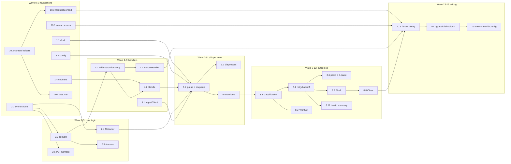

# Implementation Plan: Better Stack Error Logging

## Overview

Build a new stdlib-only `logging/` package bottom-up, then wire it into `main.go`. The order below is
forced by the design's dependency structure: pure, goroutine-free code first (clock, config,
counters, conversion, redaction), then the `slog.Handler` layer, then the `IngestClient` and
`Shipper` with its single delivery goroutine, then integration outside `logging/`.

Two consequences of that ordering are worth stating up front:

- Conversion and redaction are verifiable through `NewHandler(nil, level)` (Req 12.9) before any
  goroutine, channel, or HTTP client exists, so the highest-risk pure logic is locked down first.
- The property-test harness (`logging/pbt_test.go`) is built once, early, and reused. Per the design,
  it is randomized table-driven loops over `math/rand` with a deterministic seed — **no new `go.mod`
  requirement** (Req 12.6). Adding `pgregory.net/rapid` is an open question for the user, not a task.

Language: **Go** (existing module `backend`, Go 1.23). All new code is stdlib-only inside `logging/`.

---

## Tasks

- [x] 1. Package foundations: clock, config resolution, counters
  - [x] 1.1 Create `logging/clock.go` with the time and randomness abstractions
    - Define `Ticker`, `Clock`, `Jitter` interfaces exactly as in the design
    - Implement `SystemClock()`, `RandJitter(seed int64)` (`math/rand`), `FixedJitter(f float64)`
    - Add `logging/clock_fake_test.go` with a `fakeClock` whose `Now`, `NewTicker`, and `After` are
      driven by explicit advancement, plus a recorder of every `After` duration for later backoff
      assertions
    - No `time.Now`, `time.After`, or `time.NewTicker` anywhere else in the package
    - _Requirements: 7.4, 7.5, 12.2_

  - [x] 1.2 Create `logging/config.go` with `RawConfig`, `Config`, `Diagnostic`, and pure `ResolveConfig`
    - `ResolveConfig(raw RawConfig) (Config, []Diagnostic)` reads no environment variable, performs no
      I/O, and returns deferred diagnostics rather than writing them
    - Implement the full decision table from the design: whitespace trimming, disabled state on empty
      token or URL, ERROR diagnostic on non-`https`/unparseable/host-less URL, service-name default
      `fundis-backend` and 64-char cap, `MinLevel` mapping (`warn`/`error`, default `LevelError` with
      no diagnostic), `BatchSize` 20 / 1–1000, `FlushEvery` 5s / 1–300, `QueueSize` 1000 / 1–100000
    - Emit no diagnostic when an optional numeric variable is unset or empty; emit WARN only for a
      non-empty rejected value (the design's flagged interpretation of Req 5.4 / 5.6)
    - Apply the production ERROR when `APP_ENV` is `production` (case-insensitive) and state is disabled
    - Default `DiagWriter` to `os.Stderr`, `Clock` to `SystemClock()`, `Jitter` to `RandJitter`
    - _Requirements: 1.1, 1.2, 1.3, 1.4, 1.5, 1.6, 1.7, 1.8, 1.12, 1.14, 2.1, 2.2, 2.8, 5.4, 5.6, 6.1, 6.7, 12.1_

  - [x]* 1.3 Write the `ResolveConfig` decision-table test in `logging/config_test.go`
    - Table covering every row of the design's decision table, asserting resulting state, resolved
      value, and diagnostic level/count
    - Pure function, so no `t.Setenv` and no environment mutation
    - _Requirements: 1.3, 1.4, 1.5, 1.6, 1.12, 2.1, 2.2, 2.8, 5.4, 5.6, 6.1, 6.7, 12.1_

  - [x] 1.4 Create `logging/counters.go` with `DropReason`, `counters`, and `Snapshot`
    - `DropReason` constants `reasonQueueFull`, `reasonAbandonedBatch`, `reasonNonRetryable`,
      `reasonConversionPanic`, `reasonAfterClose`, `numDropReasons`
    - `counters` guarded by one `sync.Mutex`; `addAdmitted`, `addDelivered`, `addDropped`,
      `addInFlight`, `snapshot`
    - `addSat` saturating helper so every increment holds at `math.MaxUint64` without panicking
    - `snapshot()` copies every field under a single lock acquisition and derives
      `QueueDepth = enqueued - delivered - dropped - inFlight` rather than reading `len(chan)`
    - Never hold the lock across a channel send, HTTP call, clock call, or diagnostic write
    - _Requirements: 11.1, 11.2, 11.3, 11.4, 11.5, 11.10, 11.11_

  - [x]* 1.5 Write counter saturation and snapshot-consistency unit tests in `logging/counters_test.go`
    - Seed a counter at `MaxUint64 - 1`, add 5, assert saturation without panic
    - Assert the accounting equality holds for hand-driven increment sequences
    - _Requirements: 11.1, 11.2, 11.4, 11.5_

- [x] 2. Pure Log_Event conversion and redaction (no goroutines, no network)
  - [x] 2.1 Create `logging/event.go` with `Event` and its sub-structs
    - `Event`, `ErrorInfo`, `SourceInfo`, `RequestInfo`, `UserInfo` with the exact JSON tags from the
      design, including `truncated` always emitted and `error`/`source`/`request`/`user`/`context`
      as `omitempty`
    - Cache each event's serialized byte length on the `Event` at conversion time so the batch
      1 MiB check is O(1) per event later
    - _Requirements: 3.1, 3.14_

  - [x] 2.2 Implement `convert` in `logging/convert.go` with the two distinctly-typed depth axes
    - Define `type ctxLevel int` and `type rootDepth int` with `maxContextDepth ctxLevel = 8` and
      `maxRedactDepth rootDepth = 10`, so cross-axis comparison is a compile error
    - `appendAttrs(dst map[string]any, attrs []slog.Attr, lvl ctxLevel, ev *Event)` omits attrs at
      `ctxLevel >= 9` and sets `truncated`
    - Field derivation per the design table: `dt` as UTC with three fractional digits and a literal
      appended `Z`, `level` from `r.Level.String()`, `message`, `service`/`environment` capped at 64
      chars with `unknown` fallback, first `error`-valued attr lifted to `error` with `type` via
      `%T` and `chain` from repeated `errors.Unwrap` capped at 10, `source` from `r.PC` via
      `runtime.CallersFrames` with `filepath.Base` and omitted when `r.PC == 0`
    - Skip empty attrs, call `a.Value.Resolve()` before inspection, inline unnamed groups, drop empty
      groups, let later duplicate keys at one object level overwrite earlier ones via `map[string]any`
    - Route reserved-key attrs and surplus error-valued attrs under `context`
    - Represent nil as JSON null, replace invalid UTF-8 with the replacement character, and render
      JSON-unrepresentable types with default Go string formatting
    - _Requirements: 2.7, 3.2, 3.3, 3.4, 3.5, 3.6, 3.7, 3.8, 3.9, 3.10, 3.11, 3.13, 3.15, 3.16, 10.7, 10.8_

  - [x] 2.3 Implement the 64 KiB size cap in `logging/truncate.go`
    - Serialize; if over 65536 bytes, truncate `context` string values in descending byte-length
      order, then `message`, cutting at a UTF-8 boundary via `utf8.DecodeLastRuneInString` and
      appending a truncation indicator, re-measuring after each cut
    - Set `truncated = true`; never treat `dt`, `level`, `service`, `environment`, `error.type`, or
      any `source` field as a truncation candidate
    - _Requirements: 3.12, 3.14, 3.17_

  - [x] 2.4 Implement the `Redactor` in `logging/redact.go`
    - `NewRedactor(sourceToken string)`, `Apply(ev *Event)`, `redactedPlaceholder`,
      `truncatedPlaceholder`, and the `sensitiveSubstrings` list from the design
    - Match per lower-cased **key path segment** with `strings.Contains`, never the joined dotted path
    - Replace a matched value — string, number, bool, null, object, or array, and everything nested
      beneath it — with the single string `[REDACTED]`, preserving all keys
    - Replace any value equal to the Source_Token; perform zero content-shape inspection (no `Bearer`
      prefix or JWT-shape sniffing)
    - Apply to `context`, `error`, `request`, `user` only; leave `dt`, `level`, `message`, `service`,
      `environment`, `source`, `truncated` untouched
    - `redactValue(v any, d rootDepth)` replaces values at `rootDepth >= 11` with `[TRUNCATED]`, stops
      descending, and sets `truncated`; the depth cap alone provides cycle safety
    - _Requirements: 10.1, 10.2, 10.3, 10.9, 10.10, 10.11_

  - [x]* 2.5 Write the depth-cap relationship guard test in `logging/depth_test.go`
    - Assert the **relationship** in normalized `rootDepth` — `rootDepth(maxContextDepth)+1 <
      maxRedactDepth+1` — so the invariant survives retuning either constant, rather than asserting
      the literal values 8 and 10
    - _Requirements: 3.9, 10.10_

  - [x] 2.6 Build the property-test harness in `logging/pbt_test.go`
    - `pbtIterations = 100`, `pbtSeed(t)` defaulting to a fixed seed with `FUNDIS_PBT_SEED` override
      and always logging the seed used
    - Generators `genRecord`, `genAttr` (groups, nils, invalid UTF-8, channel and func values,
      self-referential values, panicking `Stringer` and `LogValuer`), `genEvent`, `genHandlerOps`,
      `genStatus`
    - Bias generators toward boundaries: empty strings, depths 8/9/10/11, sizes 65535/65536/65537,
      statuses 199/200/202/299/402/403/406/413/429/499/500/599/600
    - On failure, log the offending input as JSON so a counterexample can be pasted into a regression
      table (no automatic shrinking is available)
    - _Requirements: 12.6_

  - [x]* 2.7 Write property test for conversion round-trip in `logging/event_test.go`
    - **Property 2: Conversion round-trips through JSON**
    - **Validates: Requirements 3.1, 3.2, 3.3, 3.4, 3.5, 3.13, 3.15**

  - [x]* 2.8 Write property test for hostile-input safety in `logging/event_test.go`
    - **Property 3: Every Log_Record produces valid JSON and never panics the caller**
    - **Validates: Requirements 3.13, 8.5, 8.8**

  - [x]* 2.9 Write property test for the size cap in `logging/size_test.go`
    - **Property 8: Size cap is respected and privileged fields survive it**
    - **Validates: Requirements 3.12, 3.14, 3.17**

  - [x]* 2.10 Write property test for redaction idempotence in `logging/redact_test.go`
    - **Property 4: Redaction is idempotent**
    - **Validates: Requirements 10.1, 10.2, 10.3**

  - [x]* 2.11 Write property test for redaction structure preservation in `logging/redact_test.go`
    - **Property 5: Redaction preserves structure**
    - **Validates: Requirements 10.1, 10.2, 10.3, 10.11**

  - [x]* 2.12 Write property test for the redaction depth cap in `logging/redact_depth_test.go`
    - **Property 14: Redaction depth cap terminates**
    - Hand-built deep and cyclic events passed straight to the `Redactor`, no `Shipper` involved
    - **Validates: Requirements 10.10, 12.9**

- [x] 3. Checkpoint - conversion and redaction are complete and green
  - Ensure all tests pass, ask the user if questions arise.

- [x] 4. The `slog.Handler` layer
  - [x] 4.1 Implement `Handler` state, `Enabled`, `WithAttrs`, and `WithGroup` in `logging/handler.go`
    - `attrFrame{groups, attrs}` binding each attr batch to the group path open when it was added
    - `Handler{shipper, level, groups, frames}` where `shipper == nil` is legal (conversion-only)
    - `Enabled` returns `l >= h.level.Level()` and nothing else — no queue-depth or enabled-state check
    - `WithAttrs` returns the receiver for an empty batch; otherwise copies the struct and uses
      `slices.Clip(h.frames)`, `slices.Clip(h.groups)`, and `slices.Clone(attrs)` so sibling handlers
      derived from one parent can never alias a backing array
    - `WithGroup("")` returns the receiver; otherwise clips both slices before appending
    - Record attrs nest under the groups open at `Handle` time; frame attrs nest under their own
      recorded group path
    - _Requirements: 2.9, 2.10, 3.9, 3.10, 3.11_

  - [x] 4.2 Implement `Handler.Handle` with admission counting and panic recovery in `logging/handler.go`
    - Return `nil` immediately when `shipper == nil` or the level is below threshold, producing zero
      serialized bytes
    - Increment the admitted ("enqueued") counter **before** conversion so a conversion panic keeps the
      Req 11.4 accounting equality intact
    - `defer`/`recover` above `Value.Resolve()`: on panic increment `dropped[reasonConversionPanic]`
      and `conversionPanics`, write one Self_Diagnostic with the panic value truncated to 1024 chars
      and stack to 8192 bytes, leave the queue and all previously enqueued events untouched
    - Call `convert`, then `redactor.Apply`, then `enqueue` — redaction strictly before enqueue
    - Return `nil` from every path and propagate no panic for any input
    - Read request id, method, path, and user id from the `context.Context` argument; omit `request`
      when absent and omit `user` when absent, without erroring or discarding the event
    - _Requirements: 2.3, 2.4, 4.5, 4.7, 4.10, 8.5, 8.8, 9.2, 10.9_

  - [x]* 4.3 Write property test for handler derivation in `logging/handler_test.go`
    - **Property 17: Handler derivation places attributes at the group path open when they were added**
    - Includes the sibling case: two handlers derived from one parent each emit only their own attrs
    - **Validates: Requirements 3.9, 3.10, 3.11**

  - [x] 4.4 Implement `FanoutHandler` in `logging/fanout.go`
    - `Enabled` returns the OR of all children so a console-level change can never silence Better Stack
    - `Handle` calls children in construction order, gating each on that child's own `Enabled`, joining
      errors with `errors.Join`, and never letting one child's error or panic prevent a later child
    - Never mutate the incoming `slog.Record`; any child adding attrs calls `r.Clone()` first
    - `WithAttrs`/`WithGroup` fan out and return a new `FanoutHandler` with a freshly allocated slice
    - _Requirements: 1.10, 2.5, 6.5, 8.6, 8.9_

  - [x]* 4.5 Write the console byte-identity test in `logging/fanout_test.go`
    - Same record through a bare `slog.NewJSONHandler(w, nil)` and through the fan-out handler;
      compare stdout bytes exactly, including for records the Better Stack child drops
    - _Requirements: 2.5, 6.5, 8.9_

- [x] 5. Ingest client
  - [x] 5.1 Implement `IngestClient` in `logging/ingest.go`
    - `NewIngestClient(url, token string, timeout time.Duration)` creating exactly one `http.Client`
      with the default transport so idle connections are pooled and reused
    - `Send(ctx, batch, perRequestTimeout) SendOutcome` POSTing a JSON array of events in enqueue
      order, with `Content-Type: application/json` and `Authorization: Bearer <token>`
    - `io.CopyN(io.Discard, resp.Body, 4096)` then `resp.Body.Close()` **before** the caller inspects
      `Status`, on every status and every attempt
    - Parse `Retry-After` into `SendOutcome.RetryAfter`; report timeout and transport failures in `Err`
    - Structured after `notifications/slack.go`: `encoding/json` body, `net/http` POST, wrapped errors
    - _Requirements: 5.8, 5.9, 5.10, 5.11, 7.16, 12.6_

  - [x]* 5.2 Write ingest client example tests in `logging/ingest_test.go`
    - `httptest.Server` asserting the exact `Authorization` and `Content-Type` header values
    - Server returning a large body; assert the body was read-capped and closed and the connection was
      reused across attempts
    - _Requirements: 5.9, 5.10, 5.11, 7.16, 12.3_

- [x] 6. Shipper: queue, diagnostics, and the delivery loop
  - [x] 6.1 Implement the `Shipper` struct, `Start`, `Handler`, `Snapshot`, and non-blocking `enqueue` in `logging/shipper.go`
    - Fields per the design, including `queue chan *Event` sized to `cfg.QueueSize`, `state atomic.Int32`
      (`stateEnabled`/`stateDisabled`/`stateSuspended`), `closed atomic.Bool`, `closeOnce`, `closeDone`,
      `flushReq`
    - `NewShipper` starts nothing; `Start` starts exactly one delivery goroutine, and starts zero
      goroutines and opens zero connections when state is disabled
    - `enqueue` drops with `reasonAfterClose`/`reasonDisabled` when closed or disabled, otherwise does a
      `select` send with a `default` arm dropping with `reasonQueueFull` — wait-free, so the 1 ms bound
      holds regardless of ingest latency
    - `Snapshot` never panics in disabled state and reports zeros for a shipper disabled at startup
    - _Requirements: 1.11, 5.1, 5.2, 5.3, 5.13, 6.2, 6.3, 6.9, 7.12, 9.4, 11.3, 11.10, 11.11_

  - [x] 6.2 Implement the Self_Diagnostic logger and startup diagnostics in `logging/diag.go`
    - `s.diag` built as `slog.New(slog.NewJSONHandler(cfg.DiagWriter, nil)).With("logshipper", true)` —
      constructed inside the Shipper, never `slog.Default()`, so no diagnostic can re-enter the fan-out
      handler or the queue
    - `diagf` and `diagPanic` helpers; `EmitStartupDiagnostics(diags []Diagnostic)` writing the deferred
      validation diagnostics plus, when enabled, exactly one INFO summary containing threshold, batch
      size, flush seconds, queue capacity, and the ingest **host** only
    - `maybeDiagDrop` rate-limiting the drop WARN to one per 60 s on the injected clock while reporting
      the cumulative dropped count and configured capacity
    - Endpoint rendering helper emitting scheme, host, and path only, stripping query and userinfo; the
      Source_Token appears in no diagnostic
    - _Requirements: 6.4, 6.8, 7.13, 8.1, 8.2, 10.4, 10.5, 11.8, 11.9, 12.8_

  - [x]* 6.3 Write property test for queue capacity in `logging/shipper_queue_test.go`
    - **Property 7: Queue capacity is never exceeded**
    - **Validates: Requirements 6.2, 6.3**

  - [x]* 6.4 Write property test for non-blocking enqueue in `logging/shipper_queue_test.go`
    - **Property 9: Enqueue never blocks on the network**
    - Test server blocks on a never-closed channel; assert total enqueue time is linear in operation
      count and independent of server latency
    - **Validates: Requirements 5.2, 5.13**

  - [x] 6.5 Implement the delivery goroutine loop `Shipper.run` in `logging/shipper.go`
    - `select` over `queue`, the flush ticker from the injected clock, `flushReq`, and `closeDone`
    - Batch-size trigger transmits within 100 ms of the count being observed while not transmitting;
      flush-tick trigger transmits only when `pending` is non-empty, otherwise zero requests and the
      interval restarts
    - `fits` uses the cached per-event serialized length to keep bodies under 1048576 bytes, flushing
      the current batch and retaining the event that would exceed the cap; a batch always holds at
      least one event
    - `Send` is called synchronously inside the loop, so zero additional transmissions can begin while
      one is in progress and all batching/retry state stays goroutine-private and lock-free
    - `pending` never exceeds `BatchSize`, bounding retained payload at `(QueueSize + BatchSize) × 65536`
    - Increment `inFlight` when an event leaves the channel
    - _Requirements: 5.3, 5.5, 5.7, 5.12, 5.14, 5.15, 6.6_

  - [x]* 6.6 Write property test for batching confluence in `logging/delivery_test.go`
    - **Property 6: Batching boundaries do not change the delivered multiset**
    - **Validates: Requirements 5.5, 5.7, 5.8, 7.1**

  - [x]* 6.7 Write property test for the 1 MiB body cap in `logging/delivery_test.go`
    - **Property 15: Delivery_Batch bodies stay under the 1 MiB cap**
    - **Validates: Requirements 5.14, 6.6**

- [x] 7. Checkpoint - queue and delivery loop are complete and green
  - Ensure all tests pass, ask the user if questions arise.

- [ ] 8. Delivery outcomes: classification, retry, suspension, lifecycle, health
  - [x] 8.1 Implement HTTP status classification in `logging/classify.go`
    - Table-driven mapping per the design: 202 delivered; other 2xx delivered plus one WARN; 402
      non-retryable plus suspension; 403 permanent disable; 406 and 413 non-retryable with ERROR;
      429 and 5xx retryable; transport failure and timeout retryable; every other status
      non-retryable with an ERROR naming the status
    - Applied only after the response body has been read-capped and closed
    - _Requirements: 7.1, 7.2, 7.3, 7.10, 7.11, 7.14, 7.15, 7.16_

  - [x] 8.2 Implement retry, backoff, and jitter in `logging/retry.go`
    - `retryDelay(attempt int, retryAfter time.Duration)`: base 1/2/4/8/16 s capped at 30 s, replaced by
      `Retry-After` clamped to 1–300 s for 429 only when it parses as a non-negative integer
    - Add jitter of `Fraction() × 0.2 × base` so every delay lies in `[base, 1.2×base]` and never exceeds
      360 s; all waiting via `s.clock.After`
    - Per-batch attempt counter starting at 1, never exceeding 5, so one batch appears in at most 5
      requests; on a retryable 5th attempt discard the batch, increment `dropped[reasonAbandonedBatch]`
      and `abandoned`, and write one ERROR with the discarded count and last status or transport category
    - Enqueue stays open throughout backoff
    - _Requirements: 7.2, 7.3, 7.4, 7.5, 7.6, 7.7, 7.12_

  - [x] 8.3 Implement 402 suspension and 403 permanent disable in `logging/shipper.go`
    - 402: discard the batch, count drops as `reasonNonRetryable`, enter `stateSuspended` for 15 minutes
      on the injected clock transmitting nothing, write one ERROR about account/quota rejection, resume
      at the first flush boundary after the window
    - 403: discard the batch, non-blockingly drain the queue counting every drained event, enter
      `stateDisabled` permanently, write one ERROR stating the Source_Token was rejected, and transmit
      zero requests thereafter including at flush boundaries and during `Close`
    - _Requirements: 7.8, 7.9, 7.10, 7.12_

  - [x]* 8.4 Write property test for status classification in `logging/retry_test.go`
    - **Property 11: Status classification determines attempt count**
    - **Validates: Requirements 7.1, 7.2, 7.3, 7.6, 7.10, 7.11, 7.14, 7.15**

  - [x]* 8.5 Write property test for retry delay bounds in `logging/retry_test.go`
    - **Property 16: Retry delays stay within the jitter bounds**
    - Fake clock records every `After` duration; compare against the doubling schedule with clamp
    - **Validates: Requirements 7.4, 7.5**

  - [x] 8.6 Implement delivery-goroutine panic recovery and the 5-panic disable rule in `logging/shipper.go`
    - Wrap `run` so a recovered panic discards the in-flight batch, increments
      `dropped[reasonAbandonedBatch]` by the batch size, writes one ERROR with the panic value truncated
      to 1024 chars and stack to 8192 bytes, and resumes the loop within 1 second
    - Track `panicCount`; on the 5th recovered panic enter disabled state permanently, start zero
      replacement goroutines, and write one ERROR stating delivery is permanently stopped
    - _Requirements: 8.3, 8.4_

  - [~] 8.7 Implement `Shipper.Flush` in `logging/flush.go`
    - Send a `flushRequest` carrying a reply channel; the delivery goroutine drains and transmits, then
      reports `FlushResult{Delivered, Dropped, Drained}`
    - Accept a caller-supplied deadline from 1 ms to 60 s; return once every queued event reached a
      terminal state or the deadline elapsed; leave the Shipper usable afterwards
    - _Requirements: 12.4_

  - [~] 8.8 Implement `Shipper.Close` and `finalDrain` in `logging/close.go`
    - `sync.Once` so the flush happens exactly once, concurrent callers block and all receive the same
      `CloseResult`; a call after `Close` returned is one atomic load
    - Disabled shipper: return within 10 ms with zero HTTP requests and zero diagnostics
    - `finalDrain` under a fixed 5 s budget from `s.clock.After` that no environment variable alters, with
      per-request timeout `min(remaining budget, 10s)`, one attempt per batch and zero backoff waits
    - Transmit events queued at invocation plus those enqueued during the drain, in batches of at most
      `BatchSize`; on budget expiry discard the remainder, count the drops, write exactly one ERROR with
      the discarded count, and return
    - Store `s.closed` **after** the drain so records emitted during drain still enqueue; afterwards
      enqueue drops with `reasonAfterClose` while the console keeps writing
    - _Requirements: 9.3, 9.4, 9.5, 9.6, 9.7, 9.8, 9.9, 9.10, 9.11, 9.12_

  - [ ]* 8.9 Write property test for close idempotence in `logging/close_test.go`
    - **Property 10: Close is idempotent**
    - **Validates: Requirements 9.8, 9.9**

  - [ ]* 8.10 Write close-path example tests in `logging/close_test.go`
    - Disabled close under 10 ms with zero requests and zero diagnostics; budget expiry discarding with
      exactly one ERROR; enqueue after close dropping while the console record is still written
    - _Requirements: 9.7, 9.10, 9.11_

  - [x] 8.11 Implement the periodic health summary in `logging/health.go`
    - Every 5 minutes on the injected clock, if at least one counter increased since the previous
      evaluation, write exactly one INFO Self_Diagnostic from a single snapshot containing every counter,
      all five per-reason drop counts, queue depth, and in-flight count
    - If nothing changed, write zero diagnostics and transmit zero HTTP requests
    - Write zero periodic summaries while disabled
    - _Requirements: 11.6, 11.7, 11.8, 11.10_

  - [ ]* 8.12 Write property test for snapshot accounting in `logging/health_test.go`
    - **Property 13: Snapshot accounting is exact**
    - Concurrent enqueue, delivery, and snapshot goroutines, run under `-race`
    - **Validates: Requirements 11.1, 11.4, 11.5, 11.12**

  - [ ]* 8.13 Write property test for secret containment in `logging/health_test.go`
    - **Property 12: Secrets never appear on the wire**
    - Scan every request body and every diagnostic byte slice for the Source_Token and generated
      sensitive values
    - **Validates: Requirements 7.13, 10.1, 10.2, 10.3, 10.4, 10.11**

  - [ ]* 8.14 Write startup-diagnostic and periodic-summary example tests in `logging/health_test.go`
    - Startup INFO contains threshold, batch size, flush seconds, queue capacity, and ingest host, and
      excludes the token and query string
    - Advance the fake clock 5 min with and without a counter change; assert one summary and zero
      summaries respectively
    - _Requirements: 10.5, 11.6, 11.7, 11.9_

- [~] 9. Checkpoint - the `logging` package is feature-complete and green under `-race`
  - Ensure all tests pass, ask the user if questions arise.

- [ ] 10. Wire the shipper into the application
  - [x] 10.1 Add the seven `configs/env.go` accessors and the `.env.example` block
    - `BetterStackSourceToken`, `BetterStackIngestURL`, `BetterStackServiceName`, `BetterStackMinLevel`,
      `BetterStackBatchSize`, `BetterStackFlushSeconds`, `BetterStackQueueSize`, each a one-line
      `os.Getenv` returning a raw string so all parsing and clamping stays in `ResolveConfig`
    - Add all seven to `.env.example` with the documented defaults and comments from the design
    - _Requirements: 1.13, 1.14, 12.1_

  - [x] 10.2 Implement request-correlation context helpers in `logging/context.go`
    - `ContextWithRequest`, `ContextWithUserID`, `RequestFromContext`, `UserIDFromContext`, `FromContext`
    - `NewRequestID`: hex of 16 `crypto/rand` bytes plus `-` plus a base-36 monotonic counter, so
      distinctness within the process is guaranteed rather than probabilistic, length 18–30
    - `ValidRequestID`: 1–200 chars, ASCII alphanumeric plus `-` and `_`
    - No `echo` import, so the package stays stdlib-only and importable from `contextutil`
    - _Requirements: 4.1, 4.3, 4.5, 4.7, 4.11_

  - [x] 10.3 Implement `middleware.RequestContext` in `middleware/requestlog.go`
    - Adopt a valid `X-Request-Id` byte-for-byte; otherwise silently discard it, generate one, and
      continue without erroring or rejecting the request
    - Set the `X-Request-Id` response header **before** calling `next` so it is present on handler
      responses, centralized error responses, and recovered panics
    - Read `c.Path()` for the route template with parameters unsubstituted; substitute `<unmatched>`
      when empty
    - Attach id, method, and path via `logging.ContextWithRequest` and `c.SetRequest`
    - **Register with `app.Use`, never `app.Pre`** — Echo routes before `Use` middleware, so `app.Pre`
      leaves `c.Path()` empty and the Req 4.8 route template is never populated
    - _Requirements: 4.1, 4.2, 4.3, 4.4, 4.8, 4.9_

  - [x] 10.4 Extend `contextutil.SetUser` to write the user ID into the request `context.Context`
    - Keep `c.Set("user_id", userID)` unchanged and additionally
      `c.SetRequest(r.WithContext(logging.ContextWithUserID(r.Context(), userID)))`
    - `GetUserID(c)` is unchanged, so no existing caller changes; `JWTAuth` already calls `SetUser`
      before `next(c)`, so every downstream record on a protected route carries the user id
    - Verify `go build ./...` and `go vet ./...` report no import cycle from the new
      `contextutil` → `logging` edge
    - _Requirements: 4.6, 4.10_

  - [x]* 10.5 Write request-correlation middleware tests in `middleware/requestlog_test.go`
    - Valid header adopted byte-for-byte; empty, over-length, and illegal-character values replaced
      without erroring; header present on 200, on error responses, and on recovered panics
    - Unregistered path yields the `<unmatched>` placeholder with `id` and `method` still present
    - `/api/v1/job-requests/:jobRequestId/chats` yields the template, not the substituted path
    - Two records in one request share an identical `request.id`; authenticated route carries `user.id`;
      public route omits `user`
    - _Requirements: 4.1, 4.2, 4.3, 4.4, 4.5, 4.6, 4.8, 4.9, 4.10, 4.11_

  - [~] 10.6 Wire the Shipper and `FanoutHandler` into `main.go` startup
    - Build `logging.RawConfig` from the `configs.BetterStack*` accessors plus `configs.AppEnv()`, call
      `ResolveConfig`, set `cfg.DiagWriter = os.Stdout` so diagnostics are console-shaped in production
    - `NewShipper`, `EmitStartupDiagnostics(diags)`, `Start()`
    - Reuse the existing `slog.NewJSONHandler(os.Stdout, nil)` value unchanged as the **first** child of
      `logging.NewFanoutHandler(console, shipper.Handler())`, then `slog.SetDefault`
    - Register `middleware.RequestContext()` with `app.Use` **before** `Logger()` and `Recover()`
    - Startup must continue to inbound-request readiness with zero exits attributable to logging config
    - _Requirements: 1.7, 1.9, 1.10, 1.11, 2.5, 4.2, 4.8, 8.6, 8.9, 11.9_

  - [~] 10.7 Add graceful shutdown to `main.go` — this does not exist today
    - `main.go` currently ends at `app.Start(port)` with no `signal`, `Shutdown`, or SIGTERM handling, so
      Req 9.1's "after the Echo shutdown call returns" has nothing to hook. Signal handling must be
      **added**, not merely hooked into
    - `signal.NotifyContext(context.Background(), os.Interrupt, syscall.SIGTERM)`; run `app.Start` in a
      goroutine treating `http.ErrServerClosed` as normal; on `ctx.Done()` call `app.Shutdown` with a
      10 s timeout
    - Call `shipper.Close()` **only after** `app.Shutdown` returns, and return from `main` only after
      `Close` returns, so records emitted during Echo shutdown are still enqueued and covered by the
      final flush
    - _Requirements: 9.1, 9.2, 9.3_

  - [~] 10.8 Replace Echo's default `Recover()` with `RecoverWithConfig` in `main.go`
    - Echo's default `Recover()` logs through `c.Logger()`, which is Echo's own logger and not `slog`, so
      panics reach neither stdout `slog` output nor Better Stack today
    - Use `RecoverWithConfig` with `StackSize: 8192`, `DisableStackAll: true`, `DisablePrintStack: true`,
      and a `LogErrorFunc` emitting exactly one `slog.ErrorContext` carrying the panic value truncated to
      1024 chars and the stack truncated to 8192 bytes
    - `DisablePrintStack: true` is what keeps Req 2.6's "exactly one Log_Record" true by suppressing
      Echo's duplicate
    - _Requirements: 2.6, 4.2_

  - [ ]* 10.9 Write the panic-record and end-to-end correlation test in `main_logging_test.go`
    - Handler panics: assert exactly one ERROR record with truncated panic text and stack, no duplicate
      from Echo, and an `X-Request-Id` header on the response
    - _Requirements: 2.6, 4.2_

  - [ ]* 10.10 Write property test for the severity filter in `logging/pbt_filter_test.go`
    - **Property 1: Severity filter is a faithful filter**
    - Full wired path: fan-out handler into a 202 `httptest.Server`; compare the delivered multiset
      against a one-line `filter` reference model
    - **Validates: Requirements 2.3, 2.4, 2.9, 2.10**

  - [ ]* 10.11 Write the parallel-isolation and disabled-startup tests in `logging/parallel_test.go`
    - At least eight Shippers constructed and exercised concurrently with `t.Parallel()`, asserting
      independent delivered and dropped counts, which also guards the no-package-mutable-state rule
    - Empty token: assert zero goroutine growth via `runtime.NumGoroutine` and zero outbound connections
      via a listener that fails the test on accept
    - _Requirements: 1.4, 1.11, 12.3, 12.7_

- [~] 11. Final checkpoint - full suite, vet, format, and race detector
  - Run `make test` (`go test ./... -v`) and assert zero failures and zero skips with no edits to any
    pre-existing test assertion
  - Run `go test -race ./logging/...` for the concurrency properties
  - Run `make lint` (`go vet ./...`) to confirm no import cycle, and `make format-check`
  - Confirm the `logging` package adds under 5 seconds of wall-clock time and that no test sleeps longer
    than 50 ms
  - _Requirements: 11.12, 12.2, 12.5, 12.6_
  - Ensure all tests pass, ask the user if questions arise.

---

## OPTIONAL: Deferred Work — Not Part Of This Feature

The tasks below come from the design's Deferred Work section. They are **out of scope** for this
feature and must not be treated as required to call it complete. Each is separately reviewable.

- [ ] 12. Deferred follow-on work (optional, scoped separately)
  - [ ]* 12.1 Migrate the 53 existing call sites from `slog.Error`/`slog.Warn` to the `Context` variants
    - Mechanical pass across `auth`, `jobrequests`, `jobs`, `notifications`, `payments`, `quotations`,
      and `main.go` so existing records carry `request.id`
    - `jobs/scheduler.go` records have no request context by nature and will always omit `request`
    - _Requirements: 4.7 (improves coverage; not required for this feature)_

  - [ ]* 12.2 Decide the fate of `notifications/slack.go`'s unused `SendErrorNotification`
    - Either remove it or document its relationship to Better Stack alerting
    - _Requirements: none (cleanup)_

  - [ ]* 12.3 Route Echo access logs through `slog`
    - Replace `echomiddleware.Logger()` with `LoggerWithConfig` emitting through `slog` so access logs
      carry `request.id`; needs a separate quota discussion given the volume
    - _Requirements: none (out of scope)_

---

## Notes

- Sub-tasks marked `*` are optional and can be skipped for a faster MVP; core implementation sub-tasks
  are never marked optional.
- Every task cites the requirement clauses it implements, and each property-test task names the design
  property it encodes.
- Property tests use stdlib `math/rand` randomized table-driven loops with a deterministic seed, per the
  design. Whether to add `pgregory.net/rapid` as a test-only dependency is an open question for the
  user, not a task.
- Checkpoints at tasks 3, 7, 9, and 11 give four testable increments: pure conversion, queue plus
  delivery loop, the complete package, and the wired application.

## Task Dependency Graph

Visual view — each node is a task, each column a wave that can proceed in parallel:



```json
{
  "waves": [
    { "id": 0, "tasks": ["1.1", "1.2", "1.4", "10.1", "10.2"] },
    { "id": 1, "tasks": ["1.3", "1.5", "2.1", "10.3", "10.4"] },
    { "id": 2, "tasks": ["2.2", "2.4", "10.5"] },
    { "id": 3, "tasks": ["2.3", "2.5", "2.6"] },
    { "id": 4, "tasks": ["2.7", "2.9", "2.10", "4.1"] },
    { "id": 5, "tasks": ["2.8", "2.11", "2.12", "4.2"] },
    { "id": 6, "tasks": ["4.3", "4.4", "5.1"] },
    { "id": 7, "tasks": ["4.5", "5.2", "6.1"] },
    { "id": 8, "tasks": ["6.2", "6.5"] },
    { "id": 9, "tasks": ["6.3", "8.1"] },
    { "id": 10, "tasks": ["6.4", "6.6", "8.2", "8.3"] },
    { "id": 11, "tasks": ["6.7", "8.4", "8.7", "8.11"] },
    { "id": 12, "tasks": ["8.5", "8.6", "8.8"] },
    { "id": 13, "tasks": ["8.9", "8.12", "10.6"] },
    { "id": 14, "tasks": ["8.10", "8.13", "10.7"] },
    { "id": 15, "tasks": ["8.14", "10.8", "10.11"] },
    { "id": 16, "tasks": ["10.9", "10.10"] },
    { "id": 17, "tasks": ["12.1", "12.2"] },
    { "id": 18, "tasks": ["12.3"] }
  ]
}
```
