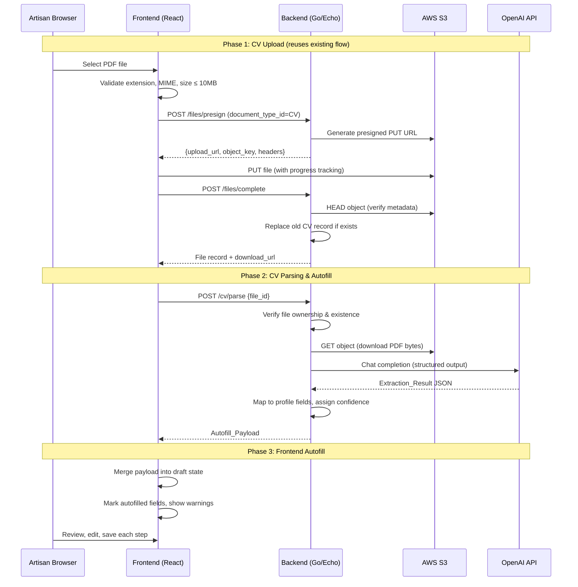
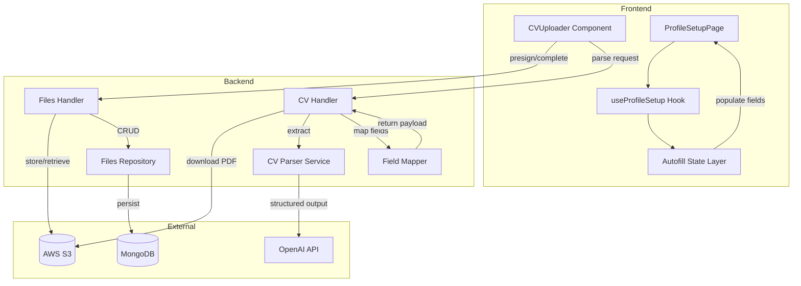

# Technical Design Document: CV Upload & Autofill

## Overview

This design implements a CV upload and autofill feature for the Fundis artisan profile setup wizard. The feature allows artisans to upload a PDF CV, have it parsed by an LLM-based extraction service, and automatically populate profile fields across the 6-step wizard. The system integrates with the existing presigned URL upload infrastructure, adds a new backend parsing endpoint backed by OpenAI's API, and extends the frontend draft state to accommodate autofilled data with confidence indicators.

### Key Design Decisions

| Decision | Choice | Rationale |
|----------|--------|-----------|
| CV Parsing Engine | OpenAI GPT-4o-mini via structured outputs | Handles diverse CV formats without brittle regex/template matching; structured output guarantees valid JSON schema; cost-effective for extraction tasks |
| Parsing Model | Synchronous request with 30s timeout | Simpler implementation; GPT-4o-mini responds in 3-8s typically; avoids polling complexity; meets requirement timeout |
| File Replacement Strategy | Delete-then-insert with orphan logging | Matches requirement 7.5/7.6; keeps at most one CV record per artisan |
| Autofill State | Extend `useProfileSetup` draft with metadata layer | Leverages existing draft/committed pattern; avoids parallel state trees |
| Confidence Display | Inline warning icon + tooltip for scores < 0.6 | Non-intrusive; artisan can review at their pace without blocking workflow |

## Architecture



### System Architecture Diagram



## Components and Interfaces

### Backend Components

#### 1. CV Handler (`cvparser/handlers.go`)

New package `cvparser` responsible for the parse endpoint.

```go
// POST /api/v1/cv/parse
type ParseCVRequest struct {
    FileID string `json:"file_id" validate:"required"`
}

type ParseCVResponse struct {
    AutofillPayload AutofillPayload `json:"autofill_payload"`
    FieldCount      int             `json:"field_count"`
    Message         string          `json:"message"`
}

type AutofillPayload struct {
    // Scalar fields with confidence
    Address              *FieldWithConfidence `json:"address,omitempty"`
    City                 *FieldWithConfidence `json:"city,omitempty"`
    State                *FieldWithConfidence `json:"state,omitempty"`
    HighestEducationLevel *FieldWithConfidence `json:"highest_education_level,omitempty"`
    Certificate          *FieldWithConfidence `json:"certificate,omitempty"`
    Institution          *FieldWithConfidence `json:"institution,omitempty"`
    OtherQualifications  *FieldWithConfidence `json:"other_qualifications,omitempty"`
    ProfessionalBody     *FieldWithConfidence `json:"professional_body,omitempty"`
    SkillAcquisitionMode *FieldWithConfidence `json:"skill_acquisition_mode,omitempty"`
    YearsOfExperience    *NumericFieldWithConfidence `json:"years_of_experience,omitempty"`

    // Collection fields with per-item confidence
    PastEmployers         []PastEmployerWithConfidence         `json:"past_employers,omitempty"`
    LanguageProficiencies []LanguageProficiencyWithConfidence   `json:"language_proficiencies,omitempty"`
    References            []ReferenceWithConfidence             `json:"references,omitempty"`
}

type FieldWithConfidence struct {
    Value      string  `json:"value"`
    Confidence float64 `json:"confidence"`
}

type NumericFieldWithConfidence struct {
    Value      int     `json:"value"`
    Confidence float64 `json:"confidence"`
}

type PastEmployerWithConfidence struct {
    Name        FieldWithConfidence `json:"name"`
    PhoneNumber FieldWithConfidence `json:"phone_number"`
    Location    FieldWithConfidence `json:"location"`
    Confidence  float64            `json:"confidence"`
}

type LanguageProficiencyWithConfidence struct {
    Language         FieldWithConfidence `json:"language"`
    ProficiencyLevel FieldWithConfidence `json:"proficiency_level"`
    WrittenSkills    FieldWithConfidence `json:"written_skills"`
    Confidence       float64            `json:"confidence"`
}

type ReferenceWithConfidence struct {
    Name        FieldWithConfidence `json:"name"`
    PhoneNumber FieldWithConfidence `json:"phone_number"`
    JobTitle    FieldWithConfidence `json:"job_title"`
    Email       FieldWithConfidence `json:"email"`
    Location    FieldWithConfidence `json:"location"`
    Confidence  float64            `json:"confidence"`
}
```

#### 2. CV Parser Service (`cvparser/parser.go`)

Encapsulates OpenAI API interaction with structured output.

```go
type Parser interface {
    Extract(ctx context.Context, pdfBytes []byte) (*ExtractionResult, error)
}

type OpenAIParser struct {
    apiKey     string
    model      string
    httpClient *http.Client // 30s timeout
}

type ExtractionResult struct {
    PersonalDetails   *PersonalDetails    `json:"personal_details,omitempty"`
    Education         *Education          `json:"education,omitempty"`
    Professional      *Professional       `json:"professional,omitempty"`
    WorkHistory       []WorkHistoryEntry  `json:"work_history,omitempty"`
    Languages         []LanguageEntry     `json:"languages,omitempty"`
    References        []ReferenceEntry    `json:"references,omitempty"`
}
```

#### 3. Field Mapper (`cvparser/mapper.go`)

Maps `ExtractionResult` to `AutofillPayload`, enforcing:
- Type validation (non-numeric `years_of_experience` → omit, confidence = 0)
- Collection cap at 10 items per field
- Omit fields with empty/null values

```go
type Mapper struct{}

func (m *Mapper) MapToAutofill(result *ExtractionResult) *AutofillPayload
```

#### 4. Extended Files Handler

The existing files handler is extended to support CV-specific behavior:
- Accept only `application/pdf` and `application/vnd.openxmlformats-officedocument.wordprocessingml.document` for CV document type
- Enforce 10 MB limit for CV uploads
- Replace existing CV record on new upload (delete old S3 object + record)

### Frontend Components

#### 1. CVUploader Component (`components/profile-setup/CVUploader.tsx`)

New component rendered above the step indicator in `ProfileSetupPage`.

```typescript
interface CVUploaderProps {
  onParseComplete: (payload: AutofillPayload) => void;
  onError: (error: CVError) => void;
}

interface CVUploaderState {
  status: 'idle' | 'uploading' | 'parsing' | 'success' | 'error';
  fileName: string | null;
  fileId: string | null;
  progress: number;
  error: CVError | null;
  retryCount: number;
}
```

#### 2. Autofill State Layer

Extension to the existing `useProfileSetup` hook:

```typescript
interface AutofillMetadata {
  /** Map of field path → confidence score */
  confidenceScores: Record<string, number>;
  /** Set of field paths that were autofilled and not yet edited */
  autofilledFields: Set<string>;
  /** Total number of fields that were autofilled */
  totalAutofilledCount: number;
  /** Whether the summary banner has been dismissed */
  bannerDismissed: boolean;
}

// New hook to manage autofill state alongside the profile setup
function useAutofillState(draft: UpdateProfilePayload): {
  metadata: AutofillMetadata;
  applyAutofill: (payload: AutofillPayload) => UpdateProfilePayload;
  markEdited: (fieldPath: string) => void;
  clearAutofill: (currentDraft: UpdateProfilePayload) => UpdateProfilePayload;
  dismissBanner: () => void;
}
```

#### 3. AutofillIndicator Component

```typescript
interface AutofillIndicatorProps {
  fieldPath: string;
  confidence: number;
  isAutofilled: boolean;
}
```

Renders a small icon badge next to autofilled fields. Shows warning tooltip when confidence < 0.6.

### API Endpoints

| Method | Path | Description |
|--------|------|-------------|
| POST | `/api/v1/files/presign` | Existing — generate presigned upload URL |
| POST | `/api/v1/files/complete` | Existing — finalize upload, extended for CV replacement |
| POST | `/api/v1/cv/parse` | New — trigger CV parsing and return autofill payload |

## Data Models

### MongoDB Collections

#### `document_types` (existing — new seed record)

```json
{
  "_id": "cv-document-type-id",
  "name": "CV",
  "created_at": "2024-01-01T00:00:00Z",
  "updated_at": "2024-01-01T00:00:00Z"
}
```

#### `files` (existing — CV records follow same schema)

```json
{
  "_id": "uuid",
  "user_id": "artisan-user-id",
  "document_type_id": "cv-document-type-id",
  "file_name": "john_doe_cv.pdf",
  "file_url": "https://bucket.s3.region.amazonaws.com/users/{user_id}/{uuid}/john_doe_cv.pdf",
  "relative_path": "john_doe_cv.pdf",
  "mime_type": "application/pdf",
  "size": 245760,
  "created_at": "2024-06-01T10:00:00Z",
  "updated_at": "2024-06-01T10:00:00Z"
}
```

### OpenAI Structured Output Schema

The structured output schema sent to OpenAI defines the extraction format:

```json
{
  "name": "cv_extraction",
  "strict": true,
  "schema": {
    "type": "object",
    "properties": {
      "personal_details": {
        "type": "object",
        "properties": {
          "address": { "type": ["string", "null"] },
          "city": { "type": ["string", "null"] },
          "state": { "type": ["string", "null"] }
        },
        "required": ["address", "city", "state"],
        "additionalProperties": false
      },
      "education": {
        "type": "object",
        "properties": {
          "highest_level": { "type": ["string", "null"] },
          "certificate": { "type": ["string", "null"] },
          "institution": { "type": ["string", "null"] },
          "other_qualifications": { "type": ["string", "null"] }
        },
        "required": ["highest_level", "certificate", "institution", "other_qualifications"],
        "additionalProperties": false
      },
      "professional": {
        "type": "object",
        "properties": {
          "professional_body": { "type": ["string", "null"] },
          "skill_acquisition_mode": { "type": ["string", "null"] },
          "years_of_experience": { "type": ["integer", "null"] }
        },
        "required": ["professional_body", "skill_acquisition_mode", "years_of_experience"],
        "additionalProperties": false
      },
      "work_history": {
        "type": "array",
        "items": {
          "type": "object",
          "properties": {
            "employer_name": { "type": ["string", "null"] },
            "phone_number": { "type": ["string", "null"] },
            "location": { "type": ["string", "null"] }
          },
          "required": ["employer_name", "phone_number", "location"],
          "additionalProperties": false
        }
      },
      "languages": {
        "type": "array",
        "items": {
          "type": "object",
          "properties": {
            "language": { "type": ["string", "null"] },
            "proficiency_level": { "type": ["string", "null"] },
            "written_skills": { "type": ["string", "null"] }
          },
          "required": ["language", "proficiency_level", "written_skills"],
          "additionalProperties": false
        }
      },
      "references": {
        "type": "array",
        "items": {
          "type": "object",
          "properties": {
            "name": { "type": ["string", "null"] },
            "phone_number": { "type": ["string", "null"] },
            "job_title": { "type": ["string", "null"] },
            "email": { "type": ["string", "null"] },
            "location": { "type": ["string", "null"] }
          },
          "required": ["name", "phone_number", "job_title", "email", "location"],
          "additionalProperties": false
        }
      },
      "confidence_scores": {
        "type": "object",
        "properties": {
          "personal_details": { "type": "number" },
          "education": { "type": "number" },
          "professional": { "type": "number" },
          "work_history": { "type": "number" },
          "languages": { "type": "number" },
          "references": { "type": "number" }
        },
        "required": ["personal_details", "education", "professional", "work_history", "languages", "references"],
        "additionalProperties": false
      }
    },
    "required": ["personal_details", "education", "professional", "work_history", "languages", "references", "confidence_scores"],
    "additionalProperties": false
  }
}
```

### Autofill Payload (Frontend TypeScript)

```typescript
interface AutofillPayload {
  // Scalar fields
  address?: FieldWithConfidence;
  city?: FieldWithConfidence;
  state?: FieldWithConfidence;
  highest_education_level?: FieldWithConfidence;
  certificate?: FieldWithConfidence;
  institution?: FieldWithConfidence;
  other_qualifications?: FieldWithConfidence;
  professional_body?: FieldWithConfidence;
  skill_acquisition_mode?: FieldWithConfidence;
  years_of_experience?: NumericFieldWithConfidence;

  // Collection fields
  past_employers?: PastEmployerWithConfidence[];
  language_proficiencies?: LanguageProficiencyWithConfidence[];
  references?: ReferenceWithConfidence[];
}

interface FieldWithConfidence {
  value: string;
  confidence: number; // 0.0 - 1.0
}

interface NumericFieldWithConfidence {
  value: number;
  confidence: number;
}
```

### S3 Object Key Pattern

CV files follow the existing user-scoped pattern:

```
users/{user_id}/{uuid}/{sanitized_filename}.pdf
```

This ensures ownership validation via `objectBelongsToUser()` and the `user-id` metadata tag set during presigned upload.

## Correctness Properties

*A property is a characteristic or behavior that should hold true across all valid executions of a system — essentially, a formal statement about what the system should do. Properties serve as the bridge between human-readable specifications and machine-verifiable correctness guarantees.*

### Property 1: File validation rejects invalid uploads

*For any* file descriptor with a MIME type not in `{application/pdf, application/vnd.openxmlformats-officedocument.wordprocessingml.document}`, OR with a size of 0 bytes, OR with a size exceeding 10,485,760 bytes, the CV upload validation function SHALL return an error and SHALL NOT produce a presigned URL or file record.

**Validates: Requirements 1.2, 1.3, 1.4, 7.3, 7.4**

### Property 2: Field mapper produces only known profile fields

*For any* valid ExtractionResult (including results with arbitrary extra fields not in the supported set), the Field Mapper SHALL produce an AutofillPayload containing only keys that exist in the ProfileUpdateRequest type, and SHALL discard all unrecognized fields.

**Validates: Requirements 3.1, 3.2**

### Property 3: Type-invalid fields are omitted with zero confidence

*For any* ExtractionResult where `years_of_experience` contains a non-integer value (e.g., "five", "3.5 years", empty string), the Field Mapper SHALL omit that field from the AutofillPayload entirely, effectively assigning it a confidence of 0.

**Validates: Requirements 3.3**

### Property 4: Collection fields are capped at 10 items

*For any* ExtractionResult containing N items in a collection field (past_employers, language_proficiencies, or references) where N > 10, the Field Mapper SHALL include exactly 10 items in the corresponding AutofillPayload collection, selected by descending confidence score.

**Validates: Requirements 3.6**

### Property 5: Scalar autofill does not overwrite existing draft values

*For any* draft state where a scalar field already has a non-empty user-entered value, and an AutofillPayload that includes a value for that same field, the autofill merge function SHALL preserve the existing draft value and NOT replace it with the autofilled value.

**Validates: Requirements 3.5**

### Property 6: Collection autofill appends without replacing

*For any* draft state containing K existing items in a collection field, and an AutofillPayload containing M items for that same collection field, after applying autofill the collection SHALL contain exactly K + M items (where M is capped at 10), with the original K items appearing first in their original order.

**Validates: Requirements 3.5**

### Property 7: Confidence scores are bounded between 0 and 1

*For any* field in the AutofillPayload, its confidence score SHALL be a number in the closed interval [0.00, 1.00], rounded to at most two decimal places.

**Validates: Requirements 2.3**

### Property 8: Editing an autofilled field removes it from the autofill set

*For any* autofill metadata state tracking a set of autofilled field paths, when a field at path P is marked as edited, the resulting metadata SHALL no longer include P in its autofilled fields set, AND the total autofill count SHALL decrease by 1.

**Validates: Requirements 4.2**

### Property 9: Clear autofill preserves manually edited values

*For any* draft state where some fields were autofilled and some were manually edited (marked as edited in metadata), executing the "clear autofill" operation SHALL remove only the values of fields still in the autofilled set, and SHALL preserve all values in fields that were manually entered or edited.

**Validates: Requirements 4.4**

### Property 10: Ownership validation rejects mismatched user IDs

*For any* object key and authenticated user ID pair where the object key does NOT start with the prefix `users/{authenticated_user_id}/`, OR where the S3 object's `user-id` metadata does NOT equal the authenticated user ID, the ownership verification function SHALL return a rejection result.

**Validates: Requirements 6.2, 6.5**

### Property 11: At most one CV file record per artisan

*For any* sequence of CV upload-complete operations by the same artisan, querying the files collection filtered by that artisan's user_id and the CV document_type_id SHALL return at most 1 record.

**Validates: Requirements 7.5**

## Error Handling

### Backend Error Categories

| Error Type | HTTP Status | Error Code | User-Facing Message |
|-----------|-------------|------------|---------------------|
| Invalid file type | 400 | `invalid_file_type` | "Only PDF and DOCX files are accepted for CV upload" |
| File too large | 400 | `file_too_large` | "CV file must be smaller than 10 MB" |
| File size zero | 400 | `file_empty` | "File cannot be empty" |
| File not found | 404 | `file_not_found` | "The referenced file could not be found" |
| Ownership mismatch | 403 | `ownership_mismatch` | "You do not have permission to access this file" |
| PDF unreadable | 422 | `pdf_unreadable` | "The PDF content could not be read. Please upload a text-based PDF" |
| PDF password-protected | 422 | `pdf_password_protected` | "The PDF is password-protected. Please upload an unprotected version" |
| Parse timeout | 504 | `parse_timeout` | "CV processing timed out. Please try again" |
| OpenAI API error | 502 | `parser_unavailable` | "CV parsing service is temporarily unavailable" |
| Zero fields extracted | 200 | (no error) | Response includes empty autofill payload with `field_count: 0` |

### Backend Error Flow

```go
// cvparser/errors.go
var (
    ErrFileNotFound       = errors.New("file not found")
    ErrOwnershipMismatch  = errors.New("ownership mismatch")
    ErrPDFUnreadable      = errors.New("pdf unreadable")
    ErrPDFPasswordProtected = errors.New("pdf password protected")
    ErrParseTimeout       = errors.New("parse timeout")
    ErrParserUnavailable  = errors.New("parser unavailable")
)
```

### Frontend Error Handling Strategy

1. **Upload errors**: Caught in `CVUploader` component. Retry up to 3 times with the same file reference. After 3 failures, disable retry and offer alternatives.

2. **Parse errors**: Caught after the `/cv/parse` call. Display appropriate message based on error code. Always offer "proceed with manual entry" as fallback.

3. **Draft preservation**: The `useProfileSetup` hook's existing pattern already preserves draft on error (the `mergedDraft` is set before the request). The autofill state layer follows the same pattern — autofill metadata is only cleared on explicit "clear autofill" action.

4. **Error display timing**: The `CVUploader` component uses a state machine. On error detection, the state transitions to `'error'` immediately, and React's batched rendering ensures the UI updates within a single frame (well under the 2-second requirement).

### Graceful Degradation

- If OpenAI API is down: artisan can still upload CV (file is stored) and proceed with manual entry
- If S3 download fails during parsing: return `parser_unavailable` error
- If old CV deletion fails during replacement: log orphaned key, continue with new record (requirement 7.6)

## Testing Strategy

### Testing Approach

This feature uses a **dual testing approach**:
- **Property-based tests**: Verify universal correctness properties across generated inputs for the pure logic layer (field mapper, validation, autofill merge, ownership checks)
- **Unit tests**: Verify specific examples, edge cases, error conditions, and UI behavior
- **Integration tests**: Verify the end-to-end flow between components and external services

### Property-Based Testing

**Library**: [rapid](https://github.com/flyweight-design/rapid) for Go (backend), [fast-check](https://github.com/dubzzz/fast-check) for TypeScript (frontend)

**Configuration**: Minimum 100 iterations per property test.

**Tag format**: `Feature: cv-upload-autofill, Property {number}: {property_text}`

| Property | Component Under Test | Generator Strategy |
|----------|---------------------|-------------------|
| 1: File validation | `files/service.go` `validateUpload` | Generate random UploadRequest with varied MIME types, sizes (0, 1, 10MB, 10MB+1, MAX_INT), extensions |
| 2: Known fields only | `cvparser/mapper.go` `MapToAutofill` | Generate ExtractionResult with random extra fields mixed with valid fields |
| 3: Type-invalid omission | `cvparser/mapper.go` `MapToAutofill` | Generate ExtractionResult with years_of_experience as random non-integer strings |
| 4: Collection cap | `cvparser/mapper.go` `MapToAutofill` | Generate ExtractionResult with 0-50 items per collection field |
| 5: Scalar no-overwrite | Frontend `applyAutofill` | Generate draft with random non-empty fields + AutofillPayload with overlapping fields |
| 6: Collection append | Frontend `applyAutofill` | Generate draft with 0-5 existing items + AutofillPayload with 0-15 items |
| 7: Confidence bounds | `cvparser/mapper.go` | Generate raw OpenAI response with varied confidence values, verify all output scores in [0,1] |
| 8: Edit removes from set | Frontend `markEdited` | Generate autofill metadata with random fields, mark random field as edited |
| 9: Clear preserves edits | Frontend `clearAutofill` | Generate mixed state (some autofilled, some edited), clear autofill |
| 10: Ownership validation | `cvparser/handlers.go` ownership check | Generate random user IDs and object keys, verify reject/accept |
| 11: Single CV record | Files repository (integration-level) | Sequence of N upload-complete operations for same user, verify count ≤ 1 |

### Unit Tests (Example-Based)

| Area | Test Cases |
|------|-----------|
| CV Parser (with mocked OpenAI) | Valid extraction, empty extraction, unreadable PDF error, password-protected error, timeout |
| Field Mapper | Mapping each field category, null handling, edge values |
| CVUploader component | Render states (idle, uploading, success, error), file selection, retry flow |
| AutofillIndicator | Warning icon shown when confidence < 0.6, hidden when ≥ 0.6 |
| Summary banner | Correct count display, dismiss behavior, visibility across steps |
| Clear autofill | Confirmation prompt, cancel behavior |

### Integration Tests

| Scenario | What's Verified |
|----------|----------------|
| Full upload → parse → autofill flow | End-to-end happy path with real S3 (or localstack) and mocked OpenAI |
| CV replacement | Old S3 object deleted, old record removed, new record created |
| Ownership rejection | Request with mismatched file_id returns 403 |
| Timeout handling | Mock slow OpenAI response, verify 504 returned within 30s |

### Test Environment

- **Backend**: Go test suite with `testing` package, `rapid` for PBT, `httptest` for handler tests, mocked MongoDB via interface
- **Frontend**: Vitest with `fast-check` for PBT, React Testing Library for component tests, MSW for API mocking

