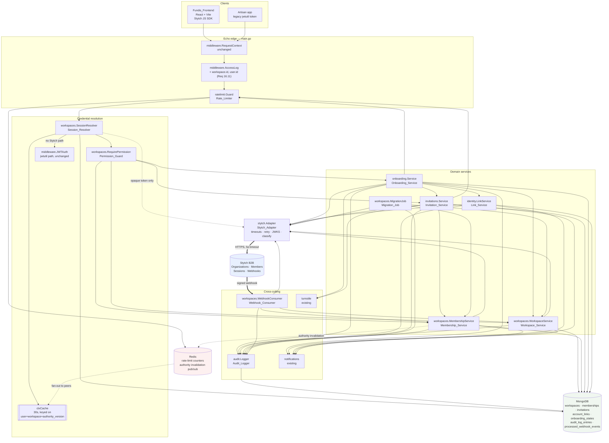
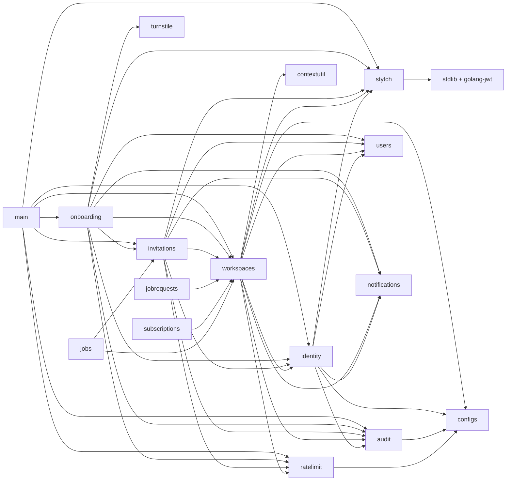
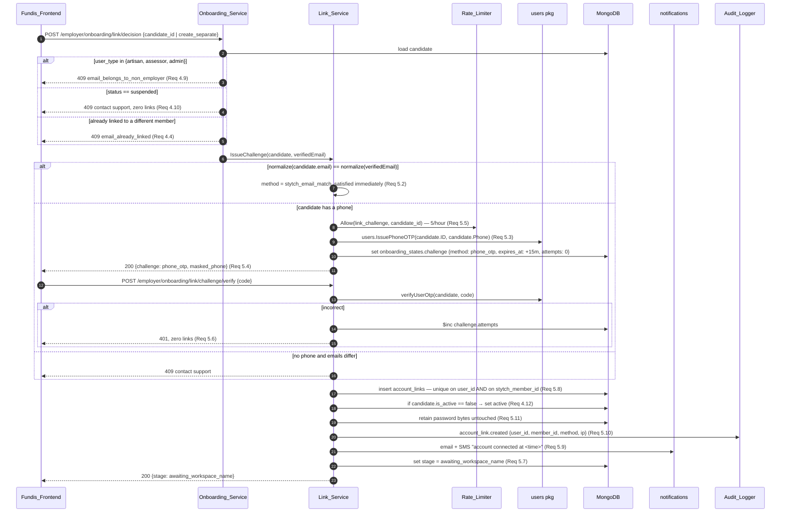
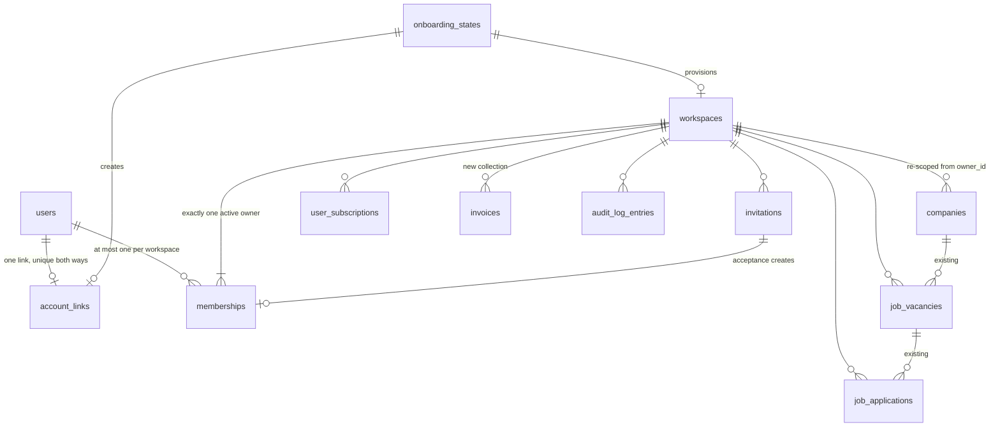
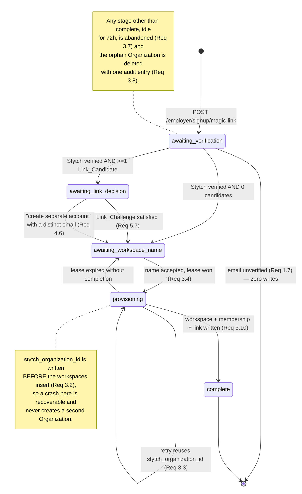
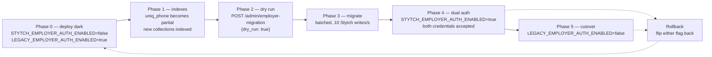
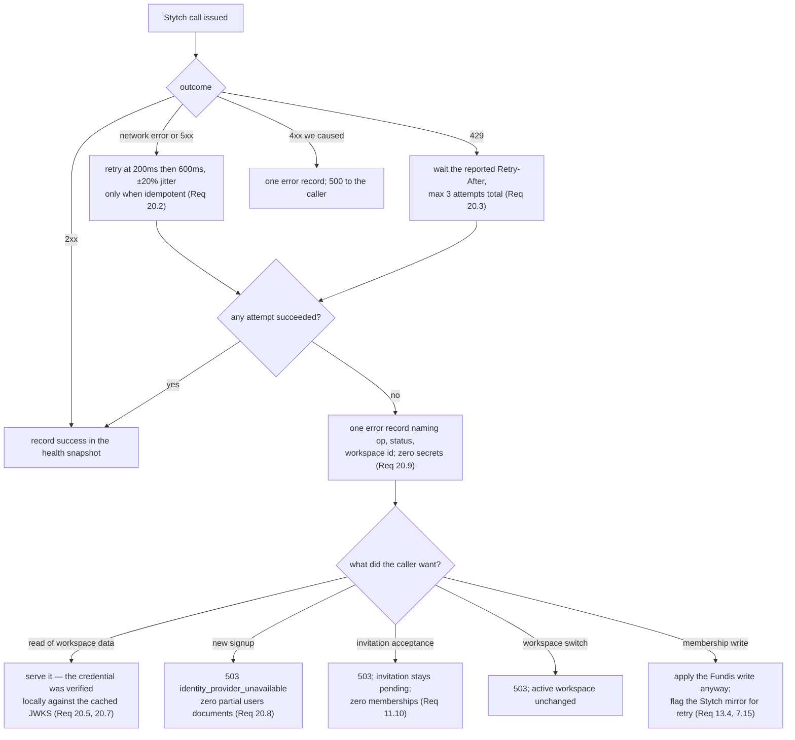

# Design Document

## Overview

This design replaces employer account creation with Stytch B2B and introduces the Workspace as a
first-class multi-user tenant. It touches identity, authorization, tenancy, billing scope, and a
batch migration, so the shape of the design matters more than any individual handler.

Six structural decisions carry the requirements. Each one is chosen so that a requirement holds *by
construction* rather than by runtime discipline, because the alternative — remembering to check —
does not survive the next contributor.

1. **Authority is derived from one Mongo document, never from a token claim.** `Session_Resolver`
   reads `(member_id, organization_id)` out of a verified Stytch credential and then resolves the
   `memberships` document. The `Permission_Matrix` is a pure function of the *stored* role. No Stytch
   RBAC claim, no webhook payload field, and no `users.user_type` value participates in a workspace
   permission decision (Req 7.13, 7.14, 8.11, 16.6, 19.13). A misconfigured Stytch RBAC policy
   therefore cannot escalate privilege — it can only fail to mirror.
2. **Exactly one Owner is a database constraint, not a code path.** A partial unique index on
   `memberships` over `{workspace_id}` filtered to `{role: "owner", status: "active"}` makes a
   second active Owner unrepresentable (Req 14.1, 14.2). Every guard in `Membership_Service` is
   defence in depth on top of it, which is why P9 can be asserted after *every* operation in a
   generated sequence rather than after the operations we remembered to think about.
3. **Cross-system writes are resumable, not transactional.** Stytch and MongoDB share no
   transaction. Instead of pretending otherwise, every Stytch-then-Mongo sequence is driven by an
   `onboarding_states` document that records the Stytch identifier *before* the Mongo write it
   enables, and every terminal Mongo write is protected by a unique index. A crash at any point
   leaves a state the next request finishes (Req 3.2, 3.3, 3.5, 3.6, 3.10). Duplicate suppression is
   the index; progress is the state record.
4. **Ownership transfer is the one operation that requires a MongoDB multi-document transaction, and
   the deployment is probed for it at startup.** Req 14.3 and 14.4 demand that a two-document role
   swap be all-or-nothing; no single-document trick delivers that while the partial unique index
   forbids the intermediate two-owner state and Req 14.1 forbids the intermediate zero-owner state.
   See [Transaction availability](#transaction-availability).
5. **Employer credentials and legacy credentials are resolved by one chain, in a fixed order.**
   `Session_Resolver` tries the Stytch path, then the `jwtutil` path, and returns an
   indistinguishable 401 when neither validates (Req 16.13). This is what makes the dual-auth
   migration window a configuration value rather than a fork in the codebase (Req 21.10).
6. **Workspace scoping is declared at route-registration time and audited at startup.** A
   workspace-scoped route is registered through `ScopedGroup`, whose method signatures take a
   `Permission` argument, so "declares no permission" is a compile error. A startup audit closes the
   bypass: any route named in the code-resident `workspaceScopedRoutes` set that was *not* registered
   through a `ScopedGroup` fails startup (Req 8.5, 8.6).

### What this design deliberately does not build

Everything in the requirements' Out Of Scope list, plus three scope boundaries that are worth naming
because they look like omissions:

- **Artisans, assessors, and platform admins are untouched.** No route they call gains a membership
  requirement, and `middleware.JWTAuth`, `IsArtisan`, `IsCustomer`, `IsAssessor`, and `IsAdmin` keep
  their current behaviour (Req 22). The employer surfaces are re-registered through `ScopedGroup`;
  the artisan surfaces are not re-registered at all.
- **Per-workspace Stytch RBAC is written but never read.** `Stytch_Adapter` mirrors the Fundis role
  onto the Stytch Member so the Stytch dashboard is legible to operators (Req 7.15), and a mirror
  failure is a warning, not a rollback.
- **The employer billing `invoices` collection is created by this feature.** It does not exist today;
  see [The `invoices` collection does not exist yet](#the-invoices-collection-does-not-exist-yet).

### Grounding findings that change how requirements must be implemented

Four facts about the current repository contradict, or silently defeat, a literal reading of the
requirements. Each is called out here because the design that follows depends on the correction.

| Finding | Consequence |
| --- | --- |
| `users.EnsureIndexes` creates `uniq_phone` as a **non-partial** unique index on `{phone: 1}`. Two documents that both omit `phone` both index as `null`, so the *second* phone-less insert fails with a duplicate-key error. | Req 1.12's stated mechanism ("omit the `phone` field so the index applies to zero Employers") does not work as written. `uniq_phone` must become partial. See [The `uniq_phone` problem](#the-uniq_phone-problem-and-its-mitigation). |
| No `invoices` collection exists. `external_invoices` is the artisan→customer invoice, keyed by `artisan_id`. | Req 9.1, 18.9, 24.1, 24.8, and 24.9 name a collection this feature must create. `external_invoices` is not repurposed. |
| `jobs.NewScheduler()` exists but is **never called** from `main.go`; `jobs/scheduler.go` has no live caller. | Req 12.8 ("using the existing `jobs` scheduler"), Req 3.7 (72-hour reaper), Req 18.8 (deletion effective time), and Req 13.4 (Stytch delete retry) all need a running scheduler. `main.go` must start it. |
| The repository contains zero `StartSession`/`WithTransaction` calls. Every "atomic" operation is a single-document conditional update (`ClaimJobRequest`, `UpdateJobApplicationStatus`, `ReserveApplication`). `configs.ConnectDB` sets Stable API v1 but the deployment topology is not documented anywhere in the repo. | Transactions cannot be assumed. They are probed at startup and required only for ownership transfer. See [Transaction availability](#transaction-availability). |

---

## Architecture

### Component diagram



Two edges deserve emphasis. `Permission_Guard` has **no edge to `stytch.Adapter`** — a permission
decision never touches the network (Req 7.13, 7.14, 16.9). And `Webhook_Consumer` writes only through
`Membership_Service` and `Workspace_Service`, never directly, so the "membership document is
authoritative" rule (Req 19.13) is enforced by the same code that enforces it for HTTP requests.

### Package placement

Seven new packages, following the repo's existing "domain package per business capability, with
`model.go` / `service.go` / `routes.go`" convention.

| Package | Owns | Documents |
| --- | --- | --- |
| `stytch/` | `Stytch_Adapter`: the client interface, the HTTP implementation, retry/timeout/classification, the JWKS cache, session verification, webhook signature verification, and the in-process fake. Zero Fundis domain knowledge. | none |
| `identity/` | `Link_Service`, `Link_Challenge`, `Account_Link` lifecycle, email-change reconciliation. | `account_links` |
| `workspaces/` | `Workspace_Service`, `Membership_Service`, `Permission_Matrix`, `Session_Resolver`, `Permission_Guard`, `ScopedGroup` + route registry, data re-scoping, the abandoned-org reaper, the orphan report, `Webhook_Consumer`, `Migration_Job`. | `workspaces`, `memberships`, `processed_webhook_events`, `employer_migration_runs`, `employer_migration_findings` |
| `invitations/` | `Invitation_Service`: issue, deliver, resolve, resend, revoke, decline, expiry sweep. | `invitations` |
| `onboarding/` | `Onboarding_Service`: the signup state machine, the Onboarding_Ticket, candidate discovery, provisioning orchestration. | `onboarding_states` |
| `audit/` | `Audit_Logger` and the append-only read endpoint. | `audit_log_entries` |
| `ratelimit/` | `Rate_Limiter`: a named-limit table, a Redis store, an in-memory fallback. | none (Redis keys) |

Why `Session_Resolver` and `Permission_Guard` live in `workspaces/` rather than `middleware/`: they
need `Permission_Matrix`, the `memberships` collection, and the context cache, all of which are
`workspaces` internals. Putting them in `middleware` would make `middleware` import `workspaces`
while `workspaces` needs `middleware`'s route helpers — a cycle. Echo middleware is just a function,
so the package boundary is free to follow the data.

Import graph, all edges new in this feature:



| Edge | Cycle risk | Resolution |
| --- | --- | --- |
| `jobrequests` → `workspaces` | `workspaces` must never import `jobrequests`. | Data re-scoping and tenancy filters in `workspaces` write the `companies` / `job_vacancies` / `job_applications` collections **directly** via `configs.MI.DB`, exactly as `subscriptions.ActivatePurchase` already writes `job_vacancies` and `users`. No import needed. |
| `subscriptions` → `workspaces` | Same. | `workspaces` writes `user_subscriptions` directly for re-scoping (Req 6.3) and reads it for the deletion blocker (Req 18.11). |
| `stytch` → `configs` | **Not created.** | `stytch` reads no environment variable. `main.go` reads `configs.Stytch*()` and passes a `stytch.Config` value in, following the `logging.RawConfig` precedent. This is also what makes the adapter testable without `t.Setenv`. |
| `contextutil` → `workspaces` | **Not created.** | `contextutil` gains only `SetWorkspaceID(c, id string)` / `GetWorkspaceID(c) string`, primitives that mirror the existing `SetUser`. The typed `SessionContext` is stored and read through `workspaces.FromEcho(c)`. |
| `logging` → anything | **Not created.** | `logging` stays stdlib-only; it gains `ContextWithWorkspaceID` alongside the existing `ContextWithUserID`. |

### Integration points in this repository

| Location | Change | Why |
| --- | --- | --- |
| `users/model.go` — `User.Phone` | `bson:"phone"` → `bson:"phone,omitempty"`. JSON tag unchanged. | Req 1.12 needs the key absent, not empty. Legacy registration always supplies a phone, so `omitempty` never fires there; `HandleSocialLogin` with an empty phone currently writes `phone: ""`, and omitting is the fix, not a regression. `UpdateUser(id, bson.M{"phone": ""})` is unaffected because `bson.M` is explicit. |
| `users/model.go` — `EnsureIndexes` | Rebuild `uniq_phone` as a partial unique index. Add `users_email_normalized` and the `stytch_linked` marker index. | See [The `uniq_phone` problem](#the-uniq_phone-problem-and-its-mitigation). |
| `users/model.go` | New `GetUsersByNormalizedEmail(ctx, email) ([]User, error)`. | Req 4.1 and 4.8 need *all* case-variant matches, and the existing `GetUserByEmail` returns one document with an exact-match filter. |
| `main.go` | Build `stytch.Adapter`, `audit.Logger`, `ratelimit.Limiter`; call `EnsureIndexes` for the five new packages; register the new route groups; start `jobs.NewScheduler()`; run the startup route audit and the transaction-capability probe; validate the five Stytch variables. | Req 8.6, 20.11, and the scheduler finding above. |
| `main.go` — `authGroup` | Employer endpoints move from `authGroup` to a `ScopedGroup`; artisan and shared endpoints stay. | Req 8.5. The full list is in [Route surface](#route-surface). |
| `middleware/auth.go` | Unchanged. `JWTAuth` remains the legacy path and is invoked by `Session_Resolver` as its fallback. | Req 16.12, 22.3, 22.7. |
| `middleware/requestlog.go` — `AccessLog` | Emit `workspace.id` when the request context carries one. | Req 16.11. |
| `contextutil/contextutil.go` | Add `SetWorkspaceID` / `GetWorkspaceID`, mirroring `SetUser`. | Req 16.11; keeps `logging` reachable from the log path. |
| `jobrequests/routes.go` | `employerVacancyFilter`, `HandleEmployerDashboard`, `ListJobVacanciesByOwner`, `ListCompaniesByOwner`, `GetCompanyForOwner`, `GetJobVacancyForOwner`, `UpdateJobVacancyForOwner`, `DeleteJobVacancyForOwner`, `resolveVacancyCompany`, `GetCompanyByName`, and the three application handlers take a workspace scope instead of, or in addition to, `owner_id`. | Req 9.2–9.7, 6.1, 6.2. The `owner_id` value is retained on every document (Req 6.4) and remains the fallback filter for unscoped documents (Req 9.7). |
| `jobrequests/routes.go` — `HandleCreateJobApplication` | Set `workspace_id` from the target vacancy; notify every member holding `application.view` instead of `vacancy.OwnerID` alone. | Req 9.9, 22.9. |
| `subscriptions/model.go` | `UserSubscription` gains `WorkspaceID`; `GetActiveSubscriptions` / `HasEntitlement` accept a workspace scope with the individual as the documented fallback. | Req 24.1–24.3, 24.10. |
| `quotations/model.go` | `quotation_attachments` documents gain `workspace_id` on creation. | Req 9.1. |
| `jobs/scheduler.go` | New jobs: invitation expiry sweep, abandoned-onboarding reaper, workspace-deletion effector, Stytch member-delete retry. Ticker stays hourly; the retry job needs 15 minutes, so the scheduler gains a second, faster ticker. | Req 12.8, 3.7, 18.8, 13.4. |
| `configs/env.go` | Seven new one-line accessors. | Repo convention; keeps `stytch` env-free. |
| `.env.example` | Seven new variables. | Req 20.10. |
| `go.mod` | Add `github.com/stytchauth/stytch-go/v18` (production) and `pgregory.net/rapid` (test-only). | See [Stytch client](#stytch_adapter) and [PBT library decision](#pbt-library-decision). |

### Route surface

Three groups, distinguished by what resolves the caller.

**Unauthenticated (`api`, plus `ratelimit` middleware).** Turnstile applies to the first and last.

| Method | Path | Notes |
| --- | --- | --- |
| POST | `/employer/signup/magic-link` | Req 1.1, 25.1, 25.2, 25.4 |
| POST | `/employer/signup/oauth/:provider` | Req 1.2; `provider` ∈ {`google`} |
| POST | `/employer/signup/authenticate` | Redeems the Stytch magic-link / OAuth token; returns an Onboarding_Ticket or a session |
| GET | `/invitations/:token` | Req 11.1, 11.18, 25.6 |
| POST | `/invitations/:token/decline` | Req 12.6 — token is the sole authorization |
| POST | `/invitations/:token/accept` | Req 11.3, 25.7 |
| POST | `/stytch/webhooks` | Req 19; raw body required for signature verification |
| GET | `/health/identity` | Req 20.13 |

**Onboarding-ticket scoped (`onboardingGroup`).** The exact allow-list of Req 1.4.

| Method | Path |
| --- | --- |
| GET | `/employer/onboarding/state` |
| POST | `/employer/onboarding/name` |
| POST | `/employer/onboarding/workspace` (submit Workspace_Name → provision) |
| POST | `/employer/onboarding/link/decision` |
| POST | `/employer/onboarding/link/challenge` |
| POST | `/employer/onboarding/link/challenge/verify` |
| POST | `/employer/onboarding/sign-out` |

**Workspace scoped (`ScopedGroup`).** Every entry declares a `Permission`; that is the compile-time
half of Req 8.5. Paths under `/workspaces/:workspaceID` carry the workspace explicitly (Req 8.10);
the re-scoped legacy employer paths keep their current URLs for frontend compatibility and take the
workspace from the session.

| Method | Path | Permission |
| --- | --- | --- |
| GET | `/workspaces` | *(session scoped, not workspace scoped — Req 15.10)* |
| POST | `/workspaces` | *(session scoped — Req 15.12, 15.13)* |
| POST | `/workspaces/:workspaceID/switch` | *(session scoped — Req 15.7)* |
| GET | `/workspaces/:workspaceID` | `workspace.view` |
| PATCH | `/workspaces/:workspaceID` | `workspace.rename` |
| POST | `/workspaces/:workspaceID/deletion` | `workspace.delete` |
| DELETE | `/workspaces/:workspaceID/deletion` | `workspace.delete` |
| GET | `/workspaces/:workspaceID/permissions` | `workspace.view` |
| POST | `/workspaces/:workspaceID/import-personal-data` | `workspace.import_personal_data` |
| GET | `/workspaces/:workspaceID/members` | `member.view` |
| PATCH | `/workspaces/:workspaceID/members/:membershipID` | `member.role_change` |
| DELETE | `/workspaces/:workspaceID/members/:membershipID` | `member.remove` |
| POST | `/workspaces/:workspaceID/members/:membershipID/suspension` | `member.remove` |
| DELETE | `/workspaces/:workspaceID/members/:membershipID/suspension` | `member.remove` |
| POST | `/workspaces/:workspaceID/ownership` | `ownership.transfer` |
| GET | `/workspaces/:workspaceID/invitations` | `member.view` |
| POST | `/workspaces/:workspaceID/invitations` | `member.invite` |
| POST | `/workspaces/:workspaceID/invitations/:id/resend` | `member.invite` |
| DELETE | `/workspaces/:workspaceID/invitations/:id` | `member.invite` |
| GET | `/workspaces/:workspaceID/audit-log` | `audit.view` |
| GET | `/job-vacancies` | `vacancy.view` |
| GET | `/job-vacancy` | `vacancy.view` |
| POST | `/job-vacancies` | `vacancy.create` |
| POST | `/job-vacancies/update` | `vacancy.update` |
| POST | `/job-vacancies/delete` | `vacancy.close` |
| GET | `/job-applications` | `application.view` |
| GET | `/job-applications/:id/review` | `application.view` |
| POST | `/job-applications/decision` | `application.decide` |
| GET | `/employer/dashboard` | `vacancy.view` |
| GET | `/employer/artisans` | `artisan.browse` |
| GET | `/companies` | `workspace.view` |
| POST | `/companies` | `company.create` |
| POST | `/companies/update` | `company.update` |
| POST | `/companies/delete` | `company.update` |
| GET | `/subscriptions/mine` | `billing.view` |
| POST | `/subscriptions/purchase` | `subscription.manage` |
| POST | `/subscriptions/cancel` | `subscription.manage` |
| GET | `/invoices` | `invoice.view` |
| POST | `/invoices/:id/pay` | `invoice.pay` |
| GET | `/payments` | `payout.view` |
| POST | `/payment-methods` | `payment_method.manage` |

The four money rows at the bottom split by role exactly as the matrix does: `GET /invoices`
(`invoice.view`) and `GET /payments` (`payout.view`) are reachable by Owner, Finance, **and Admin**
(Req 7.4), while `POST /invoices/:id/pay` (`invoice.pay`), `POST /payment-methods`
(`payment_method.manage`), and both `/subscriptions` writes (`subscription.manage`) are reachable by
Owner and Finance alone (Req 7.9). HR reaches none of the six (Req 24.6), and Finance reaches no
`/job-vacancies` write and no `/job-applications` read (Req 24.7) — both are consequences of the
matrix, not separate checks.

The three `/workspaces` rows marked *session scoped* are registered on a fourth, smaller group:
authenticated by `Session_Resolver` but not requiring a membership in any particular workspace,
because listing, creating, and switching workspaces are precisely the operations a caller performs
before an active workspace exists. They are excluded from `workspaceScopedRoutes` and therefore from
the Req 8.6 audit, deliberately and by name.

Platform-admin routes keep `middleware.IsAdmin` and are outside all of this (Req 8.12), plus two new
ones: `POST /admin/employer-migration` and `GET /admin/employer-migration/:runID` (Req 21), and
`POST /admin/workspaces/:workspaceID/ownership` (Req 14.13).


### Sequence: employer signup by magic link, through to a provisioned workspace

```mermaid
sequenceDiagram
    autonumber
    participant FE as Fundis_Frontend
    participant API as Echo
    participant RL as Rate_Limiter
    participant TS as turnstile
    participant ONB as Onboarding_Service
    participant ADP as Stytch_Adapter
    participant STY as Stytch
    participant DB as MongoDB
    participant WS as Workspace_Service

    FE->>API: POST /employer/signup/magic-link {email, turnstile_token}
    API->>RL: Allow(signup_ip, ip) and Allow(signup_email, normalize(email))
    alt limit reached
        RL-->>FE: 429 + Retry-After (Req 25.1-25.3)
    end
    API->>ONB: InitiateMagicLink
    ONB->>ONB: mail.ParseAddress(normalize(email))
    alt unparseable
        ONB-->>FE: 400 field=email, zero Stytch calls (Req 1.5)
    end
    ONB->>TS: Verify(token, ip, "employer_signup")
    alt rejected
        ONB-->>FE: 400, zero Stytch calls (Req 1.10)
    end
    ONB->>ADP: DiscoveryEmailSend(normalized)
    ADP->>STY: POST /v1/b2b/magic_links/email/discovery/send
    ONB-->>FE: 200, fixed body — identical whether or not the account exists (Req 25.4)

    Note over FE,STY: user clicks the emailed link
    FE->>API: POST /employer/signup/authenticate {discovery_token}
    API->>ONB: Authenticate
    ONB->>ADP: DiscoveryAuthenticate(token)
    ADP->>STY: POST /v1/b2b/magic_links/discovery/authenticate
    STY-->>ADP: {intermediate_session_token, email_address, email_verified, discovered_organizations}
    alt email not verified
        ONB-->>FE: 403 email verification required, zero writes (Req 1.7)
    end
    ONB->>DB: findOneAndUpdate onboarding_states<br/>{stytch_member_id or email} upsert (Req 3.6)
    ONB->>DB: GetUsersByNormalizedEmail(email)
    alt at least one Link_Candidate
        ONB->>DB: set stage = awaiting_link_decision
        ONB-->>FE: 200 {stage, candidates: masked} + Onboarding_Ticket (Req 4.2, 4.3)
    else no candidate
        ONB->>DB: insert users doc (phone key omitted) + set stage = awaiting_workspace_name
        ONB-->>FE: 200 {stage: awaiting_workspace_name} + Onboarding_Ticket (Req 1.3, 1.11-1.13)
    end

    FE->>API: POST /employer/onboarding/workspace {workspace_name}<br/>Authorization: Bearer <Onboarding_Ticket>
    API->>WS: CreateDefaultWorkspace
    WS->>WS: ValidateName → NormalizeName → DeriveSlug (Req 2.2-2.9)
    WS->>DB: findOneAndUpdate onboarding_states<br/>{stage: awaiting_workspace_name} → {stage: provisioning, lease}
    alt lease not won
        WS-->>FE: 409 provisioning_in_progress (Req 3.4)
    end
    alt state already carries stytch_organization_id
        WS->>WS: reuse it, zero Stytch creates (Req 3.3)
    else
        WS->>ADP: DiscoveryOrganizationCreate(intermediate_session_token,<br/>name, slug, jit=RESTRICTED, invites=ANY, idempotency_key)
        ADP->>STY: POST /v1/b2b/discovery/organizations/create
        STY-->>ADP: {organization_id, member_id, session_jwt, session_token}
        WS->>DB: set onboarding_states.stytch_organization_id BEFORE any workspace write (Req 3.2)
    end
    WS->>DB: insert workspaces {slug} — retry suffix on duplicate key (Req 2.8, 2.10)
    alt insert fails
        WS-->>FE: 503 retry; org id retained (Req 3.5)
    end
    WS->>DB: insert memberships {role: owner, status: active, authority_version: 1}
    WS->>DB: insert account_links {user_id, stytch_member_id}
    WS->>DB: re-scope companies / job_vacancies / user_subscriptions (Req 6.1-6.3)
    WS->>DB: set onboarding_states.stage = complete
    WS-->>FE: 200 {workspace, role, permissions, session_jwt} (Req 3.10)
```

The Google OAuth variant differs only in the first two exchanges:
`ADP->>STY: POST /v1/b2b/oauth/discovery/{provider}/start` returns a redirect URL, and
`POST /v1/b2b/oauth/discovery/authenticate` returns the same
`{intermediate_session_token, email_address, email_verified}` triple. Everything from the candidate
search onward is identical code, which is what makes the two signup methods one property rather than
two (Req 1.2, 1.8).

### Sequence: link an existing Fundis account, with a Link_Challenge



### Sequence: issue and accept an invitation

```mermaid
sequenceDiagram
    autonumber
    participant OWN as Owner or Admin
    participant PG as Permission_Guard
    participant INV as Invitation_Service
    participant RL as Rate_Limiter
    participant DB as MongoDB
    participant N as notifications
    participant INVITEE as Invited person
    participant ADP as Stytch_Adapter
    participant MS as Membership_Service

    OWN->>PG: POST /workspaces/:id/invitations {email, role}
    PG->>PG: require member.invite (Req 8.4)
    PG->>INV: Create
    INV->>RL: Allow(invite_create, workspace_id) — 20/hour (Req 10.12)
    INV->>DB: count pending — cap 100 (Req 10.13)
    INV->>INV: normalize(email); reject role == owner (Req 10.3)
    INV->>DB: existing active membership? → 409 already_a_member (Req 10.5)
    INV->>DB: upsert on the partial unique index<br/>{workspace_id, email, status: pending}
    alt upserted an existing pending row
        INV-->>OWN: 200 invitation_updated, role and expiry refreshed (Req 10.6)
    else inserted
        INV->>INV: token = 32 random bytes (base64url); store sha256(token) only (Req 10.8)
        INV->>DB: expires_at = now + 168h (Req 10.9)
        INV->>N: invitation email — workspace, inviter, role, permission summary, expiry (Req 10.11)
        alt send fails
            INV-->>OWN: 202 invitation_created_delivery_pending (Req 10.16)
        end
        INV-->>OWN: 201
    end

    INVITEE->>INV: GET /invitations/:token
    INV->>RL: Allow(invite_resolve_ip, ip) — 10/min and 30/hour (Req 11.18, 25.6)
    INV->>DB: find by sha256(token)
    alt not found
        INV-->>INVITEE: 404 invitation_not_found (Req 11.2)
    else revoked / expired / workspace deleted
        INV-->>INVITEE: 410 with the matching code (Req 11.12-11.14)
    end
    INV-->>INVITEE: 200 {workspace_name, role, inviter, masked_email} (Req 11.1)

    INVITEE->>INV: POST /invitations/:token/accept {stytch credential, turnstile_token}
    INV->>INV: normalize(authenticated email) == invitation.email?
    alt mismatch
        INV-->>INVITEE: 403 invitation_email_mismatch + masked invited email (Req 11.4)
    end
    INV->>DB: resolve or create the users document (Req 11.6-11.8)
    INV->>ADP: CreateMember(organization_id, email, roles=[role])
    alt Stytch failure
        INV-->>INVITEE: 503; invitation stays pending; zero memberships (Req 11.10)
    end
    INV->>MS: CreateMembership — unique (user_id, workspace_id) (Req 11.3, 15.2)
    alt duplicate key
        MS-->>INVITEE: 200 naming the existing membership (Req 11.11)
    end
    INV->>DB: status = accepted; other pending rows for (workspace, email) → revoked (Req 11.17)
    INV->>N: notify the inviter (Req 11.15)
    INV-->>INVITEE: 200 {active_workspace, role, permissions, session_jwt} (Req 11.16)
```

### Sequence: switch the active workspace

```mermaid
sequenceDiagram
    autonumber
    participant FE as Fundis_Frontend
    participant SR as Session_Resolver
    participant DB as MongoDB
    participant ADP as Stytch_Adapter
    participant STY as Stytch

    FE->>SR: POST /workspaces/:workspaceID/switch<br/>Authorization: Bearer <session_jwt in workspace A>
    SR->>SR: verify JWT locally against the cached JWKS (Req 16.2)
    SR->>DB: memberships {stytch_member_id} → user_id, workspace A
    SR->>DB: memberships {user_id, workspace_id: B, status: active}
    alt no active membership in B
        SR-->>FE: 404, active workspace unchanged (Req 15.8)
    end
    SR->>ADP: ExchangeSession(session_token, target_organization_id: B) (Req 15.9)
    ADP->>STY: POST /v1/b2b/sessions/exchange
    STY-->>ADP: {member_id: B-scoped, session_jwt, session_token}
    alt Stytch unavailable
        SR-->>FE: 503 identity_provider_unavailable (Req 20.4)
    end
    SR->>DB: memberships[B].last_active_at = now (Req 15.4)
    SR->>DB: memberships[B].stytch_member_id = new member id
    SR->>SR: cache the new context; the old one is unreachable (different key)
    SR-->>FE: 200 {workspace: B, role, permissions, session_jwt} (Req 15.7)
```

The active workspace is therefore **not** server-side session state. It is a property of the
credential the client holds: `organization_id` inside the verified Stytch session (Req 16.5). The only
persisted trace is `memberships.last_active_at`, which exists solely to answer "which workspace at
next sign-in" (Req 15.4). That choice is what keeps the backend horizontally scalable with no sticky
sessions, and it is why a switch must round-trip Stytch.

### Sequence: webhook processing

```mermaid
sequenceDiagram
    autonumber
    participant STY as Stytch
    participant WHC as Webhook_Consumer
    participant SIG as stytch.VerifyWebhook
    participant DB as MongoDB
    participant MS as Membership_Service
    participant Q as deferred queue

    STY->>WHC: POST /stytch/webhooks<br/>svix-id, svix-timestamp, svix-signature, raw body
    WHC->>SIG: Verify(rawBody, headers, secret)
    Note over SIG: HMAC-SHA256 over "{id}.{timestamp}.{body}"<br/>compared with hmac.Equal; base64 secret after whsec_
    alt signature invalid
        WHC-->>STY: 401 + one warning naming the source IP; zero state change (Req 19.2)
    else timestamp skew over 5 minutes
        WHC-->>STY: 400; zero state change (Req 19.3)
    end
    WHC->>DB: insert processed_webhook_events {_id: svix-id}
    alt duplicate key
        WHC-->>STY: 200; zero additional state change (Req 19.5)
    end
    WHC->>WHC: classify event type
    alt member.email.updated
        WHC->>MS: apply Req 5.13 / 5.14 through Link_Service
    else member.deleted and target role != owner
        WHC->>MS: status = removed, $inc authority_version<br/>guarded by {last_webhook_event_at: {$lt: eventTS}} (Req 19.7, 19.10)
    else member.deleted and target role == owner
        WHC->>MS: retain membership; recreate the Stytch member; one error log (Req 19.8)
    else organization.deleted
        WHC->>DB: set deletion_state = deleted only if already scheduled/deleted, else one error log (Req 19.9)
    end
    alt processing exceeds the 5s budget
        WHC->>Q: enqueue the remainder
        WHC-->>STY: 200 (Req 19.11)
    end
    alt processing fails after verification
        WHC->>DB: delete processed_webhook_events {_id}
        WHC-->>STY: 500 so Stytch retries; identifier left unrecorded (Req 19.12)
    end
```

The `processed_webhook_events` insert happens **before** processing, and is deleted on failure. The
alternative — insert after success — leaves a window in which a Stytch retry double-applies. Deleting
on failure is safe because the operations behind it are themselves idempotent and timestamp-guarded,
so a retry that arrives during the failure window converges to the same state (Req 19.10, P20).


---

## Components and Interfaces

### Stytch_Adapter

`stytch/` owns every outbound call. Nothing else in the repository imports the Stytch SDK, which is
what makes the in-process fake a one-line substitution in tests (Req 20.1–20.4, 20.9, 20.12).

```go
package stytch

// Config is injected by main.go from configs.Stytch*(). The adapter reads no
// environment variable, following the logging.RawConfig precedent, so every
// test constructs an adapter without t.Setenv.
type Config struct {
    ProjectID     string
    Secret        string
    PublicToken   string
    Environment   string        // "test" | "live"
    WebhookSecret string        // whsec_-prefixed
    BaseURL       string        // empty → the SDK default; set by tests to an httptest.Server
    Timeout       time.Duration // default and maximum 5s (Req 20.1)
    JWKSTTL       time.Duration // minimum 1h (Req 20.6)
    MaxAttempts   int           // default 3 (Req 20.2, 20.3)
    Clock         Clock         // injected; tests advance it
}

// Client is the seam. The HTTP implementation wraps stytch-go/v18; the fake
// implements the same interface in-process with no network and no goroutine.
type Client interface {
    // Discovery — employer signup (Req 1.1, 1.2)
    DiscoveryEmailSend(ctx context.Context, in DiscoveryEmailSendInput) error
    DiscoveryAuthenticate(ctx context.Context, token string) (DiscoveryResult, error)
    OAuthDiscoveryStartURL(provider, redirectURL string) (string, error)
    OAuthDiscoveryAuthenticate(ctx context.Context, token string) (DiscoveryResult, error)

    // Organizations (Req 2.1, 2.13, 2.16, 3.8, 18.8)
    CreateOrganizationFromDiscovery(ctx context.Context, in CreateOrgInput) (CreateOrgResult, error)
    UpdateOrganization(ctx context.Context, orgID string, in UpdateOrgInput) error
    DeleteOrganization(ctx context.Context, orgID string) error
    GetOrganization(ctx context.Context, orgID string) (Organization, error)
    ListOrganizations(ctx context.Context, cursor string) (OrganizationPage, error) // orphan report (Req 3.9)

    // Members (Req 11.9, 13.3, 13.12, 7.15, 19.8)
    CreateMember(ctx context.Context, in CreateMemberInput) (Member, error)
    UpdateMemberRoles(ctx context.Context, orgID, memberID string, roles []string) error
    DeleteMember(ctx context.Context, orgID, memberID string) error
    SearchMembersByEmail(ctx context.Context, orgID, email string) ([]Member, error)

    // Sessions (Req 15.9, 16.2, 17.3, 17.5, 17.6)
    AuthenticateSession(ctx context.Context, sessionToken string) (Session, error)
    ExchangeSession(ctx context.Context, sessionToken, targetOrgID string) (Session, error)
    RevokeSession(ctx context.Context, sessionID string) error
    RevokeMemberSessions(ctx context.Context, orgID, memberID string) error
}

// CreateOrgInput carries the two settings Req 2.13 fixes for every Workspace and
// the Fundis-side idempotency value of Req 3.12.
type CreateOrgInput struct {
    IntermediateSessionToken string
    Name                     string
    Slug                     string
    EmailJITProvisioning     string // always "RESTRICTED" — disables domain auto-join (D6, Req 2.13)
    EmailInvites             string // always "ALL_ALLOWED"
    IdempotencyKey           string // "onboarding:" + onboarding_state _id
}

// Adapter wraps a Client with the retry, timeout, classification, health, and
// logging policy of Req 20. Every domain service depends on *Adapter, not Client.
type Adapter struct{ /* client, cfg, jwks *jwksCache, health atomic.Pointer[HealthSnapshot] */ }

func New(cfg Config) (*Adapter, error) // validates cfg; used by main.go (Req 20.11)
func NewWithClient(cfg Config, c Client) *Adapter // test seam

// Do wraps one logical operation. name is the operation label used in logs and
// in the health snapshot; mutating reports whether the call changes remote state
// without an idempotency key, which Req 20.2 forbids retrying.
func (a *Adapter) Do(ctx context.Context, name string, mutating bool, fn func(context.Context) error) error

func (a *Adapter) Health() HealthSnapshot // Req 20.13

// VerifySessionJWT verifies locally against the cached JWKS. It never calls
// Stytch, so it is the path that survives an outage (Req 20.5).
func (a *Adapter) VerifySessionJWT(token string) (Session, error)

// VerifyWebhook is a pure function over the raw body and the three svix headers.
// Pure means it is property-testable without a server (P21).
func VerifyWebhook(secret string, header http.Header, rawBody []byte, now time.Time) (Event, error)

// Session is the adapter's credential-agnostic result.
type Session struct {
    MemberID       string
    OrganizationID string
    SessionID      string
    Email          string
    EmailVerified  bool
    ExpiresAt      time.Time
    // Roles is populated for observability only. Session_Resolver ignores it
    // (Req 16.6). It is deliberately not typed as workspaces.Role so no caller
    // can mistake it for authority.
    Roles []string
}
```

**Error classification.** `Do` maps every failure into a small closed set, because Req 20.4 requires
one status and one code at the HTTP edge regardless of which call failed.

```go
type Kind int
const (
    KindUnavailable   Kind = iota // network error, 5xx, or every attempt exhausted → 503 identity_provider_unavailable
    KindRateLimited               // 429 after 3 attempts → 503 identity_provider_unavailable
    KindNotFound                  // 404 — used by the orphan report (Req 3.9)
    KindConflict                  // 409 — e.g. slug already taken inside Stytch
    KindInvalidRequest            // 4xx we caused; a bug, logged at error, surfaced as 500
    KindUnauthenticated           // bad credential → 401
)
type Error struct { Kind Kind; Op string; Status int; StytchCode string; err error }
func (e *Error) Error() string // never includes Config.Secret or a session token (Req 20.12)
func (e *Error) Unwrap() error
func IsUnavailable(err error) bool
```

**Retry schedule** (Req 20.2, 20.3). Attempt 1 immediate; retries at 200 ms and 600 ms with ±20%
jitter drawn from the injected clock's jitter source; a `429` waits the duration Stytch reports in
`Retry-After`, clamped to `Timeout`. `mutating == true` with an empty `IdempotencyKey` is never
retried. On exhaustion, exactly one error record is emitted naming `op`, the final status, and the
workspace identifier when the call was issued under a resolved `SessionContext` (Req 20.9).

**Why the SDK rather than hand-rolled HTTP.** The repository's existing integrations (`turnstile`,
`notifications/slack.go`, `payments/*`) are hand-rolled, and consistency argues for that here too.
Against it: this feature needs discovery flows, intermediate session tokens, session exchange, RS256
JWKS verification, and eleven endpoints, and `stytch-go/v18` already models the request and response
shapes that Stytch versions. Hand-rolling those is a large surface with no test coverage advantage,
because the `Client` interface is the seam that tests replace either way. The SDK is therefore adopted
and confined to one file, `stytch/client_http.go` — ratified, not provisional (Open Question 6,
resolved); a hand-rolled client is not carried forward. Webhook verification is *not* delegated to a Svix
library: it is 20 lines of `crypto/hmac` over `{svix-id}.{svix-timestamp}.{body}`, and keeping it as a
pure local function is what makes P21 cheap.

### Permission_Matrix

`workspaces/permissions.go`. A single declaration, evaluated with no I/O (Req 7.13).

```go
package workspaces

type Role string

const (
    RoleOwner   Role = "owner"
    RoleAdmin   Role = "admin"
    RoleHR      Role = "hr"
    RoleFinance Role = "finance"
)

// AllRoles is the closed set of Req 7.1. Order is stable so table tests and the
// matrix endpoint are deterministic.
var AllRoles = [...]Role{RoleOwner, RoleAdmin, RoleHR, RoleFinance}

type Permission string

const (
    PermWorkspaceView               Permission = "workspace.view"
    PermWorkspaceRename             Permission = "workspace.rename"
    PermWorkspaceDelete             Permission = "workspace.delete"
    PermWorkspaceImportPersonalData Permission = "workspace.import_personal_data"
    PermOwnershipTransfer           Permission = "ownership.transfer"
    PermMemberView                  Permission = "member.view"
    PermMemberInvite                Permission = "member.invite"
    PermMemberRoleChange            Permission = "member.role_change"
    PermMemberRemove                Permission = "member.remove"
    PermVacancyCreate               Permission = "vacancy.create"
    PermVacancyUpdate               Permission = "vacancy.update"
    PermVacancyClose                Permission = "vacancy.close"
    PermVacancyView                 Permission = "vacancy.view"
    PermApplicationView             Permission = "application.view"
    PermApplicationDecide           Permission = "application.decide"
    PermCompanyCreate               Permission = "company.create"
    PermCompanyUpdate               Permission = "company.update"
    PermArtisanBrowse               Permission = "artisan.browse"
    PermBillingView                 Permission = "billing.view"
    PermBillingManage               Permission = "billing.manage"
    PermPaymentMethodManage         Permission = "payment_method.manage"
    PermInvoiceView                 Permission = "invoice.view"
    PermInvoicePay                  Permission = "invoice.pay"
    PermPayoutView                  Permission = "payout.view"
    PermSubscriptionManage          Permission = "subscription.manage"
    PermAuditView                   Permission = "audit.view"
)

// AllPermissions is the universe Req 7.3 quantifies over: Owner holds exactly
// this set. Adding a Permission constant without adding it here is caught by a
// startup check and by P1, so the two lists cannot silently diverge.
var AllPermissions = [...]Permission{
    PermWorkspaceView, PermWorkspaceRename, PermWorkspaceDelete,
    PermWorkspaceImportPersonalData, PermOwnershipTransfer,
    PermMemberView, PermMemberInvite, PermMemberRoleChange, PermMemberRemove,
    PermVacancyCreate, PermVacancyUpdate, PermVacancyClose, PermVacancyView,
    PermApplicationView, PermApplicationDecide,
    PermCompanyCreate, PermCompanyUpdate, PermArtisanBrowse,
    PermBillingView, PermBillingManage, PermPaymentMethodManage,
    PermInvoiceView, PermInvoicePay, PermPayoutView, PermSubscriptionManage,
    PermAuditView,
}

// PermissionSet is a bitmask over the index of each Permission in
// AllPermissions. 26 permissions fit in a uint32 with room to spare, and a
// bitmask makes Grants a single AND — no map lookup, no allocation, and no
// database handle in scope, which is how Req 7.13 is enforced by signature
// rather than by review.
type PermissionSet uint32

// permissionMatrix is the Permission_Matrix. It is the only place a role's
// authority is written down (Req 7.13, 7.18).
var permissionMatrix = map[Role]PermissionSet{
    // Req 7.3: Owner holds every Permission the backend defines.
    RoleOwner: setOf(AllPermissions[:]...),

    // Req 7.4, verbatim. PermInvoiceView and PermPayoutView are Admin's
    // read-only money access; the four money *write* permissions are not here,
    // which is what keeps Req 7.9 true.
    RoleAdmin: setOf(
        PermWorkspaceView, PermWorkspaceRename,
        PermMemberView, PermMemberInvite, PermMemberRoleChange, PermMemberRemove,
        PermVacancyCreate, PermVacancyUpdate, PermVacancyClose, PermVacancyView,
        PermApplicationView, PermApplicationDecide,
        PermCompanyCreate, PermCompanyUpdate, PermArtisanBrowse,
        PermBillingView, PermInvoiceView, PermPayoutView, PermAuditView,
    ),

    // Req 7.5, verbatim.
    RoleHR: setOf(
        PermWorkspaceView, PermMemberView,
        PermVacancyCreate, PermVacancyUpdate, PermVacancyClose, PermVacancyView,
        PermApplicationView, PermApplicationDecide,
        PermCompanyCreate, PermCompanyUpdate, PermArtisanBrowse,
    ),

    // Req 7.6, verbatim.
    RoleFinance: setOf(
        PermWorkspaceView, PermMemberView,
        PermBillingView, PermBillingManage, PermPaymentMethodManage,
        PermInvoiceView, PermInvoicePay, PermPayoutView, PermSubscriptionManage,
    ),
}

// Grants is total over the four Roles and the declared Permissions and performs
// zero I/O (Req 7.13, 7.14, P1). An unknown Role yields the empty set rather
// than a panic, so a corrupt document degrades to "no authority".
func Grants(r Role, p Permission) bool { return permissionMatrix[r].has(p) }

func GrantedPermissions(r Role) []Permission // stable order, for the API payload (Req 7.16)
func ValidRole(s string) bool               // Req 7.17
func setOf(ps ...Permission) PermissionSet
func (s PermissionSet) has(p Permission) bool
```

Consequences of the literal reading, recorded here because they are easy to get wrong:

- `workspace.import_personal_data` is not in the Req 7.4 Admin list, so it is **Owner-only**. Req 6.8
  phrases the import as `WHERE an Employer holds Permission workspace.import_personal_data`, which
  the matrix answers.
- Admin holds the three read-only money permissions `billing.view`, `invoice.view`, and `payout.view`,
  and none of the four money *write* permissions `billing.manage`, `payment_method.manage`,
  `invoice.pay`, and `subscription.manage`, which Req 7.9 reserves to Owner and Finance. So `GET
  /invoices` and `GET /payments` are reachable by Admin while `POST /invoices/:id/pay` and `POST
  /payment-methods` are not. This is the ratified reading of Req 7.4 (Open Question 1, resolved).
- `audit.view` is Admin and Owner only; HR and Finance cannot read the audit log.
- Finance holds no `vacancy.*` and no `application.*` permission, which is what makes Req 24.7 a
  consequence of the matrix rather than a separate check.

A startup assertion (`workspaces.VerifyMatrix()`) checks that every `Permission` constant appears in
`AllPermissions` exactly once, that `permissionMatrix` has an entry for all four roles, and that
Owner's set is a superset of the union of the other three (Req 7.3). It returns an error, so `main.go`
exits — a matrix typo is a deployment-blocking bug, not a runtime surprise.

### Session_Resolver

`workspaces/session.go`. Converts an inbound credential into a `SessionContext` (Req 16).

```go
type CredentialKind uint8
const (
    CredentialStytchJWT   CredentialKind = iota // verified locally against the JWKS
    CredentialStytchToken                       // opaque; authenticated remotely
    CredentialLegacyJWT                         // jwtutil HS256, migration window (Req 21.10)
)

// SessionContext is the Workspace_Session_Context. It is immutable once
// resolved; every field is either derived from the credential or read from the
// Membership document, never from a token claim (Req 16.6).
type SessionContext struct {
    UserID           string
    UserStatus       string        // users.status — Req 8.9
    WorkspaceID      string
    MembershipID     string
    Role             Role
    Permissions      PermissionSet
    AuthorityVersion int64
    DeletionState    DeletionState // Req 18.4
    Credential       CredentialKind
    StytchMemberID   string
    StytchSessionID  string
    ResolvedAt       time.Time
}

func (sc SessionContext) Grants(p Permission) bool { return sc.Permissions.has(p) }

type Resolver struct { /* adapter *stytch.Adapter, cache *ctxCache, clock Clock, legacyEnabled func() bool */ }

// Authenticate resolves the caller's identity with no workspace requirement. It
// is the middleware for /workspaces, /workspaces (POST), and the switch route.
func (r *Resolver) Authenticate(next echo.HandlerFunc) echo.HandlerFunc

// Resolve produces the full SessionContext for a workspace. workspaceID comes
// from the URL path when present, otherwise from the credential's
// organization_id (Req 8.10, 16.5).
func (r *Resolver) Resolve(ctx context.Context, cred Credential, workspaceID string) (SessionContext, error)

// FromEcho reads the context the middleware stored. Handlers in jobrequests and
// subscriptions call this instead of contextutil.GetUserID when they need the
// workspace scope.
func FromEcho(c echo.Context) (SessionContext, bool)
```

**Credential order** (Req 16.13, 21.10). One chain, tried in order, with a single indistinguishable
failure:

1. Bearer value parses as a JWT with an RS256 header and an `iss` naming the configured Stytch
   project → `adapter.VerifySessionJWT`. No network call (Req 16.2, 20.5).
2. Bearer value is opaque → `adapter.AuthenticateSession`. One network call, cached for the request.
3. Bearer value parses as an HS256 JWT → `jwtutil.ValidateToken`. Only accepted while
   `LEGACY_EMPLOYER_AUTH_ENABLED` is true for a user holding an Account_Link, and always accepted for
   a user holding none (Req 22.2, 22.3).
4. None validated → `401` with a fixed body, `{"success": false, "message": "Unauthorized"}`, byte
   identical across all four failure modes and carrying no hint about which path was tried
   (Req 16.13, P27's sibling claim).

**Member-to-user resolution.** In Stytch B2B a Member is scoped to one Organization, so a person in
three Workspaces has three `member_id` values, while exactly one Account_Link exists per `users`
document. Req 5.8 and Req 16.3 now state the two halves of that split explicitly, and this design
implements them verbatim (Open Question 2, resolved).

`memberships.stytch_member_id` carries the per-workspace Member identifier and has its own unique
index, so a session resolves to `(user_id, workspace_id)` in **one** indexed read (Req 16.3).
`account_links` records the *primary* Member — the one in the Workspace where the link was established,
at signup or at link time — and is the answer to "is this human a Stytch-authenticated Fundis user",
which is what Req 16.4's `unlinked_member` asks. `Resolve` therefore requires both: a membership
holding the session's `member_id`, and an Account_Link for the `user_id` that membership names. Absent
either → `401 unlinked_member` (Req 16.4).

**Context cache** (Req 16.7–16.9, 17.2, 17.4, 17.8).

```go
type ctxCacheKey struct{ userID, workspaceID string }
type ctxCacheEntry struct {
    ctx        SessionContext
    resolvedAt time.Time // from the injected Clock, so tests advance instead of sleeping
}
const ctxCacheTTL = 30 * time.Second
```

An in-process sharded map, not Redis. A hit within 30 s serves the stored `SessionContext` with zero
Mongo reads and zero Stytch calls (Req 16.9). A miss re-reads the membership and refreshes the entry,
so the worst-case staleness of an authority change is exactly `ctxCacheTTL` (Req 17.8). The
`AuthorityVersion` is stored on the entry and compared on every refresh; a mismatch is what proves the
refresh happened (Req 16.7, 16.8).

Immediate invalidation (Req 17.4) needs two mechanisms because the deployment may run several
instances:

- `Membership_Service` calls `resolver.Invalidate(userID, workspaceID)` in-process on the instance that
  performed the write.
- The same write publishes `{user_id, workspace_id, authority_version}` on the Redis channel
  `fundis:workspace:authority`. Every instance subscribes and drops the entry on receipt.

When `configs.RDB` is nil the publish is skipped and the 30-second TTL is the only bound. That is a
documented degradation, consistent with how `notifications.CachedStore` already treats an absent
Redis, and it still satisfies Req 17.8 because 30 s is the requirement's own bound.

### Permission_Guard and the route registry

`workspaces/guard.go`. This is where Req 8.5 and 8.6 become mechanical.

```go
// ScopedGroup is the only way to register a workspace-scoped route. Its methods
// take a Permission, so "registered without declaring a permission" is a
// compile error rather than a startup error (Req 8.5).
type ScopedGroup struct { /* group *echo.Group, registry *RouteRegistry */ }

func NewScopedGroup(parent *echo.Group, prefix string, r *Resolver, reg *RouteRegistry) *ScopedGroup

func (s *ScopedGroup) GET(path string, p Permission, h echo.HandlerFunc)
func (s *ScopedGroup) POST(path string, p Permission, h echo.HandlerFunc)
func (s *ScopedGroup) PATCH(path string, p Permission, h echo.HandlerFunc)
func (s *ScopedGroup) DELETE(path string, p Permission, h echo.HandlerFunc)

// RouteRegistry records what was declared, so the startup audit has an oracle.
type RouteRegistry struct { /* declared map[routeKey]Permission */ }
type routeKey struct{ method, path string }

// workspaceScopedRoutes is the code-resident statement of intent: every route
// here MUST be workspace scoped. It is the second half of Req 8.6, because the
// compile-time half cannot catch an employer route that was left on authGroup by
// mistake.
var workspaceScopedRoutes = map[routeKey]struct{}{ /* every row of the scoped table */ }

// Verify is called by main.go after all registration and returns an error that
// makes startup fail (Req 8.6). It asserts four things:
//  1. every declared Permission exists in AllPermissions;
//  2. every route in workspaceScopedRoutes was declared through a ScopedGroup;
//  3. no route in workspaceScopedRoutes also appears on a non-scoped group;
//  4. every route registered through a ScopedGroup appears in
//     workspaceScopedRoutes, so the two lists cannot drift.
func (r *RouteRegistry) Verify(routes []*echo.Route) error
```

The guard body, in evaluation order. Every branch returns before the handler runs, and every early
return is counted in tests by a handler-invocation counter (Req 8.2–8.4).

| Order | Condition | Response |
| --- | --- | --- |
| 1 | credential does not resolve | `401`, fixed body (Req 8.2, 16.13) |
| 2 | `users.status == "suspended"` | `403` (Req 8.9) |
| 3 | no membership for `(user, workspace)`, or `status == "removed"` | `404` (Req 8.3, 8.8) |
| 4 | `status == "suspended"` | `403` `membership_suspended` (Req 8.7) |
| 5 | `deletion_state == "scheduled"` and the route is a write, and the permission is not `workspace.delete` | `409` `workspace_deletion_scheduled` (Req 18.4) |
| 6 | `!sc.Grants(required)` | `403` `permission_denied` with `details.missing_permission` (Req 8.4) |
| 7 | otherwise | `contextutil.SetWorkspaceID`; store the `SessionContext`; call the handler |

Order 3 before order 4 matters: a removed membership must be indistinguishable from a workspace that
does not exist (`404`), while a suspended one is told why (`403`). Order 2 before order 3 matters
because Req 8.9 applies "regardless of Workspace_Role", including for a workspace the suspended user
is not a member of.

### Onboarding_Service

`onboarding/service.go`. Drives the state machine of Req 1, 3, 4, and 15.5–15.6.

```go
type Stage string
const (
    StageAwaitingVerification  Stage = "awaiting_verification"
    StageAwaitingLinkDecision  Stage = "awaiting_link_decision"
    StageAwaitingWorkspaceName Stage = "awaiting_workspace_name"
    StageProvisioning          Stage = "provisioning"
    StageComplete              Stage = "complete"
)

type Service struct { /* adapter, workspaces, invitations, link, rate, turnstile, audit, clock */ }

func (s *Service) InitiateMagicLink(ctx context.Context, in InitiateInput) (InitiateResult, error)
func (s *Service) OAuthStartURL(ctx context.Context, provider string) (string, error)
func (s *Service) Authenticate(ctx context.Context, in AuthenticateInput) (AuthResult, error)
func (s *Service) SubmitName(ctx context.Context, stateID, first, last string) error
func (s *Service) DecideLink(ctx context.Context, stateID string, d LinkDecision) (LinkResult, error)
func (s *Service) Resume(ctx context.Context, memberID string) (*OnboardingState, error) // Req 3.6
func (s *Service) ReapAbandoned(ctx context.Context, now time.Time) (ReapReport, error)  // Req 3.7, 3.8
func (s *Service) OrphanReport(ctx context.Context) (OrphanReport, error)                // Req 3.9
```

**The Onboarding_Ticket.** Between Stytch authentication and workspace provisioning the caller has no
Stytch Member session — the B2B discovery flow yields only an `intermediate_session_token`, which must
not leave the server. So the backend mints a short-lived bearer value bound to the
`onboarding_states` document:

```go
// Ticket is an HS256 JWT signed with configs.GetSessionKey() but carrying a
// distinct audience so it can never be mistaken for, or used as, a jwtutil
// access token. TTL 30 minutes.
type TicketClaims struct {
    StateID string `json:"sid"`
    Stage   Stage  `json:"stg"`
    jwt.RegisteredClaims // Audience: ["fundis-onboarding"], Issuer: "fundis"
}
```

`Resolver.Authenticate` recognises the audience and attaches an "onboarding-only" marker instead of a
`SessionContext`. `Permission_Guard` denies every workspace-scoped route for such a request with `403`
and permits exactly the seven onboarding paths (Req 1.4). This is why the allow-list is a table and
not a set of `if` statements: the table is what P29's sibling test enumerates.

**Candidate discovery and disclosure timing.** `Authenticate` searches candidates only *after* Stytch
reports a verified authentication (Req 25.5), and `InitiateMagicLink` — called BEFORE Stytch
authentication completes, when the caller has only submitted an email — returns a fixed
`200 {"stage":"verification_sent"}` body regardless of whether the address exists (Req 25.4, P27).
This `"verification_sent"` response value is distinct from the internal `StageAwaitingVerification`
(`"awaiting_verification"`) persisted stage set once the caller returns from the emailed magic link
and Stytch reports the authentication (see the state machine below) — the two names describe different
points in the flow and are not meant to match.
Masking (Req 4.3):

```go
// MaskEmail reveals at most the first character of the local part plus the full
// domain: "dennis@fundis.co.ke" → "d***@fundis.co.ke", "a@b.c" → "a***@b.c",
// "@b.c" → "***@b.c". MaskPhone reveals at most the final three digits:
// "+254712345678" → "*******678", "12" → "12".
func MaskEmail(email string) string
func MaskPhone(phone string) string
```

`MaskPhone("12")` returning `"12"` is deliberate: "at most the final 3 digits" is satisfied, and
padding a two-digit value to look longer would be a fabrication. The generator for P-series tests
includes 0-, 1-, and 2-character inputs for exactly this reason.

### Link_Service

`identity/link.go`. Requirements 5 and 4.9–4.12.

```go
type ChallengeMethod string
const (
    ChallengeStytchEmailMatch ChallengeMethod = "stytch_email_match" // Req 5.2
    ChallengePhoneOTP         ChallengeMethod = "phone_otp"          // Req 5.3
)

type LinkService struct { /* adapter, rate, audit, notifier, clock */ }

// SelectChallenge is pure, so the three-way decision of Req 5.1-5.3 is a
// property test with no database (P25's companion).
func SelectChallenge(candidate users.User, verifiedEmail string) (ChallengeMethod, error)

func (l *LinkService) Issue(ctx context.Context, st *OnboardingState, candidate users.User) (Challenge, error)
func (l *LinkService) Verify(ctx context.Context, st *OnboardingState, code string) error
func (l *LinkService) Link(ctx context.Context, in LinkInput) (AccountLink, error)
func (l *LinkService) Unlink(ctx context.Context, userID string) error // Req 5.16
func (l *LinkService) ApplyEmailChange(ctx context.Context, memberID, newEmail string) error // Req 5.13, 5.14, 19.6
```

The phone challenge reuses `users.IssuePhoneOTP` unchanged (Req 5.3), which means the code lives on
the `users` document with the existing 5-minute `OTPTTL` and 5-attempt lockout. The Link_Challenge's
own 15-minute expiry and 5-per-hour limit (Req 5.4, 5.5) are tracked on the `onboarding_states`
document and in the `Rate_Limiter`, and are therefore independent of the OTP's own lifetime. Where the
two disagree — an OTP that expired at 5 minutes inside a challenge still valid at 12 — the OTP's
verdict wins and the attempt counts against the challenge, which is the conservative reading.

### Workspace_Service

`workspaces/service.go`.

```go
type DeletionState string
const (
    DeletionNone      DeletionState = ""          // stored as an absent field
    DeletionScheduled DeletionState = "scheduled"
    DeletionDeleted   DeletionState = "deleted"
)

type WorkspaceService struct { /* adapter, audit, notifier, rate, clock */ }

// Name handling — all three are pure functions, which is what makes P4 and P6
// database-free.
func ValidateName(raw string) error   // Req 2.2-2.5; the reference model is two lines
func NormalizeName(raw string) string // Req 2.6: trim, then collapse whitespace runs to one space
func DeriveSlug(name string) string   // Req 2.7-2.9; returns "workspace" when the derivation empties

func (w *WorkspaceService) CreateForOnboarding(ctx context.Context, st *OnboardingState, rawName string) (Workspace, error)
func (w *WorkspaceService) CreateAdditional(ctx context.Context, sc SessionContext, rawName string) (Workspace, error) // Req 15.12, 15.13
func (w *WorkspaceService) Rename(ctx context.Context, sc SessionContext, rawName string) error                        // Req 2.15, 2.16
func (w *WorkspaceService) ScheduleDeletion(ctx context.Context, sc SessionContext, confirmation string) error         // Req 18.1-18.6
func (w *WorkspaceService) CancelDeletion(ctx context.Context, sc SessionContext) error                                // Req 18.7
func (w *WorkspaceService) EffectDueDeletions(ctx context.Context, now time.Time) (int, error)                         // Req 18.8-18.10
func (w *WorkspaceService) ListForUser(ctx context.Context, userID string) ([]WorkspaceSummary, error)                 // Req 15.10
func (w *WorkspaceService) RescopeUserData(ctx context.Context, userID, workspaceID string) (RescopeReport, error)     // Req 6.1-6.6
```

**Slug allocation** reuses the pattern already proven in `users.PublishWithUniqueSlug`: attempt the
base, and on `mongo.IsDuplicateKeyError` retry with `-2`, `-3`, … up to 100 attempts, letting the
unique index be the arbiter rather than a read-then-write check (Req 2.8, 2.10). That is a deliberate
copy of an existing, tested shape rather than a new mechanism.

**Deletion blockers** (Req 18.11, 18.12) are evaluated before scheduling: an `active` row in
`user_subscriptions` for the workspace yields `409 active_subscription`; an unsettled artisan payment
obligation — a `transactions` row for the workspace in a non-terminal state — yields
`409 outstanding_obligations`.

### Membership_Service

`workspaces/membership.go`. This is where the Owner invariant is defended.

```go
type MembershipStatus string
const (
    MembershipActive    MembershipStatus = "active"
    MembershipSuspended MembershipStatus = "suspended"
    MembershipRemoved   MembershipStatus = "removed"
)

type MembershipService struct { /* adapter, audit, notifier, resolver, clock, txCapable bool */ }

func (m *MembershipService) Create(ctx context.Context, in CreateMembershipInput) (Membership, error)
func (m *MembershipService) ChangeRole(ctx context.Context, sc SessionContext, membershipID string, to Role) error
func (m *MembershipService) SetStatus(ctx context.Context, sc SessionContext, membershipID string, to MembershipStatus) error
func (m *MembershipService) TransferOwnership(ctx context.Context, sc SessionContext, targetMembershipID string) error
func (m *MembershipService) AdminTransferOwnership(ctx context.Context, adminUserID, workspaceID, targetMembershipID string) error // Req 14.13
func (m *MembershipService) List(ctx context.Context, sc SessionContext) ([]MemberView, error)
func (m *MembershipService) RetryPendingStytchDeletes(ctx context.Context, now time.Time) error // Req 13.4
```

Every authority-changing write is a single `findOneAndUpdate` whose filter encodes the precondition
and whose update carries `$inc: {authority_version: 1}` in the *same* document write (Req 13.1, 17.1).
Example, for a role change:

```go
res := coll.FindOneAndUpdate(ctx,
    bson.M{
        "_id":          membershipID,
        "workspace_id": sc.WorkspaceID,
        "status":       MembershipActive,
        "role":         bson.M{"$ne": RoleOwner}, // Req 14.11: never demote the sole owner here
    },
    bson.M{
        "$set": bson.M{"role": to, "updated_at": now},
        "$inc": bson.M{"authority_version": 1},
    },
    options.FindOneAndUpdate().SetReturnDocument(options.Before),
)
```

`ReturnDocument(Before)` yields the previous value, which the audit entry needs (Req 13.10, 23.10) and
which also makes the "increments by exactly 1 iff something changed" claim of P18 checkable from the
service's own return value rather than by re-reading.

Guard table, applied before the write and re-checked by the filter:

| Attempt | Rejection | Req |
| --- | --- | --- |
| Admin changes the Owner's role | `403 owner_protected` | 7.10 |
| Admin removes the Owner | `403 owner_protected` | 7.11 |
| Admin grants `owner` | `403` | 7.12 |
| Any role value outside the four | `400` | 7.17 |
| Demote the sole Owner outside `TransferOwnership` | `409 last_owner_protected` | 14.11 |
| Suspend or remove the sole Owner | `409 last_owner_protected` | 14.12 |
| Caller changes their own role | `409 self_role_change_denied` | 13.8 |
| Owner removes their own membership | `409 owner_must_transfer_first` | 13.7 |
| Sole member removes their membership | `409` → deletion flow | 14.14 |
| Transfer target not `active` | `409` | 14.5 |
| Transfer target's user suspended | `409` | 14.6 |
| Transfer target is the caller | `400` | 14.7 |

**Stytch mirroring.** After a successful Fundis write, `UpdateMemberRoles` mirrors the role
(Req 7.15); a failure produces one warning and leaves the Fundis document alone — the write already
happened, and rolling it back would trade a cosmetic mismatch for an authority mismatch. On
`SetStatus(removed|suspended)`, `RevokeMemberSessions` is called and, for `removed`, `DeleteMember`
(Req 13.3); a failure sets `stytch_member_delete_pending` and the scheduler retries every 15 minutes
for 24 hours (Req 13.4). Access is denied throughout by the membership check regardless (Req 13.5,
17.7), which is the whole point of decision 1.

### Invitation_Service

`invitations/service.go`. The five-state machine of Req 10–12.

```go
type Status string
const (
    StatusPending  Status = "pending"
    StatusAccepted Status = "accepted"
    StatusDeclined Status = "declined"
    StatusRevoked  Status = "revoked"
    StatusExpired  Status = "expired"
)

type Service struct { /* adapter, memberships, link, audit, notifier, rate, clock */ }

func (s *Service) Create(ctx context.Context, sc SessionContext, email string, role Role) (CreateResult, error)
func (s *Service) Resolve(ctx context.Context, token string, ip string) (PublicView, error) // unauthenticated
func (s *Service) Accept(ctx context.Context, token string, cred Credential) (AcceptResult, error)
func (s *Service) Decline(ctx context.Context, token string) error // token is the sole authorization (Req 12.6)
func (s *Service) Resend(ctx context.Context, sc SessionContext, id string) error
func (s *Service) Revoke(ctx context.Context, sc SessionContext, id string) error
func (s *Service) List(ctx context.Context, sc SessionContext) ([]AdminView, error) // zero tokens (Req 10.17)
func (s *Service) SweepExpired(ctx context.Context, now time.Time) (int, error)     // Req 12.8

// EffectiveStatus is pure: a stored `pending` row whose expiry has passed reads
// as `expired` on every read, without waiting for the sweep (Req 12.7). The
// sweep only makes the stored value agree with the computed one, which is why
// P11's reference table has a clock-advance transition.
func EffectiveStatus(stored Status, expiresAt, now time.Time) Status

// Token handling. The plaintext token exists only in the email and in the URL;
// the stored value is a hash (Req 10.8, 20.12, 28).
func newToken() (plaintext string, hash string, err error) // 32 bytes from crypto/rand, base64url
func hashToken(plaintext string) string                    // sha256, hex
```

`Create` is an upsert against the partial unique index `uniq_pending_invitation_workspace_email`. That
one index makes Req 10.6 (update rather than duplicate), Req 11.17 (revoke siblings on acceptance),
and P12's single-use claim hold by construction rather than by a read-then-write race.

### Webhook_Consumer

`workspaces/webhook.go`.

```go
func (c *WebhookConsumer) Handle(ec echo.Context) error

// Event kinds handled. Anything else is recorded as processed and ignored with
// one info record, so an unknown Stytch event never becomes a 500 retry loop.
const (
    EventMemberEmailUpdated = "member.email.update"
    EventMemberDeleted      = "member.delete"
    EventMemberUpdated      = "member.update"
    EventOrganizationDeleted = "organization.delete"
)
```

The handler needs the **raw** body for signature verification, so the route is registered before any
body-consuming middleware and reads `ec.Request().Body` through `io.LimitReader` into a buffer once.
Ordering (Req 19.10) is enforced by a `last_webhook_event_at` field on `memberships` and `workspaces`
and a `{"last_webhook_event_at": {"$lt": eventTS}}` clause in every conditional update, so a
late-arriving stale event matches zero documents instead of overwriting a newer state.

### Audit_Logger

`audit/audit.go`.

```go
type Entry struct {
    ID          string    `bson:"_id"`
    WorkspaceID string    `bson:"workspace_id"`
    ActorUserID string    `bson:"actor_user_id"`
    ActorKind   string    `bson:"actor_kind"` // member | platform_admin | system (Req 23.9)
    Action      string    `bson:"action"`
    TargetKind  string    `bson:"target_kind"`
    TargetID    string    `bson:"target_id"`
    IP          string    `bson:"ip"`
    Previous    any       `bson:"previous,omitempty"` // Req 23.10
    New         any       `bson:"new,omitempty"`
    CreatedAt   time.Time `bson:"created_at"` // always UTC (Req 23.2)
}

// Actions is the closed set of Req 23.1. A call with an unlisted action fails
// the build's vet step via an exhaustive switch in the writer.
const (
    ActionWorkspaceCreated      = "workspace.created"
    ActionWorkspaceRenamed      = "workspace.renamed"
    ActionWorkspaceDeletionState = "workspace.deletion_state_changed"
    ActionInvitationCreated     = "invitation.created"
    ActionInvitationRevoked     = "invitation.revoked"
    ActionInvitationAccepted    = "invitation.accepted"
    ActionMembershipCreated     = "membership.created"
    ActionRoleChanged           = "membership.role_changed"
    ActionStatusChanged         = "membership.status_changed"
    ActionOwnershipTransferred  = "ownership.transferred"
    ActionAccountLinkCreated    = "account_link.created"
    ActionAccountLinkRemoved    = "account_link.removed"
    ActionPaymentMethodChanged  = "billing.payment_method_changed"
)

// Write never returns an error to its caller. A failed audit write emits one
// error record and is dropped, because Req 23.8 forbids failing the underlying
// action over it. The signature is what enforces that, not a convention.
func (l *Logger) Write(ctx context.Context, e Entry)

func (l *Logger) List(ctx context.Context, workspaceID string, page, limit int64) ([]Entry, int64, error)
```

There is no update and no delete method, and no route registers one, which is how Req 23.3 is
satisfied structurally. `Previous` and `New` are redacted through the same key-substring rule
`logging.Redactor` already uses, so a password hash or token in a diff never lands in the collection
(Req 23.7, P28).

### Rate_Limiter

`ratelimit/ratelimit.go`. One component, one table of named limits (Req 25, plus 5.5, 10.12, 10.13,
11.18, 12.4, 15.13).

```go
type Name string
const (
    LimitSignupPerIP      Name = "signup_ip"        // 5 / 10m  (Req 25.1)
    LimitSignupPerEmail   Name = "signup_email"     // 3 / 10m  (Req 25.2)
    LimitLinkChallenge    Name = "link_challenge"   // 5 / 1h   (Req 5.5)
    LimitInviteCreate     Name = "invite_create"    // 20 / 1h  (Req 10.12)
    LimitInviteResend     Name = "invite_resend"    // 3 / 1h   (Req 12.4)
    LimitInviteResolveMin Name = "invite_resolve_m" // 10 / 1m  (Req 11.18)
    LimitInviteResolveHr  Name = "invite_resolve_h" // 30 / 1h  (Req 25.6)
    LimitWorkspaceCreate  Name = "workspace_create" // 5 / 24h  (Req 15.13)
)

type Limit struct{ Max int; Window time.Duration }
var limits = map[Name]Limit{ /* the table above */ }

type Decision struct { Allowed bool; RetryAfter time.Duration; Limit Limit }

// Allow is a fixed-window counter: INCR plus EXPIRE-on-first-increment, which is
// two Redis commands in one pipeline and needs no Lua. A fixed window can admit
// up to 2*Max across a window boundary; that is acceptable for abuse control and
// is stated so P26's reference model asserts per-window counts, not per-rolling-hour.
func (l *Limiter) Allow(ctx context.Context, n Name, subject string) Decision

// Guard is the Echo middleware. It emits one warning per rejection naming the
// endpoint, the limit, and the IP (Req 25.8), and sets Retry-After (Req 25.3).
func (l *Limiter) Guard(n Name, subject func(echo.Context) string) echo.MiddlewareFunc
```

The store is Redis when `configs.RDB` is non-nil and an in-process map otherwise, so a single-instance
deployment or a test needs no Redis and a multi-instance one gets a shared count (Req 25.9). The
`miniredis` dependency already in `go.mod` makes the Redis path testable offline.

### Migration_Job

`workspaces/migration.go`, driven by two platform-admin routes rather than a new binary. The
repository has no `cmd/` directory and no CLI convention; adding one for a job that must run against
production data — with the same Mongo and Stytch configuration the API already has — would be a new
deployment artefact for no benefit. Requirement 21.8's dry run and 21.16's report are what make an
API-driven job safe.

```go
type MigrationOptions struct {
    DryRun    bool // Req 21.8: zero writes to Mongo and zero writes to Stytch
    BatchSize int  // Req 21.9, default 50
    MaxRPS    int  // Req 21.9, fixed at 10 state-changing Stytch calls per second
    Limit     int  // 0 = all; a safety valve for the first production run
}

type Outcome string
const (
    OutcomeMigrated          Outcome = "migrated"
    OutcomeAlreadyMigrated   Outcome = "already_migrated"    // Req 21.5
    OutcomeSkippedNoEmail    Outcome = "skipped_no_email"    // Req 21.6
    OutcomeSkippedCollision  Outcome = "skipped_collision"   // Req 21.7
    OutcomeSkippedNotEmployer Outcome = "skipped_not_employer" // Req 21.14, 21.15
    OutcomeFailed            Outcome = "failed"              // Req 21.16
)

func (j *MigrationJob) Run(ctx context.Context, opt MigrationOptions) (RunID string, err error)
func (j *MigrationJob) Report(ctx context.Context, runID string) (Run, []Finding, error)

// Candidates is pure given a repository interface, so Req 21.14 and 21.15 are a
// model-based property rather than an integration test.
func Candidates(users []users.User, owns func(userID string) (companies, vacancies int)) []users.User

// DeriveWorkspaceName implements Req 21.3 and is likewise pure.
func DeriveWorkspaceName(u users.User, newestCompanyName string) string
```

Candidate rule, stated once so the property test and the implementation share it: `user_type ==
"customer"` (Req 21.14) **and** a non-empty email after normalization (Req 21.6) **and** at least one
`companies` or `job_vacancies` document owned by that user (Req 21.15) **and** no existing Account_Link
(Req 21.5). Among documents whose normalized emails collide, the one with the greatest `created_at`
wins and the rest are reported (Req 21.7).

Per candidate the job performs exactly the same calls as a live signup, in the same order, through the
same `Workspace_Service` code path — not a parallel implementation. That is what makes Req 21.2's
"one org, one workspace, one owner membership, one account link" the same property as P7 rather than a
second one, and it is why the job is in `workspaces/` rather than in its own package.


---

## Data Models

Seven new collections, six modified ones. Every `_id` is a UUID string, matching the repo-wide
convention. Every index is created by an `EnsureIndexes(ctx)` function called from `main.go`, matching
`users`, `subscriptions`, `quotations`, `referrals`, `notifications`, `jobrequests`, `institutions`,
and `files`.



### `workspaces`

```go
type Workspace struct {
    ID                   string        `json:"id"                     bson:"_id"`
    Name                 string        `json:"name"                   bson:"name"`
    NameNormalized       string        `json:"-"                      bson:"name_normalized"`
    Slug                 string        `json:"slug"                   bson:"slug"`
    StytchOrganizationID string        `json:"-"                      bson:"stytch_organization_id"`
    CreatedBy            string        `json:"created_by"             bson:"created_by"`
    DeletionState        DeletionState `json:"deletion_state,omitempty" bson:"deletion_state,omitempty"`
    DeletionRequestedBy  string        `json:"-"                      bson:"deletion_requested_by,omitempty"`
    DeletionEffectiveAt  *time.Time    `json:"deletion_effective_at,omitempty" bson:"deletion_effective_at,omitempty"`
    LastWebhookEventAt   *time.Time    `json:"-"                      bson:"last_webhook_event_at,omitempty"`
    CreatedAt            time.Time     `json:"created_at"             bson:"created_at"`
    UpdatedAt            time.Time     `json:"updated_at"             bson:"updated_at"`
}
```

`NameNormalized` exists only to answer Req 2.12 — "identical after normalization and
case-insensitive comparison" — without a `$regex` scan. `StytchOrganizationID` is `json:"-"`: a Stytch
identifier is not a Fundis-client concern and keeping it out of every payload removes it from a whole
class of accidental disclosure.

### `memberships`

```go
type Membership struct {
    ID                        string           `json:"id"                bson:"_id"`
    WorkspaceID               string           `json:"workspace_id"      bson:"workspace_id"`
    UserID                    string           `json:"user_id"           bson:"user_id"`
    Role                      Role             `json:"role"              bson:"role"`
    Status                    MembershipStatus `json:"status"            bson:"status"`
    AuthorityVersion          int64            `json:"authority_version" bson:"authority_version"`
    StytchMemberID            string           `json:"-"                 bson:"stytch_member_id,omitempty"` // per-workspace Member identity (Req 5.8, 16.3)
    InvitedBy                 string           `json:"invited_by,omitempty" bson:"invited_by,omitempty"`
    InvitationID              string           `json:"-"                 bson:"invitation_id,omitempty"`
    JoinedAt                  time.Time        `json:"joined_at"         bson:"joined_at"`
    LastActiveAt              time.Time        `json:"-"                 bson:"last_active_at"`
    StytchDeletePending       bool             `json:"-"                 bson:"stytch_member_delete_pending,omitempty"`
    StytchDeleteAttempts      int              `json:"-"                 bson:"stytch_member_delete_attempts,omitempty"`
    StytchDeleteFirstFailedAt *time.Time       `json:"-"                 bson:"stytch_member_delete_first_failed_at,omitempty"`
    LastWebhookEventAt        *time.Time       `json:"-"                 bson:"last_webhook_event_at,omitempty"`
    CreatedAt                 time.Time        `json:"created_at"        bson:"created_at"`
    UpdatedAt                 time.Time        `json:"updated_at"        bson:"updated_at"`
}
```

`AuthorityVersion` starts at 1 and is `$inc`-ed by exactly 1 in the same write as any `role` or
`status` change (Req 13.1, 17.1). It is never written with `$set`, anywhere — that is the one discipline
P18 depends on, and it is enforced by keeping all authority writes inside `MembershipService`.

### `invitations`

```go
type Invitation struct {
    ID            string     `json:"id"          bson:"_id"`
    WorkspaceID   string     `json:"workspace_id" bson:"workspace_id"`
    Email         string     `json:"email"       bson:"email"`      // Email_Normalization applied
    Role          Role       `json:"role"        bson:"role"`
    Status        Status     `json:"status"      bson:"status"`
    TokenHash     string     `json:"-"           bson:"token_hash"` // sha256 hex; never the token
    InvitedBy     string     `json:"invited_by"  bson:"invited_by"`
    IssuedAt      time.Time  `json:"issued_at"   bson:"issued_at"`
    ExpiresAt     time.Time  `json:"expires_at"  bson:"expires_at"`
    DeliveryState string     `json:"delivery_state" bson:"delivery_state"` // sent | pending
    LastSentAt    *time.Time `json:"last_sent_at,omitempty" bson:"last_sent_at,omitempty"`
    ResendCount   int        `json:"resend_count" bson:"resend_count"`
    AcceptedAt    *time.Time `json:"accepted_at,omitempty" bson:"accepted_at,omitempty"`
    AcceptedBy    string     `json:"-"           bson:"accepted_user_id,omitempty"`
    DeclinedAt    *time.Time `json:"declined_at,omitempty" bson:"declined_at,omitempty"`
    RevokedAt     *time.Time `json:"revoked_at,omitempty"  bson:"revoked_at,omitempty"`
    RevokedBy     string     `json:"-"           bson:"revoked_by,omitempty"`
    CreatedAt     time.Time  `json:"created_at"  bson:"created_at"`
    UpdatedAt     time.Time  `json:"updated_at"  bson:"updated_at"`
}
```

There is no field holding the plaintext token, on any document, at any point. `TokenHash` is
`json:"-"`, so even a handler that returned the whole struct could not leak it (Req 10.17, P28).

### `account_links`

```go
type AccountLink struct {
    ID                   string    `json:"id"        bson:"_id"`
    UserID               string    `json:"user_id"   bson:"user_id"`
    StytchMemberID       string    `json:"-"         bson:"stytch_member_id"`        // the primary member: the one in the workspace where the link was established (Req 5.8)
    StytchOrganizationID string    `json:"-"         bson:"stytch_organization_id"`
    LinkedEmail          string    `json:"linked_email" bson:"linked_email"`         // normalized, Stytch-verified
    LinkMethod           string    `json:"link_method"  bson:"link_method"`          // signup | stytch_email_match | phone_otp
    ReviewRequired       bool      `json:"-"         bson:"review_required,omitempty"` // Req 5.14
    CreatedAt            time.Time `json:"created_at" bson:"created_at"`
    UpdatedAt            time.Time `json:"updated_at" bson:"updated_at"`
}
```

### `onboarding_states`

```go
type OnboardingState struct {
    ID                   string     `json:"id"    bson:"_id"`
    Stage                Stage      `json:"stage" bson:"stage"`
    Email                string     `json:"-"     bson:"email"` // normalized
    EmailVerified        bool       `json:"-"     bson:"email_verified"`
    SignupMethod         string     `json:"-"     bson:"signup_method"` // magic_link | google_oauth
    FirstName            string     `json:"-"     bson:"first_name,omitempty"`
    LastName             string     `json:"-"     bson:"last_name,omitempty"`
    UserID               string     `json:"-"     bson:"user_id,omitempty"`
    StytchMemberID       string     `json:"-"     bson:"stytch_member_id,omitempty"`
    StytchOrganizationID string     `json:"-"     bson:"stytch_organization_id,omitempty"`

    // Secret. Never logged, never serialized, redacted from every error. It is
    // a live Stytch discovery credential that authorizes organization creation
    // — effectively a bearer token with write access to create Stytch
    // Organizations. It MUST be encrypted at rest using the existing encryption
    // utilities before this document is written to MongoDB, because a database
    // dump, backup, or compromise that exposes this field in plaintext would
    // let an attacker hijack every in-flight onboarding to create rogue
    // Organizations. It must never appear in logs or backups in plaintext.
    IntermediateSessionToken string `json:"-" bson:"stytch_intermediate_session_token,omitempty"`

    LinkCandidateIDs      []string   `json:"-" bson:"link_candidate_ids,omitempty"`
    SelectedCandidateID   string     `json:"-" bson:"selected_link_candidate_id,omitempty"`
    Challenge             *Challenge `json:"-" bson:"challenge,omitempty"`
    WorkspaceID           string     `json:"-" bson:"workspace_id,omitempty"`
    IdempotencyKey        string     `json:"-" bson:"idempotency_key"` // "onboarding:" + _id (Req 3.12)
    ProvisioningLeaseUntil *time.Time `json:"-" bson:"provisioning_lease_until,omitempty"`
    RescopePending        bool       `json:"-" bson:"rescope_pending,omitempty"` // Req 6.6
    AbandonedHandled      bool       `json:"-" bson:"abandoned_handled,omitempty"`
    CreatedAt             time.Time  `json:"-" bson:"created_at"`
    UpdatedAt             time.Time  `json:"-" bson:"updated_at"`
    CompletedAt           *time.Time `json:"-" bson:"completed_at,omitempty"`
}

type Challenge struct {
    Method    ChallengeMethod `bson:"method"`
    IssuedAt  time.Time       `bson:"issued_at"`
    ExpiresAt time.Time       `bson:"expires_at"` // issued_at + 15m (Req 5.4)
    Attempts  int             `bson:"attempts"`
}
```

Every field is `json:"-"`. The response payloads are explicit view structs, not this document, because
it carries a live Stytch credential.

### `audit_log_entries` and `processed_webhook_events`

```go
// audit.Entry — see the Audit_Logger section.

type ProcessedWebhookEvent struct {
    ID             string    `bson:"_id"`             // svix-id
    EventType      string    `bson:"event_type"`
    TargetKind     string    `bson:"target_kind"`
    TargetID       string    `bson:"target_id"`
    EventTimestamp time.Time `bson:"event_timestamp"`
    ProcessedAt    time.Time `bson:"processed_at"`
    ExpiresAt      time.Time `bson:"expires_at"` // processed_at + 30d
}
```

### `invoices`

#### The `invoices` collection does not exist yet

Req 9.1, 18.9, 24.1, 24.8, and 24.9 all name `invoices`. The repository has `external_invoices`
(`quotations/model.go`), which is an artisan's invoice to a customer, keyed by `artisan_id` and
`quotation_id`. It is not the employer's billing invoice and is not repurposed; this feature creates a
new collection.

```go
type Invoice struct {
    ID            string     `json:"id"           bson:"_id"`
    WorkspaceID   string     `json:"workspace_id" bson:"workspace_id"`
    WorkspaceName string     `json:"workspace_name" bson:"workspace_name"` // Req 24.9, snapshot at issue
    Number        string     `json:"number"       bson:"number"`
    SubscriptionID string    `json:"subscription_id,omitempty" bson:"subscription_id,omitempty"`
    Status        string     `json:"status"       bson:"status"` // open | paid | void
    AmountKES     int64      `json:"amount"       bson:"amount"`
    Currency      string     `json:"currency"     bson:"currency"`
    IssuedAt      time.Time  `json:"issued_at"    bson:"issued_at"`
    DueAt         *time.Time `json:"due_at,omitempty" bson:"due_at,omitempty"`
    PaidAt        *time.Time `json:"paid_at,omitempty" bson:"paid_at,omitempty"`
    CreatedAt     time.Time  `json:"created_at"   bson:"created_at"`
    UpdatedAt     time.Time  `json:"updated_at"   bson:"updated_at"`
}
```

`WorkspaceName` is snapshotted at issue rather than joined at read time, so a later rename does not
retroactively alter an issued invoice — the same reason `job_vacancies` already snapshots
`company_name`.

### Fields added to existing collections

| Collection | Field | Type | Notes |
| --- | --- | --- | --- |
| `companies` | `workspace_id` | string, `omitempty` | Req 6.1, 9.1. `owner_id` retained (Req 6.4) and remains the only filter for documents without it (Req 9.7). |
| `job_vacancies` | `workspace_id` | string, `omitempty` | Req 6.2, 9.1 |
| `job_applications` | `workspace_id` | string, `omitempty` | Req 9.9 — copied from the target vacancy at creation |
| `user_subscriptions` | `workspace_id` | string, `omitempty` | Req 6.3, 24.1. Absent → applies to `user_id` (Req 24.10) |
| `quotation_attachments` | `workspace_id` | string, `omitempty` | Req 9.1 |
| `users` | `phone` | tag change only | `bson:"phone"` → `bson:"phone,omitempty"` (Req 1.12) |

`omitempty` on every added field is deliberate. It makes "no `workspace_id`" mean *absent* rather than
*empty string*, which is what lets a partial index target the scoped documents and what makes the
Req 9.7 legacy-visibility rule a clean `{"workspace_id": {"$exists": false}}` filter instead of an
`$in: ["", null]` disjunction.

### Complete index catalogue

Every index this feature creates or changes. `PFE` abbreviates `partialFilterExpression`.

| Collection | Name | Keys | Options | Requirement |
| --- | --- | --- | --- | --- |
| `users` | `uniq_phone` | `{phone: 1}` | **unique**, `PFE {phone: {$type: "string", $gt: ""}}` — **replaces** today's non-partial index | 1.12 |
| `users` | `uniq_email` | `{email: 1}` | unique, `PFE {email: {$type:"string", $gt:""}}` — unchanged | 4.6 |
| `users` | `users_email_ci` | `{email_normalized: 1}` | non-unique | 4.1, 4.8, 21.7 |
| `workspaces` | `uniq_workspace_slug` | `{slug: 1}` | **unique** | 2.10 |
| `workspaces` | `uniq_workspace_stytch_org` | `{stytch_organization_id: 1}` | **unique** | 3.3, 3.10, 19.9 |
| `workspaces` | `workspaces_name_normalized` | `{name_normalized: 1}` | non-unique | 2.12 |
| `workspaces` | `workspaces_created_by` | `{created_by: 1, created_at: -1}` | non-unique | 15.13 |
| `workspaces` | `workspaces_deletion_due` | `{deletion_state: 1, deletion_effective_at: 1}` | `PFE {deletion_state: {$exists: true}}` | 18.8 |
| `memberships` | `uniq_membership_user_workspace` | `{user_id: 1, workspace_id: 1}` | **unique** | 15.1, 15.2, 11.11, 14.14 |
| `memberships` | `uniq_active_owner_per_workspace` | `{workspace_id: 1}` | **unique**, `PFE {role: "owner", status: "active"}` | **14.1, 14.2** |
| `memberships` | `uniq_membership_stytch_member` | `{stytch_member_id: 1}` | **unique**, `PFE {stytch_member_id: {$type:"string", $gt:""}}` | 16.3, 19.7 |
| `memberships` | `memberships_workspace_status_role` | `{workspace_id: 1, status: 1, role: 1}` | non-unique | 13.15, 14.15, 22.9, 24.3 |
| `memberships` | `memberships_user_status_active` | `{user_id: 1, status: 1, last_active_at: -1}` | non-unique | 15.3, 15.4, 15.10 |
| `memberships` | `memberships_stytch_delete_pending` | `{stytch_member_delete_first_failed_at: 1}` | `PFE {stytch_member_delete_pending: true}` | 13.4 |
| `invitations` | `uniq_invitation_token_hash` | `{token_hash: 1}` | **unique**, `PFE {token_hash: {$type:"string", $gt:""}}` | 10.8, 11.2, 12.3 |
| `invitations` | `uniq_pending_invitation_workspace_email` | `{workspace_id: 1, email: 1}` | **unique**, `PFE {status: "pending"}` | 10.6, 11.17 |
| `invitations` | `invitations_workspace_status` | `{workspace_id: 1, status: 1, created_at: -1}` | non-unique | 10.13, 10.17 |
| `invitations` | `invitations_pending_expiry` | `{expires_at: 1}` | `PFE {status: "pending"}` | 12.8 |
| `invitations` | `invitations_email_status` | `{email: 1, status: 1}` | non-unique | 15.6, 10.5 |
| `account_links` | `uniq_account_link_user` | `{user_id: 1}` | **unique** | **5.8** |
| `account_links` | `uniq_account_link_member` | `{stytch_member_id: 1}` | **unique** | **5.8** |
| `account_links` | `account_links_email` | `{linked_email: 1}` | non-unique | 5.13, 21.11 |
| `account_links` | `account_links_review` | `{updated_at: -1}` | `PFE {review_required: true}` | 5.14 |
| `onboarding_states` | `uniq_onboarding_member` | `{stytch_member_id: 1}` | **unique**, `PFE {stytch_member_id: {$type:"string", $gt:""}}` | 3.6 |
| `onboarding_states` | `uniq_onboarding_email_open` | `{email: 1}` | **unique**, `PFE {stage: "awaiting_verification"}` | 3.6 |
| `onboarding_states` | `onboarding_stage_updated` | `{stage: 1, updated_at: 1}` | non-unique | 3.7 |
| `onboarding_states` | `onboarding_rescope_pending` | `{user_id: 1}` | `PFE {rescope_pending: true}` | 6.6 |
| `onboarding_states` | `onboarding_org` | `{stytch_organization_id: 1}` | non-unique | 3.8, 3.9 |
| `audit_log_entries` | `audit_workspace_time` | `{workspace_id: 1, created_at: -1}` | non-unique | 23.4, 23.5 |
| `audit_log_entries` | `audit_target` | `{target_kind: 1, target_id: 1, created_at: -1}` | non-unique | 23.4 |
| `processed_webhook_events` | `webhook_events_ttl` | `{expires_at: 1}` | `expireAfterSeconds: 0` | 19.4 |
| `invoices` | `uniq_invoice_number` | `{number: 1}` | **unique** | 24.8 |
| `invoices` | `invoices_workspace_issued` | `{workspace_id: 1, issued_at: -1}` | non-unique | 24.8 |
| `companies` | `companies_workspace` | `{workspace_id: 1, created_at: -1}` | `PFE {workspace_id: {$exists: true}}` | 9.5, 9.6 |
| `companies` | `companies_owner` | `{owner_id: 1, created_at: -1}` | non-unique — **new**; `companies` has no index today | 9.7, 21.3 |
| `job_vacancies` | `job_vacancies_workspace` | `{workspace_id: 1, status: 1, created_at: -1}` | `PFE {workspace_id: {$exists: true}}` | 9.5, 9.6, 18.5 |
| `job_applications` | `job_applications_workspace` | `{workspace_id: 1, status: 1, created_at: -1}` | `PFE {workspace_id: {$exists: true}}` | 9.9, 24.8 |
| `user_subscriptions` | `user_subscriptions_workspace` | `{workspace_id: 1, status: 1, end_date: 1}` | `PFE {workspace_id: {$exists: true}}` | 18.11, 24.8 |
| `employer_migration_findings` | `migration_findings_run` | `{run_id: 1, outcome: 1}` | non-unique | 21.16 |

Six of these are the load-bearing constraints; everything else is performance. In order of how much
correctness rests on them: `uniq_active_owner_per_workspace` (P9), `uniq_membership_user_workspace`
(P14), the two `account_links` uniques (P22), `uniq_pending_invitation_workspace_email` (P12),
`uniq_workspace_slug` (P5), and `uniq_workspace_stytch_org` (P7).

Two notes on MongoDB partial-index semantics that the choices above depend on:

- `partialFilterExpression` supports `$eq` (including the implicit form `{role: "owner"}`), `$exists`,
  `$gt`, `$gte`, `$lt`, `$lte`, `$type`, and `$and`. It does **not** support `$ne`, `$or`, or `$in`.
  That is why `onboarding_stage_updated` is a plain compound index rather than a partial one filtered
  to "not complete", and why `RescopePending` and `StytchDeletePending` are booleans rather than
  computed conditions.
- A partial unique index only enforces uniqueness among documents matching the filter. So
  `uniq_active_owner_per_workspace` permits many `memberships` rows per workspace with
  `role: "owner", status: "removed"` — historical owners — while permitting exactly one that is
  `active`. That is precisely Req 14.1's wording, and it is why demoting an owner must go through
  `TransferOwnership` rather than a plain update.

### The `uniq_phone` problem and its mitigation

`users.EnsureIndexes` currently declares:

```go
{
    Keys:    bson.D{{Key: "phone", Value: 1}},
    Options: options.Index().SetName("uniq_phone").SetUnique(true),
},
```

This is a **non-partial** unique index, and MongoDB indexes a missing field as `null`. So:

- The first `users` document that omits `phone` indexes as `null` and inserts fine.
- The **second** one collides on `null` and fails with `E11000`.
- Similarly, at most one document may hold `phone: ""`, which is what
  `CreateNewUser` writes today because `User.Phone` has no `omitempty`.

Req 1.12 asks the Onboarding_Service to omit the field "so that the `uniq_phone` unique index applies
to zero Employers without phone numbers". Omitting the field is necessary but **not sufficient**: with
the index as it stands, employer number two without a phone cannot be created at all. Since Stytch
identity is email-first (D1) while Fundis is phone-first, most new employers will have no phone at
signup, so this would break the feature on its second user.

**Mitigation, as an ordered startup migration in `users.EnsureIndexes`, run under a distributed lock:**

0. **Distributed lock.** Acquire an exclusive, TTL-bounded lock (`migration_locks` collection,
   findAndModify-based) before any of the following steps. Without this, every instance in a
   multi-replica deployment races through drop+create concurrently, and the window between one
   instance's `DropOne` and `CreateOne` has no unique constraint on phone at all — a concurrent signup
   during that window can insert a duplicate that then makes the *next* instance's `CreateOne` fail.
   An instance that cannot acquire the lock skips the migration (another instance is already running
   it, or already ran it).
1. **Pre-check.** Aggregate `users` grouped by `phone` where `phone` is a non-empty string, and assert
   no group has a count above 1. If any does, log one error naming the duplicate phone count and
   return an error so startup fails — silently dropping a unique index over data that violates it
   would be worse than not starting.
2. **Normalize the empty AND whitespace-only values.**
   `updateMany({phone: {$regex: "^\\s*$"}}, {$unset: {phone: ""}})`. The partial filter in step 3 matches
   any non-empty string including `"   "`, so a whitespace-only value must also be unset here — matching
   only the exact empty string would let two whitespace-only phones both survive the pre-check and then
   fail index creation with a duplicate-key error partway through step 3.
3. **Drop and recreate `uniq_phone`, `uniq_email`, and `uniq_slug_public`,** each independently and each
   only when needed: `DropOne(name)`, then `CreateOne` with `SetUnique(true)` and the target
   `PartialFilterExpression`. Blasting all three through one unconditional `CreateMany` (as an earlier
   version of this migration did for `uniq_email`/`uniq_slug_public`) fails the entire startup with
   `IndexOptionsConflict` the moment any one of them already exists with slightly different options.
4. **Idempotence.** Each index's drop+recreate runs only when its existing definition differs from the
   target, so a restart is a no-op. `Indexes().List()` is read first and the stored partial filter
   expression is compared structurally (via a canonical JSON encoding, not a raw BSON byte comparison —
   MongoDB can store a semantically identical filter with different field ordering, which a byte
   comparison would treat as a spurious mismatch).

The uniqueness gap between drop and recreate for one index is bounded by one command round trip against
a collection whose duplicates were just proven absent, the distributed lock keeps only one instance
executing this window at a time, and the recreation is `unique: true`, so any concurrent duplicate
insert during the window is rejected the moment the index exists. The alternative — building the partial
index under a new name and keeping the old one — does not work: the old index would still reject the
second phone-less insert.

The struct change is the other half:

```go
// users/model.go
Phone string `json:"phone" bson:"phone,omitempty"`
```

Behaviour deltas from that tag, enumerated so review can confirm each:

- `CreateNewUser` with an empty phone now omits the key instead of writing `""`. This is the fix.
  `HandleSocialLogin` is the only existing caller that can reach it with an empty phone, and omitting
  is strictly better there too.
- `auth.HandleUserRegistration` requires a non-empty phone, so legacy registration is unchanged.
- `UpdateUser(id, bson.M{"phone": ""})` is unaffected: `bson.M` is built explicitly, and `omitempty`
  applies only to struct marshalling.
- Decoding is unaffected: a missing key decodes to `""`, exactly as `phone: ""` did.
- `GetUserByPhone("")` would previously match the one document holding `phone: ""` and now matches
  none. No caller passes an empty phone; `HandleForgotPassword` guards on `phone != ""`.

Req 1.14's phone-collision path is unchanged: a non-empty duplicate still trips the (now partial)
unique index, `auth.duplicateRegistrationError` still maps it to `409 duplicate_phone` with
`field: "phone"`, and the Onboarding_Service reuses that mapping rather than inventing a second one.

### Configuration

Seven new accessors in `configs/env.go`, following the existing one-line convention, with all parsing
and validation in `stytch.New` so it is unit-testable without `t.Setenv`:

```go
func StytchProjectID() string     { return os.Getenv("STYTCH_PROJECT_ID") }
func StytchSecret() string        { return os.Getenv("STYTCH_SECRET") }
func StytchPublicToken() string   { return os.Getenv("STYTCH_PUBLIC_TOKEN") }
func StytchEnvironment() string   { return os.Getenv("STYTCH_ENV") }
func StytchWebhookSecret() string { return os.Getenv("STYTCH_WEBHOOK_SECRET") }
func StytchEmployerAuthEnabled() string { return os.Getenv("STYTCH_EMPLOYER_AUTH_ENABLED") }
func LegacyEmployerAuthEnabled() string { return os.Getenv("LEGACY_EMPLOYER_AUTH_ENABLED") }
```

Startup validation (Req 20.11): when `STYTCH_EMPLOYER_AUTH_ENABLED` parses as true, each of the five
Stytch values must be non-empty after `strings.TrimSpace`; the first empty one produces one
error-severity log naming that variable and `os.Exit(1)`, with zero Stytch calls attempted. When the
flag is false the five are not required, so a deployment that has not adopted the feature starts
exactly as it does today.

#### `.env.example` addition

```bash
# Stytch B2B (multi-tenant) authentication for employer accounts. All five are
# required when STYTCH_EMPLOYER_AUTH_ENABLED is true; startup fails naming the
# first missing one. Never log or expose STYTCH_SECRET or STYTCH_WEBHOOK_SECRET.
STYTCH_PROJECT_ID=""
STYTCH_SECRET=""
# Safe to expose to the frontend; used by the Stytch JS SDK.
STYTCH_PUBLIC_TOKEN=""
# "test" or "live".
STYTCH_ENV="test"
# Signing secret from the Stytch webhook configuration, whsec_-prefixed.
STYTCH_WEBHOOK_SECRET=""
# Master switch for employer Stytch authentication. False keeps every employer on
# the existing password/OTP/JWT flow and makes the five variables above optional.
STYTCH_EMPLOYER_AUTH_ENABLED="false"
# Keeps POST /api/v1/login working for employers who already hold an Account_Link.
# Set to false only after the migration is complete and verified; reverting to
# true is the rollback and requires no data change.
LEGACY_EMPLOYER_AUTH_ENABLED="true"
```

---

## Atomicity, Idempotency, and Resumability

### Transaction availability

The repository contains **zero** `StartSession` or `WithTransaction` calls. `configs.ConnectDB` sets
Stable API v1, which Atlas requires but which self-hosted MongoDB 5.0+ also accepts, so the topology
cannot be inferred from the code. Multi-document transactions need a replica set or a sharded cluster;
they are unavailable on a standalone `mongod`. The design therefore does not assume them, with exactly
one exception.

```go
// configs/db.go
// TransactionsSupported reports whether the connected deployment can run
// multi-document transactions, determined once at startup from the hello
// command: a replica set reports setName, mongos reports msg == "isdbgrid".
func TransactionsSupported(ctx context.Context) (bool, error)
```

| Operation | Spans documents? | Mechanism |
| --- | --- | --- |
| Signup provisioning (Req 3) | users + onboarding_states + workspaces + memberships + account_links | **Resumable sequence.** Ordered writes, each guarded by a unique index, with `onboarding_states` recording progress. No transaction. |
| Invitation acceptance (Req 11) | users + memberships + invitations | **Ordered writes.** `uniq_membership_user_workspace` suppresses duplicates; the invitation's status flip is last and idempotent. No transaction. |
| Role change, suspend, remove, reinstate (Req 13) | one `memberships` document | Single `findOneAndUpdate`. No transaction needed. |
| Data re-scoping (Req 6) | many documents across four collections | **Idempotent `updateMany`** with a filter that excludes already-scoped rows, plus a `rescope_pending` flag for resumption. No transaction. |
| Workspace deletion (Req 18) | workspaces + memberships + job_vacancies | **Ordered, idempotent, scheduler-driven.** Re-running converges. No transaction. |
| Webhook application (Req 19) | one document per event | Timestamp-guarded single-document update. No transaction. |
| **Ownership transfer (Req 14.3, 14.4)** | **two `memberships` documents** | **Transaction required.** |

Ownership transfer is the exception because no ordering works without one. Promote-then-demote is
rejected by `uniq_active_owner_per_workspace` at the promote. Demote-then-promote passes both writes but
leaves a window with zero active Owners, which Req 14.1 forbids and which P9 observes. A durable
"transfer intent" plus a reconciler closes the window *eventually*, not *at every observation point*.
So:

```go
func (m *MembershipService) TransferOwnership(ctx context.Context, sc SessionContext, targetID string) error {
    if !m.txCapable {
        // 503 with a named code rather than a silent best-effort swap, because a
        // partially applied transfer is the one failure this feature must not have.
        return &ServiceError{Status: 503, Code: "transactions_unavailable"}
    }
    return configs.MI.Client.UseSession(ctx, func(sctx mongo.SessionContext) error {
        _, err := sctx.WithTransaction(sctx, func(sctx mongo.SessionContext) (any, error) {
            // 1. demote caller: {_id: caller, role: owner, status: active} → admin, $inc version
            // 2. promote target: {_id: target, status: active, role: {$ne: owner}} → owner, $inc version
            // Both must match exactly one document, or the transaction aborts and
            // both roles are left unchanged (Req 14.4).
        })
        return err
    })
}
```

`main.go` probes the capability at startup, logs the result, includes it in the health payload, and —
when `STYTCH_EMPLOYER_AUTH_ENABLED` is true and transactions are unavailable — **fails startup** with
one error naming the topology. Shipping a feature whose Owner invariant cannot be maintained is worse
than not starting, and the failure is loud and immediately actionable (deploy against a replica set,
which Atlas always is).

**Ratified (Open Question 3, resolved).** Production and staging are replica sets, so the probe reports
support in both environments and the fail-fast never triggers there. The fail-fast stays as the
deployment guard rather than being downgraded: the alternative of degrading to `503
transactions_unavailable` for ownership transfer alone on a standalone deployment is **not** carried
forward. The in-service `503` in `TransferOwnership` below remains only as defence in depth for a
deployment running with employer Stytch auth disabled, where startup does not probe-and-fail.

### Onboarding state machine



The stage set is closed (Req 3.1) and every transition is a conditional `findOneAndUpdate` whose filter
names the expected current stage. A request arriving in the wrong stage matches zero documents and
returns `409`, which is what makes replay safe without any locking.

### Idempotency keys

| Boundary | Key | Effect |
| --- | --- | --- |
| Stytch organization creation | `"onboarding:" + onboarding_states._id`, sent where the endpoint accepts one (Req 3.12) | Server-side dedupe at Stytch |
| Stytch organization creation, Fundis side | `onboarding_states.stytch_organization_id` present ⇒ skip (Req 3.3) | The primary guarantee; does not depend on Stytch honouring a key |
| Workspace insert | `uniq_workspace_stytch_org` | A second insert for the same Organization is impossible |
| Membership insert | `uniq_membership_user_workspace` | Duplicate acceptance returns the existing membership (Req 11.11) |
| Account_Link insert | `uniq_account_link_user`, `uniq_account_link_member` | Both directions (Req 5.8) |
| Invitation create | `uniq_pending_invitation_workspace_email` | Update-in-place (Req 10.6) |
| Webhook apply | `processed_webhook_events._id` = `svix-id` | Exactly once (Req 19.5) |
| Migration per candidate | The same account-link uniqueness | Re-running is a no-op (Req 21.5) |

The pattern is uniform: **the idempotency key is a unique index, not a remembered token.** A key stored
in a side table is only as good as the code that checks it; a unique index is checked by the database
on every path, including the paths nobody thought about.

### The abandoned-organization reaper and the orphan report

`ReapAbandoned` runs hourly from `jobs.Scheduler`:

1. Find `onboarding_states` where `stage != "complete"` and `updated_at < now-72h` and
   `abandoned_handled != true` (Req 3.7).
2. For each holding a `stytch_organization_id`: confirm zero `workspaces` reference it, and ask Stytch
   for the Organization's Member list. Delete the Organization only when it holds no Member beyond the
   creating one (Req 3.8).
3. Write one audit entry per deletion with `actor_kind: "system"` (Req 3.8, 23.9).
4. Set `abandoned_handled: true` so a Stytch failure retries next hour without re-auditing.

`OrphanReport` (Req 3.9) is a read-only admin endpoint reporting two sets: Stytch Organizations with no
`workspaces` document — paged through `ListOrganizations` — and `workspaces` documents whose
`stytch_organization_id` returns `KindNotFound`. It also reports the Req 14.15 set: workspaces with zero
active Owner memberships, which under the partial unique index should always be empty and whose
non-emptiness is an error-severity event.

---

## Migration Design

### Phases



Phase 0 is a full deploy with the feature off: new packages present, indexes not yet changed, no route
behaviour altered. Phase 1 is the index migration, which is the only irreversible step and is
irreversible only in the sense that `uniq_phone` becomes *more* permissive — nothing that was valid
before becomes invalid.

### The rollback path

Req 21.12 requires reverting by environment variable alone, with zero database migrations and zero data
loss, for at least 60 days. What makes that true:

- The Stytch path is **additive**. No `users` document loses its bcrypt hash (Req 5.11), no `owner_id`
  is cleared (Req 6.4), and no legacy index is tightened. `LEGACY_EMPLOYER_AUTH_ENABLED=true` restores
  `POST /api/v1/login` for every employer immediately.
- `workspace_id` is additive and `omitempty`. With the flag off, employer handlers fall back to the
  `owner_id` filter, which still matches every document because `owner_id` was never removed.
- The new collections are simply unread when the flag is off. They are not deleted, so re-enabling does
  not re-migrate.
- The one asymmetry to state plainly: memberships created for **invited teammates** have no legacy
  equivalent. A rolled-back deployment leaves those people unable to sign in, because they never had a
  Fundis password. The rollback runbook must therefore say so, and the 60-day window in Req 21.12 is
  the window during which rollback is *safe for the migrated original employers*, not for teammates
  invited after Phase 4. This is Open Question 4, still open, carrying option (a) — accept the gap and
  document it in the rollback runbook — as the design's assumption.

### Migration_Job report

`employer_migration_runs` holds the run summary; `employer_migration_findings` holds one document per
candidate with `{run_id, user_id, outcome, reason, workspace_id, stytch_organization_id, workspace_name}`
(Req 21.16). A dry run writes **both** collections and nothing else — that is the one write exemption to
Req 21.8, and it is stated here explicitly because "zero writes" cannot literally include the report the
same requirement demands. Every other collection and the Stytch fake's call log are byte-identical
before and after a dry run, which is exactly what the corresponding property asserts.


---

## Correctness Properties

A property is a characteristic or behavior that should hold true across all valid executions of a
system — essentially, a formal statement about what the system should do. Properties serve as the
bridge between human-readable specifications and machine-verifiable correctness guarantees.

The prework classified all 345 acceptance criteria as PROPERTY, EXAMPLE, EDGE_CASE, INTEGRATION, or
SMOKE, then consolidated the property candidates. The consolidation collapsed five large families —
field-presence-on-creation, email normalization, rate limits, guard denial, and duplicate-creation
counting — into the properties that already own those components, and folded every "zero deletion"
candidate into one preservation clause. The result is exactly the thirty properties below. Each owns a
distinct component or a distinct universally quantified claim; none is implied by another.

Two candidates were deliberately **not** promoted to new properties, and are recorded here so the
decision is reviewable rather than invisible:

- "The resolved role never comes from a session claim or a webhook payload" (Req 16.6, 19.13) is a
  metamorphic claim with genuine security value. It is folded into **P15** as an additional invariant,
  because P15 already quantifies over the resolution path; adding a thirty-first property would test the
  same code with the same generator.
- "`uniq_phone` permits arbitrarily many phone-less Employers" (Req 1.12) is folded into **P23**, which
  already quantifies over duplicate-user creation, because the failure mode is the same class of
  duplicate-key rejection. It is called out in P23's generator note so it cannot be dropped silently.

### Property 1: The Permission_Matrix is a total function with an Owner superset

*For any* Workspace_Role drawn from the four defined values and *any* Permission drawn from
`AllPermissions`, `Grants` returns a boolean without panicking, and the Permission set granted to
`owner` is a superset of the union of the sets granted to `admin`, `hr`, and `finance`.

Subject: `workspaces.Grants`, `workspaces.GrantedPermissions`. No database, no clock, no network.

**Validates: Requirements 7.1, 7.2, 7.3, 7.4, 7.5, 7.6, 7.13, 7.16, 7.18**

### Property 2: Restricted Permissions are never reachable from a non-Owner Workspace_Role

*For any* Workspace_Role other than `owner`, the granted Permission set excludes `workspace.delete`,
`ownership.transfer`, and `workspace.import_personal_data`; and *for any* Workspace_Role other than
`owner` and `finance`, the granted set excludes `billing.manage`, `payment_method.manage`,
`invoice.pay`, and `subscription.manage`.

The second exclusion list is exactly the four Req 7.9 permissions. `invoice.view` and `payout.view` are
deliberately **not** in it: Req 7.4 grants both to Admin, so an oracle that excluded them from every
non-Finance role would overreach and fail against the ratified matrix.

**Validates: Requirements 7.7, 7.8, 7.9, 7.10, 7.11, 7.12, 24.6, 24.7**

### Property 3: Email_Normalization is idempotent and case-collapsing

*For any* string `s`, `Normalize(Normalize(s)) == Normalize(s)`; *for any* pair of strings differing
only in letter case or in surrounding whitespace, the normalized values are equal; and *for any* pair
differing by a plus-suffix or by dot placement in the local part, the normalized values are unequal.

Subject: `identity.NormalizeEmail`, used identically by `Onboarding_Service`, `Invitation_Service`, and
`Migration_Job`, which is why one property covers Req 1.1, 1.13, 4.1, 4.7, 10.2, and 21.7.

This function deliberately does NOT implement Gmail-style alias normalization (stripping dots from the
local part, discarding everything after a `+`). `user+tag@gmail.com`, `u.ser@gmail.com`, and
`user@gmail.com` normalize to three distinct values here even though Gmail treats all three as the same
mailbox. This is a known, accepted limitation (see Requirement 4 criterion 7): a person can create more
than one Fundis Employer account using aliases of the same Gmail mailbox. Implementing provider-specific
alias normalization is out of scope for launch.

**Validates: Requirements 1.1, 1.13, 4.1, 4.7, 10.2, 21.7**

### Property 4: Workspace_Slug derivation is idempotent and yields a valid slug

*For any* Workspace_Name — including names composed entirely of emoji, Arabic script, punctuation, or
whitespace — the derived base slug contains only lowercase ASCII letters, digits, and hyphens; contains
no leading or trailing hyphen; contains no repeated hyphen; contains at least one character; and
satisfies `DeriveSlug(DeriveSlug(name)) == DeriveSlug(name)`.

**Validates: Requirements 2.7, 2.8, 2.9**

### Property 5: Slug allocation never collides

*For any* sequence of Workspace_Names, including sequences in which many names derive to the same base
slug, every successfully created Workspace holds a distinct Workspace_Slug, and every Workspace_Slug
begins with its own derived base slug.

**Validates: Requirements 2.8, 2.10, 2.11**

### Property 6: Workspace_Name validation accepts exactly the specified range

*For any* string, `ValidateName` accepts it if and only if the trimmed length lies in the closed
interval 2 through 80 and the trimmed string contains at least one character in the Unicode letter or
number categories; and on rejection zero Stytch_Organizations are created and the stored name equals
`NormalizeName` of the input on acceptance.

The reference model is two lines, which is what makes this a model-based property rather than a table.

**Validates: Requirements 2.2, 2.3, 2.4, 2.5, 2.6, 2.15**

### Property 7: Onboarding provisioning is idempotent

*For any* number of concurrent and sequential Workspace_Name submissions against one Onboarding_State
record, the resulting counts of Stytch_Organizations, `workspaces` documents, `memberships` documents,
and `account_links` documents each equal exactly 1, and every created Workspace records the Stytch
organization identifier, the name, the slug, the creator, and the creation time.

**Validates: Requirements 2.1, 2.13, 2.14, 2.17, 3.2, 3.3, 3.4, 3.10, 3.12, 21.2, 21.5**

### Property 8: Onboarding is resumable from any interruption point

*For any* injected failure point in the provisioning sequence, replaying the flow to completion yields
exactly one Workspace, exactly one `owner` Membership, zero additional Onboarding_State records for
that Stytch_Member, a retained `users` document, and zero Stytch_Organizations lacking a corresponding
Workspace document.

**Validates: Requirements 3.1, 3.5, 3.6, 3.7, 3.8, 3.11**

### Property 9: Every Workspace has exactly one Owner

*For any* sequence of Membership operations drawn from invite, accept, role change, suspend, remove,
reinstate, self-remove, and ownership transfer, every Workspace that is not scheduled for deletion holds
exactly one Membership with Workspace_Role `owner` and Membership_Status `active` at every observation
point, and every rejected operation carries the machine-readable code the requirements name.

**Validates: Requirements 14.1, 14.2, 14.5, 14.6, 14.7, 14.11, 14.12, 14.14, 14.15, 13.7, 13.8**

### Property 10: Ownership transfer conserves the Membership count and swaps exactly two roles

*For any* Workspace holding an arbitrary set of Memberships, an ownership transfer either fails and
leaves every Workspace_Role unchanged, or succeeds and changes exactly two Workspace_Roles — incrementing
both Authority_Versions by exactly 1 — while leaving the Membership count and the set of member
identities unchanged.

**Validates: Requirements 14.3, 14.4, 14.8, 14.10**

### Property 11: Invitation state transitions follow the declared machine

*For any* sequence of invitation operations drawn from create, resend, revoke, decline, accept, and clock
advance, the Invitation_Status equals the status produced by a five-state reference transition table, no
operation moves an Invitation out of `accepted`, `declined`, or `revoked`, and every transition writes
exactly one Audit_Log_Entry.

**Validates: Requirements 12.1, 12.2, 12.3, 12.5, 12.7, 12.8, 12.9, 12.11, 12.12**

### Property 12: An Invitation_Token is single-use and grants exactly one Membership

*For any* number of concurrent and sequential presentations of one Invitation_Token by the correctly
matching email address, exactly one Membership is created in the target Workspace, at most one `pending`
Invitation exists for that (Workspace, email) pair at any observation point, and the response to every
presentation after the first names the existing Membership.

**Validates: Requirements 10.6, 11.3, 11.11, 11.16, 11.17**

### Property 13: Invitation acceptance never grants a role other than the offered one

*For any* Invitation and *any* authenticated email address, either zero Memberships are created, or
exactly one Membership is created whose Workspace_Role equals the offered Workspace_Role, which is never
`owner`; and acceptance succeeds if and only if the normalized authenticated address equals the
normalized invited address.

**Validates: Requirements 10.3, 10.4, 10.5, 11.4, 11.6, 11.7, 11.8, 11.12, 11.13, 11.14**

### Property 14: A user holds at most one Membership per Workspace

*For any* interleaving of invitations, acceptances, removals, and reinstatements involving one email
address and one Workspace, the count of Membership documents for that pair never exceeds 1, and a
reinstatement reuses the existing document rather than creating a second one.

**Validates: Requirements 15.1, 15.2, 10.7, 13.12**

### Property 15: Workspace switching yields only the target Workspace's authority

*For any* user holding an arbitrary set of Memberships across Workspaces and *any* sequence of switch
requests, the resolved Permission set always equals the Permission_Matrix entry for the Membership
belonging to the active Workspace and equals the empty set for any Workspace in which the user holds no
`active` Membership; and the resolved Workspace_Role is invariant under arbitrary role claims carried in
the Stytch_Session or in a webhook payload.

**Validates: Requirements 15.3, 15.4, 15.7, 15.8, 15.9, 15.10, 15.11, 16.5, 16.6, 19.13**

### Property 16: Tenancy isolation holds for every generated access pattern

*For any* pair of Workspaces populated with arbitrary Companies, vacancies, applications, subscriptions,
and invoices, every read and every write issued under one Workspace's Workspace_Session_Context returns
or modifies zero documents belonging to the other Workspace, every cross-Workspace attempt yields HTTP
status 404, and a document holding no `workspace_id` is visible only to the `users` document named by its
`owner_id`.

**Validates: Requirements 9.1, 9.2, 9.3, 9.4, 9.5, 9.6, 9.7, 9.9, 23.5, 24.8**

### Property 17: A suspended or removed Membership is denied every workspace-scoped Permission

*For any* Workspace_Role and *any* Permission, a Membership whose Membership_Status is `suspended` or
`removed`, or whose `users` document `status` is `suspended`, is denied — with 403 and
`membership_suspended` for `suspended`, 404 for `removed`, and the handler invoked zero times in both
cases — regardless of the state of the corresponding Stytch_Member.

**Validates: Requirements 8.1, 8.2, 8.3, 8.4, 8.7, 8.8, 8.9, 8.10, 8.11, 13.5, 18.4**

### Property 18: Authority_Version increases monotonically and exactly once per authority change

*For any* sequence of Membership operations, the Authority_Version never decreases, increases by exactly
1 for each operation that changes the Workspace_Role or the Membership_Status, and increases by 0 for
every operation that changes neither.

**Validates: Requirements 13.1, 13.2, 13.10, 13.11, 13.12, 17.1, 19.7**

### Property 19: Session_Resolver caching never serves stale authority beyond the bound

*For any* interleaving of permission changes and requests against a controllable clock, every resolved
Workspace_Session_Context matches the stored Membership whenever the Authority_Version differs from the
cached one; the interval during which a superseded Workspace_Role is applied never exceeds 30 seconds of
simulated time; a suspension or removal takes effect on the next request with zero clock advance; and a
cache hit issues zero Stytch calls.

**Validates: Requirements 16.7, 16.8, 16.9, 17.2, 17.3, 17.4, 17.8, 17.9**

### Property 20: Webhook processing is idempotent and order-insensitive

*For any* sequence of Stytch_Webhook_Events, processing the sequence with arbitrary duplicates inserted
yields the same final Membership and Workspace state as processing the deduplicated sequence, and
reordering events that carry distinct timestamps yields the same final state; a failure after signature
verification leaves the event identifier unrecorded so that a replay is processed exactly once.

**Validates: Requirements 19.4, 19.5, 19.6, 19.7, 19.8, 19.9, 19.10, 19.12**

### Property 21: Webhook signature verification rejects every tampered payload

*For any* payload and *any* single-byte mutation of the payload, of the signature, or of the timestamp
header, verification fails, zero state changes are applied, and the handler never panics; and a timestamp
more than five minutes from the backend clock is rejected with 400 regardless of signature validity.

**Validates: Requirements 19.1, 19.2, 19.3**

### Property 22: Account_Link uniqueness holds in both directions

*For any* interleaving of link attempts across arbitrary `users` documents and Stytch_Members, every
`users` document is referenced by at most one Account_Link and every Stytch_Member is referenced by at
most one Account_Link; and every successful link writes exactly one Audit_Log_Entry naming the user, the
member, the challenge method, and the request IP.

Both uniqueness directions are per the ratified Req 5.8: the Account_Link references the Stytch_Member
of the Workspace where the link was established, and joining further Workspaces adds `memberships` rows
carrying their own `stytch_member_id` without adding Account_Links — which the generator must exercise
for this property to be non-vacuous.

**Validates: Requirements 5.7, 5.8, 5.10, 5.16, 4.4**

### Property 23: Linking never creates a duplicate user

*For any* sequence of signup and link attempts using an arbitrary set of email addresses that vary only
in letter case and surrounding whitespace, the count of `users` documents whose normalized email equals a
given value never exceeds the count that existed before the sequence plus 1; every candidate matching the
authenticating address is presented; and arbitrarily many Employers may be created without a phone
number.

The final clause is the folded Req 1.12 claim, and it is the reason this property runs against a real
test database rather than an in-memory repository: it is an assertion about an index, and only MongoDB can
answer it.

**Validates: Requirements 1.11, 1.12, 1.14, 4.6, 4.8, 4.9, 4.10, 4.12, 5.12, 21.6**

### Property 24: Data re-scoping is idempotent and lossless

*For any* set of Companies, vacancies, applications, and subscriptions owned by one user, applying
re-scoping twice yields the same documents as applying it once; the document count in every affected
collection is unchanged; every original `owner_id` value is preserved; and no `quotations`, `reviews`,
`transactions`, `notifications`, `job_applications`, or `users` document is deleted by linking, by
membership removal, or by workspace deletion.

**Validates: Requirements 6.1, 6.2, 6.3, 6.4, 6.5, 6.6, 6.7, 6.10, 13.13, 13.14, 18.9, 18.14, 21.4**

### Property 25: Link_Challenge attempt limits are enforced exactly

*For any* sequence of correct and incorrect Link_Challenge submissions against a controllable clock, zero
Account_Links are created before a correct submission within the validity window, the count of accepted
submissions per Link_Candidate per hour never exceeds 5, an incorrect submission yields 401 and increments
the recorded attempt count, and a submission after the 15-minute expiry is rejected.

**Validates: Requirements 5.1, 5.2, 5.3, 5.4, 5.5, 5.6**

### Property 26: Rate limits never admit more than the stated count

*For any* burst of requests against a controllable clock, the count of admitted requests in any window
never exceeds the configured limit for that named limit, every rejection carries HTTP status 429 with a
`Retry-After` header naming a positive number of seconds no greater than the window, exactly one
warning-severity record is emitted per rejection naming the endpoint, the limit, and the IP address, and
two limiter instances sharing one store admit the aggregate limit rather than twice it.

**Validates: Requirements 5.5, 10.12, 10.13, 11.18, 12.4, 15.13, 25.1, 25.2, 25.3, 25.6, 25.8, 25.9**

### Property 27: Signup responses do not disclose account existence

*For any* email address and *any* population of the `users` collection, the response body and the HTTP
status of a signup initiation are byte-identical whether or not a matching `users` document exists; and no
Link_Candidate is disclosed before Stytch reports a verified authentication for the matching address.

**Validates: Requirements 25.4, 25.5**

### Property 28: Secrets never leave the process

*For any* Stytch project secret, webhook signing secret, Stytch session token, intermediate session token,
Invitation_Token, or bcrypt password hash, no log line, no error response body, no API response payload,
and no Audit_Log_Entry contains any of those values.

**Validates: Requirements 10.17, 20.9, 20.12, 23.7**

### Property 29: Every registered workspace-scoped endpoint declares a Permission

*For* the full set of routes the Fundis_Backend registers, every route inside a workspace-scoped group maps
to exactly one declared Permission that exists in `AllPermissions`; every route named in
`workspaceScopedRoutes` was registered through a `ScopedGroup`; no such route also appears on a non-scoped
group; and every workspace-scoped request emits a log record carrying both the workspace identifier and the
acting user identifier.

**Validates: Requirements 8.5, 8.6, 16.11, 23.3**

### Property 30: Stytch failure never leaves a partial account

*For any* injected Stytch failure at *any* call site during signup, invitation acceptance, or workspace
switching, the resulting state contains either a complete account with a Workspace and an `owner`
Membership, or an Onboarding_State record that can be resumed; contains zero partial `users` documents for
a signup rejected during an outage; contains zero Memberships lacking a corresponding Stytch_Member on a
successful path; and the response carries HTTP status 503 with the code `identity_provider_unavailable`.

**Validates: Requirements 3.5, 11.9, 11.10, 20.1, 20.2, 20.3, 20.4, 20.5, 20.7, 20.8**


---

## Error Handling

### Machine-readable code catalogue

Every code the requirements name, with the status and the response shape. All of them travel through the
existing `responses.SendErrorWithCode`, whose `ErrorDetail` already carries `code`, `message`, `field`,
`suggested_action`, and `details` — so this feature adds no new envelope. Bare-status responses use
`responses.SendError`.

| Code | Status | `field` / `details` | Req |
| --- | --- | --- | --- |
| `duplicate_workspace_name` | 409 | `details.workspace_id` | 2.12 |
| `email_already_linked` | 409 | `suggested_action: "sign_in"` | 4.4 |
| `email_belongs_to_non_employer` | 409 | `suggested_action: "use_different_email"` | 4.9 |
| `link_candidate_suspended` | 409 | `suggested_action: "contact_support"` | 4.10 |
| `owner_protected` | 403 | — | 7.10, 7.11 |
| `permission_denied` | 403 | `details.missing_permission` | 8.4 |
| `membership_suspended` | 403 | — | 8.7 |
| `owner_not_invitable` | 400 | `field: "role"` | 10.3 |
| `already_a_member` | 409 | `details.role` | 10.5 |
| `invitation_updated` | 200 | success envelope, not an error | 10.6 |
| `invite_rate_limited` | 429 | `Retry-After` header | 10.12 |
| `pending_invite_limit` | 409 | `details.limit: 100` | 10.13 |
| `invitation_created_delivery_pending` | 202 | success envelope | 10.16 |
| `invitation_not_found` | 404 | — | 11.2 |
| `invitation_email_mismatch` | 403 | `details.invited_email` (masked) | 11.4 |
| `invitation_revoked` | 410 | — | 11.12 |
| `invitation_expired` | 410 | `details.can_request_new: true` | 11.13 |
| `owner_must_transfer_first` | 409 | — | 13.7 |
| `self_role_change_denied` | 409 | — | 13.8 |
| `last_owner_protected` | 409 | — | 14.11, 14.12 |
| `unlinked_member` | 401 | — | 16.4 |
| `workspace_deletion_scheduled` | 409 | `details.effective_at` | 18.4 |
| `active_subscription` | 409 | `details.subscription_id` | 18.11 |
| `outstanding_obligations` | 409 | `details.count` | 18.12 |
| `identity_provider_unavailable` | 503 | — | 20.4 |
| `use_stytch_sign_in` | 409 | `details.sign_in_url` | 21.11 |
| `transactions_unavailable` | 503 | — | design decision 4 |
| `provisioning_in_progress` | 409 | — | 3.4 |

Two rules govern the whole table. **404 rather than 403 for anything cross-tenant**, so document
existence is never disclosed (Req 9.3, 9.4, 8.3, 8.8). And **no error body ever names which
authentication path was attempted** (Req 16.13), which is why `unlinked_member` is the only 401 with a
code — it is returned to a caller who has already proved possession of a valid Stytch session, so the
disclosure is to themselves.

### Stytch outage degradation ladder



The asymmetry in the last two branches is the design's core stance on availability. A **read** never
needs Stytch, because the session JWT verifies against a cached JWKS held for at least an hour and
served stale on a failed refresh (Req 20.6). A **membership write** proceeds even when the Stytch mirror
fails, because Fundis is authoritative for authority (decision 1) and denying access is enforced by the
membership document regardless of the Stytch Member's state (Req 13.5, 17.7). A **new identity**
genuinely cannot proceed, so it fails cleanly with no partial state.

### Health indicator

`GET /api/v1/health/identity`, unauthenticated, no secrets (Req 20.13):

```json
{
  "success": true,
  "data": {
    "employer_stytch_auth_enabled": true,
    "legacy_employer_auth_enabled": true,
    "transactions_supported": true,
    "jwks": { "cached_at": "2026-04-11T09:14:02Z", "keys": 2, "last_refresh_error": null },
    "last_call": { "op": "sessions.authenticate", "outcome": "ok", "status": 200, "at": "2026-04-11T09:21:44Z" }
  },
  "message": "identity health"
}
```

`last_call` is an `atomic.Pointer[HealthSnapshot]` updated after every adapter call, so reading it costs
one atomic load and never blocks a request.

### Failure modes that are handled but not surfaced

| Failure | Behaviour | Req |
| --- | --- | --- |
| Audit write fails | The action completes; one error record; the request succeeds | 23.8 |
| Stytch role mirror fails | The Fundis membership is unchanged and authoritative; one warning | 7.15 |
| Stytch Member delete fails | `stytch_member_delete_pending` set; retried every 15 min for 24 h; access already denied | 13.4 |
| Stytch session revocation fails | One warning; the membership check denies access anyway | 17.7 |
| Invitation email send fails | Invitation retained as `pending`; 202 with a code; resendable | 10.16 |
| Re-scoping fails part-way | `rescope_pending` set; workspace usable; retried on the next authenticated request | 6.6 |
| Redis unavailable | Rate limits fall back to per-instance in-memory counters; authority invalidation falls back to the 30-second TTL | 25.9, 17.4 |
| Unknown webhook event type | Recorded as processed; one info record; 200 | 19.11 |

---

## Testing Strategy

### Dual approach

- **Property tests** cover the thirty universal claims above, each at a minimum of 100 generated inputs.
- **Unit and integration tests** cover specific examples, wiring, rendering, and configuration — the
  behaviours the requirements' own "Behavior Better Suited To Example-Based Tests" section names.

Neither replaces the other. The property tests are what make "exactly one Owner" and "no duplicate
account" credible; the example tests are what catch a wrong Turnstile action name or an email template
missing the expiry date.

### PBT library decision

`go.mod` today contains **no property-testing library**. The `logging` package established a house
convention of a hand-rolled harness (`logging/pbt_test.go`: `pbtIterations = 100`, `FUNDIS_PBT_SEED`,
`pbtRand`, boundary-biased generators, `pbtFailf` reporting the input as indented JSON). That choice was
forced by that feature's own requirement barring new `go.mod` entries, and it accepted the loss of
automatic shrinking.

**This design adopts `pgregory.net/rapid` as a test-only dependency.** The justification is the shape of
these thirty properties, not a preference:

- **Six of them are stateful-sequence properties.** P9, P11, P14, P18, P20, and P25 all generate a
  *sequence* of operations and assert an invariant after each one. `rapid` has first-class state-machine
  support (`rapid.Check` with `t.Repeat(map[string]func(*rapid.T))`), which is exactly that shape.
  Hand-rolling sequence generation plus shrinking for six properties is more code than the properties.
- **Shrinking is the difference between a usable and an unusable counterexample here.** A P9 failure is
  "this 40-operation sequence broke the Owner invariant". Without shrinking, that arrives at full size
  and must be minimized by hand — the failure mode the `logging` design explicitly recorded as its
  accepted cost. With a 40-step sequence over 8 operation kinds, the accepted cost becomes prohibitive.
- **Cost is one `go.mod` line with no transitive dependencies.** `rapid` imports the standard library
  only. Nothing in production imports it. `go mod tidy` keeps it out of the production build graph
  except as a `go.sum` entry.

**`rapid` is accepted (Open Question 5, resolved).** Go has no test-only dependency scope, and that is
accepted as the cost: the `go.mod` entry is real, the production build graph is not. The recorded
fallback — reusing the `logging/pbt_test.go` harness pattern in a shared `internal/pbt` helper and
accepting hand-minimization for the six sequence properties — is **not** taken, and is retained here
only as the note of what was weighed.

Every property test carries the tag the testing standard requires:

```go
// Feature: stytch-employer-onboarding, Property 9: Every Workspace has exactly one Owner
// **Validates: Requirements 14.1, 14.2, 14.5, 14.6, 14.7, 14.11, 14.12, 14.14, 14.15, 13.7, 13.8**
func TestProperty9_ExactlyOneOwnerPerWorkspace(t *testing.T) {
    rapid.Check(t, func(t *rapid.T) { /* ... */ })
}
```

### The in-process Stytch fake

`stytch/fake.go`, built for tests. It is currently compiled into the non-test build so other packages'
tests can use it without a cyclic test-only import, but it MUST NOT be the `Client` an `Adapter` is
constructed with in a live deployment: `FailAt` is a failure-injection mechanism, the org/member state
is in-memory only, and shipping this as the production Stytch client would mean every Stytch call
silently no-ops instead of reaching Stytch. `main.go` refuses to start with employer auth enabled while
the fake is wired (a stopgap until the real HTTP client, task 3.5, replaces it). The cyclic-import
concern that justifies compiling it into the main binary today should be resolved properly — either a
separate `stytch/fake` package imported only by test files, or a `//go:build test` tag — once task 3.5
lands, so the failure-injection surface area is not reachable from a production binary at all. It
implements `Client` with in-memory maps, no goroutine, and no network — which is what keeps a
100-iteration property test in the millisecond range and what satisfies the requirements' "Stytch itself
is never called from a property test".

```go
type Fake struct {
    mu    sync.Mutex
    Orgs  map[string]*FakeOrg     // organization_id → org, members, settings
    Calls []Call                  // every call, in order, for assertions
    Clock Clock

    // Failure injection. FailAt makes the Nth call to a named op fail with the
    // given Kind, which is what P8 and P30 quantify over: "an arbitrary injected
    // failure at an arbitrary call site".
    FailAt map[string][]FailSpec

    // SigningKey lets a test mint a session JWT the adapter's local verifier
    // accepts, so P19 and the credential-chain properties need no live JWKS.
    SigningKey *rsa.PrivateKey
}

type Call struct { Op string; Args any; At time.Time; Err error }
type FailSpec struct { Attempt int; Kind Kind; Status int; RetryAfter time.Duration }

func NewFake(clock Clock) *Fake
func (f *Fake) JWKS() []byte                                     // served to the adapter's cache
func (f *Fake) MintSessionJWT(memberID, orgID string, ttl time.Duration) string
func (f *Fake) CallCount(op string) int                          // "zero Stytch calls" assertions
func (f *Fake) Reset()
```

Three fake behaviours are load-bearing:

- **Call recording** is how "zero Stytch calls" (Req 1.5, 1.10, 2.3, 20.8) becomes an assertion rather
  than a hope, and how P7 asserts "exactly one organization create" across concurrent submissions.
- **`FailAt` keyed by operation and attempt number** is the generator surface for P8, P30, and the retry
  schedule property — the test draws an operation name and an attempt index, and the fake does the rest.
- **`MintSessionJWT` plus a real RSA key** means the adapter's *actual* local verification path is
  exercised, not a stubbed one. A fake that also faked signature verification would make P21 and the
  credential-chain properties vacuous.

### Property test approaches

Every row runs offline. Rows marked *Mongo* use a real test database (`APP_ENV`-derived name, matching
the existing convention) because the property is an assertion about an index; every other row uses
in-memory repositories behind the service interfaces.

| Property | Generator / strategy | Oracle | Mongo |
| --- | --- | --- | --- |
| P1 | `genRole` × `genPermission` over the two closed sets, plus arbitrary strings for the unknown-role case | The four literal sets from Req 7.3–7.6, transcribed independently in the test | no |
| P2 | `genRole` restricted to non-owner, and to non-owner-non-finance | The two exclusion lists from Req 7.7–7.9 | no |
| P3 | `genEmailVariant`: a base address plus a transformation drawn from {case-flip, pad-whitespace, plus-suffix, dot-shift, unicode-homoglyph} | Self-comparison for idempotence; the transformation kind for equality | no |
| P4 | `genWorkspaceName`: emoji-only, Arabic-only, punctuation-only, whitespace-only, mixed-script, 1/2/80/81 runes | Charset and shape predicates; self-comparison for idempotence | no |
| P5 | `genNameSequence`: 1–30 names, 60% drawn from a 3-element pool so base slugs collide | Distinctness of the resulting slug set | **yes** |
| P6 | `genWorkspaceName` biased to lengths 0,1,2,3,79,80,81 after trimming | Two-line reference predicate | no |
| P7 | `rapid.SampledFrom` over {sequential submit, concurrent submit ×N, retry after failure}; N drawn 1–8 | Counts equal to 1; `Fake.CallCount("organizations.create") == 1` | **yes** |
| P8 | `genFailurePoint`: an index into the 6-step provisioning sequence × a `FailSpec` | Replay-to-completion state | **yes** |
| P9 | `t.Repeat` state machine over 8 operations, 1–40 steps, 1–4 workspaces, 1–6 users | Reference model tracking `(workspace → owner)`; invariant checked after every step | **yes** |
| P10 | `genMembershipSet` 2–8 members × `genFailurePoint` inside the transaction | Before/after role multiset comparison | **yes** |
| P11 | `t.Repeat` over {create, resend, revoke, decline, accept, advance clock} | Five-state reference transition table as a Go map | no |
| P12 | 1–10 concurrent goroutines presenting one token, plus 0–5 sequential replays | Membership count == 1 | **yes** |
| P13 | `genRole` (including invalid strings) × `genEmailVariant` for the invited/authenticated pair | Normalized equality, and the offered role | no |
| P14 | `t.Repeat` over {invite, accept, remove, reinstate} for a fixed (email, workspace) | Membership count ≤ 1 | **yes** |
| P15 | `genMembershipMatrix`: 1–5 users × 1–5 workspaces × `genRole`, plus a switch sequence; session role claims drawn adversarially | `Grants` over the stored role | no |
| P16 | Two workspaces, each populated with 0–10 documents in 5 collections; then the full cross product of (route, foreign id) | 404 and zero modification | **yes** |
| P17 | `genRole` × `genPermission` × `genMembershipStatus` × `genUserStatus` | The guard decision table above | no |
| P18 | The P9 sequence generator, reused | Version delta equals the number of authority-changing steps | **yes** |
| P19 | Interleaving of {request, role change, suspend, remove, advance clock by 0–120 s} against a fake clock | Stored membership vs resolved context; a simulated-time bound of 30 s | no |
| P20 | `genEventSequence` 1–20 events processed in one fixed receipt order × `genDuplicateInsertion` at arbitrary positions | Final state of the same sequence with duplicates removed | **yes** |
| P21 | `genWebhookPayload` × mutation drawn from {body byte, signature byte, timestamp byte, header removal} | Verification must fail; no panic; zero state change | no |
| P22 | `genLinkAttempts`: 1–20 attempts over 1–5 users × 1–5 members, interleaved concurrently | Both uniqueness directions | **yes** |
| P23 | `genEmailVariant` populations of 0–8 pre-existing users, plus 0–6 phone-less signups | Count delta ≤ 1; all phone-less inserts succeed | **yes** |
| P24 | 0–15 documents per collection with mixed `workspace_id` presence | Once-applied state; count and `owner_id` preservation | **yes** |
| P25 | Submission sequence over {correct, incorrect} × clock advances 0–90 min | Zero links before a correct in-window submission; ≤ 5 accepted per hour | no |
| P26 | `genLimitName` × burst size 1–200 × clock advance pattern | The `limits` table itself; two limiters over one `miniredis` | no |
| P27 | `genEmailVariant` × a users population of 0–8 | Byte comparison of the two response bodies and statuses | **yes** |
| P28 | `genSecret` values injected into config, tokens, and payloads; then every code path driven | Substring search over every captured log line, response body, and audit document | no |
| P29 | The Echo route table from a fully constructed app | `RouteRegistry` and `workspaceScopedRoutes` | no |
| P30 | `genCallSite` × `FailSpec`, across signup, acceptance, and switch | The two-outcome disjunction; `users` count unchanged for signup | **yes** |

### Test infrastructure

- **`stytch.Fake`** everywhere. No test contacts Stytch. The only tests that touch the Stytch test
  environment are the two OAuth/magic-link round-trip integration tests, which are skipped unless
  `STYTCH_PROJECT_ID` is set — so `make test` is green on a machine with no Stytch credentials.
- **`fakeClock`** implementing the injected `Clock`, advanced explicitly. No test in this feature sleeps
  longer than 50 ms. This is what makes the 15-minute challenge expiry, the 7-day invitation expiry, the
  72-hour reaper, the 7-day deletion window, and the 30-second cache bound testable in microseconds.
- **`miniredis`**, already in `go.mod`, for the Redis rate-limit store and the authority-invalidation
  pub/sub. Also exercised with `configs.RDB == nil` to cover the fallback.
- **`httptest.Server`** for the JWKS endpoint and for the SDK's base URL, reached because
  `stytch.Config.BaseURL` is injected rather than read from the environment — no `t.Setenv`.
- **Notification spy** implementing the small interface the services depend on, so email and SMS content
  is asserted in memory and nothing is sent.
- **Real test MongoDB** for the sixteen Mongo-marked rows, following the existing convention of an
  `APP_ENV`-derived database name. Each test creates uniquely named collections or clears them in
  `t.Cleanup`, so `-race` and `t.Parallel()` are safe.
- **`-race`** for P7, P12, P14, P19, and P22, which are the concurrency properties.

### Example-based tests

| Area | Test | Req |
| --- | --- | --- |
| Magic-link round trip | One test against the Stytch test environment, skipped without credentials | 1.1, 1.8 |
| Google OAuth round trip | One test, same skip | 1.2, 1.8 |
| Turnstile wiring | Accept and reject stubs on signup initiation and invitation acceptance; assert the action names `employer_signup` and zero Stytch calls on reject | 1.9, 1.10, 25.7 |
| Signup method set | Assert the supported set is exactly `{magic_link, google_oauth}` and an unknown method is 400 | 1.8 |
| Stytch name pre-fill | One test asserting the pre-filled first/last name when the fake reports a name | 1.15 |
| Organization settings | Assert the recorded create call carries JIT `RESTRICTED` and invites `ALL_ALLOWED` | 2.13, D6 |
| Duplicate workspace name | Same name, two workspaces, distinct slugs | 2.11 |
| Orphan report | One seeded orphan Organization; one Workspace whose Organization is `KindNotFound`; one Workspace with zero active Owners | 3.9, 14.15 |
| `migrated` candidate | Link a `migrated: true` candidate with no password entry | 4.11 |
| Account settings payload | Assert `linked_email` and `link_method` are exposed | 5.15 |
| Link notification | Spy asserts email and SMS, both naming the change time | 5.9 |
| Invitation email | One test per role asserting workspace name, inviter, role, plain-language permission summary, and expiry date | 10.11 |
| Delivery failure | Failing notifier: assert 202, `invitation_created_delivery_pending`, retained pending row, successful resend | 10.16 |
| Unauthenticated decline | Decline with the token alone, no credential | 12.6 |
| Invitation retention | Assert no TTL index on `invitations` and no delete handler | 12.10 |
| Removal / role-change emails | Spy asserts recipient and the previous→new role naming | 13.6, 13.9 |
| Ownership transfer emails | Spy asserts both parties and the transfer time | 14.9 |
| Admin ownership transfer | Suspend the Owner's user; assert the membership is retained and the admin route succeeds | 14.13 |
| Deletion confirmation copy | Wrong confirmation → 400; correct → scheduled 7 days out; member emails sent | 18.1, 18.3, 18.6 |
| Webhook latency | A deliberately slow deferred handler; assert the response returns promptly | 19.11 |
| JWKS fetch and stale-serve | One fetch test; one test asserting the last good key set is served after a failed refresh | 20.6 |
| Startup env validation | Table over the five Stytch variables asserting the named startup failure and zero Stytch calls | 20.11 |
| `.env.example` completeness | Parse `.env.example`; assert all seven new variables are declared | 20.10 |
| Health payload | One after a success, one after a failure, one asserting no secret appears | 20.13 |
| Transaction probe | Assert startup fails when employer Stytch auth is on and the probe reports no transaction support | design decision 4 |
| Feature flag routing | Flag off → legacy path; flag on → Stytch path; both for the same user | 21.1, 21.12 |
| Migration dry-run report | Assert the report shape and that every collection except the two report collections is byte-identical | 21.8 |
| Migration email | Spy asserts the new workspace name and the new sign-in method | 21.13 |
| Legacy regression | `go test ./... ` green with **zero edits** to pre-existing assertions in `auth`, `users`, `jobrequests`, `subscriptions` | 22.1–22.4, 22.7 |
| Artisan/employer email collision | Both documents functional; the employer path returns `email_belongs_to_non_employer` for the artisan candidate | 22.6, 4.9 |
| Platform admin guards | One test per `IsAdmin` route asserting unchanged behaviour | 8.12 |
| Audit retention | Assert no TTL index on `audit_log_entries` and no update/delete method exists | 23.3, 23.6 |
| Admin-initiated audit marking | One test per administrator operation asserting `actor_kind: "platform_admin"` | 23.9 |
| Frontend workspace selector | Renders when the caller holds >1 active membership, absent at exactly 1 | 15.4 |
| Frontend invitation mismatch | Sign-out-and-retry prompt appears on `invitation_email_mismatch` | 11.5 |


---

## Frontend Changes

The sibling repository is React 18 + Vite + TypeScript, with `zustand` for auth state
(`src/store/authStore.ts`), a single `axios` instance (`src/lib/api.ts`) that injects
`Authorization: Bearer <localStorage token>`, per-domain API modules under `src/api/`, and a flat route
table in `src/App.tsx` guarded by `ProtectedRoute` + `DashboardLayout`.

### New dependency and configuration

| Change | Detail |
| --- | --- |
| `package.json` | Add `@stytch/vanilla-js` and `@stytch/react` (B2B entrypoints). The frontend performs the magic-link and OAuth redirects; the backend never sees a password. |
| `.env.example` | Add `VITE_STYTCH_PUBLIC_TOKEN` (from `STYTCH_PUBLIC_TOKEN`) and `VITE_EMPLOYER_STYTCH_AUTH=false`. |
| `src/config/features.ts` | Add `employerStytchAuth: boolean` read from `VITE_EMPLOYER_STYTCH_AUTH`, matching the existing `FEATURES.requests` pattern so the whole surface is one flag. |

### New routes in `src/App.tsx`

| Path | Screen | Purpose |
| --- | --- | --- |
| `/employer/sign-up` | `EmployerSignUpPage` | Email or "Continue with Google". Turnstile-gated. Renders the same copy regardless of whether the address exists (Req 25.4). |
| `/employer/authenticate` | `StytchCallbackPage` | Redeems the `token` query parameter from the magic-link email or the OAuth redirect; branches on the returned `stage`. |
| `/employer/onboarding/name` | `OnboardingNamePage` | First and last name, pre-filled from Stytch when reported (Req 1.15). |
| `/employer/onboarding/workspace` | `OnboardingWorkspacePage` | Workspace_Name, 2–80 characters, with the derived slug shown live and inline `duplicate_workspace_name` handling (Req 2.12). |
| `/employer/onboarding/link` | `LinkAccountPage` | Lists masked Link_Candidates with "This is me" / "Create a separate account"; renders the phone-OTP challenge when required (Req 4.2, 5.3). |
| `/invitations/:token` | `InvitationLandingPage` | **Public.** Shows workspace, inviter, role, and a plain-language permission summary; Accept / Decline. Handles 404/410 codes with distinct copy (Req 11.1, 11.2, 11.12, 11.13). |
| `/settings/members` | `MembersPage` | Member list, invite form, role change, suspend, remove, and pending-invitation management. Every control is hidden when the permission set lacks the relevant permission. |
| `/settings/workspace` | `WorkspaceSettingsPage` | Rename, ownership transfer, deletion scheduling with name confirmation, deletion cancellation. |
| `/settings/audit-log` | `AuditLogPage` | Paginated, reverse-chronological. Rendered only for `audit.view` holders. |

### Modified screens

| File | Change |
| --- | --- |
| `src/components/Layout/DashboardLayout.tsx`, `MenuBar.tsx`, `Sidebar.tsx` | Add the **workspace selector** — a dropdown listing the caller's workspaces with role badges, rendered only when more than one active membership exists (Req 15.4), plus a "Create workspace" entry. Nav items are filtered by the permission set, so an HR user never sees Billing and a Finance user never sees Vacancies (Req 24.6, 24.7). |
| `src/pages/HomePage.tsx` (hosts sign-in/sign-up) | When `FEATURES.employerStytchAuth`, the employer tab links to `/employer/sign-up`; the artisan tab is untouched. |
| `src/pages/settings/BillingPage.tsx` | Billing is workspace-scoped; show the workspace name and gate actions on `billing.manage` / `subscription.manage`. |
| `src/pages/InvoicesPage.tsx` | Reads the new workspace `invoices` endpoint; gate on `invoice.view`. |
| `src/pages/VacanciesPage.tsx`, `CreateVacancyPage.tsx`, `VacancyApplicationsPage.tsx`, `settings/CompanyDetailsPage.tsx`, `Dashboard.tsx` | No contract change — these endpoints keep their URLs and gain workspace scoping server-side. The only change is disabling controls the permission set does not grant. |
| `src/pages/settings/ChangePasswordPage.tsx` | Hidden for employers holding an Account_Link: they have no password. Artisans are unaffected. |

### State and API layer

```ts
// src/store/workspaceStore.ts — new
interface WorkspaceState {
  workspaces: WorkspaceSummary[];   // GET /workspaces
  activeWorkspaceId: string | null;
  role: WorkspaceRole | null;
  permissions: Permission[];        // the server's granted set — never recomputed client-side
  switchWorkspace: (id: string) => Promise<void>;
  can: (p: Permission) => boolean;
  hydrate: () => Promise<void>;
}
```

`permissions` is always the array the server returned (Req 7.16, 16.10). The client never derives
authority from the role, so a matrix change ships with the backend alone and the UI cannot drift into
showing a control the API will reject.

```ts
// src/lib/api.ts — two changes
// 1. The bearer token becomes the Stytch session JWT for employers on the Stytch
//    path, and stays the jwtutil token for everyone else. One storage key, one
//    interceptor; the backend's credential chain makes the client agnostic.
// 2. A response interceptor branches on the new machine-readable codes:
//    - identity_provider_unavailable → retryable-outage banner, do not sign out
//    - unlinked_member              → sign out, route to /employer/sign-up
//    - workspace_deletion_scheduled → read-only banner with the effective date
//    - permission_denied            → inline "you do not have permission" using
//                                     details.missing_permission
//    - use_stytch_sign_in           → route to /employer/sign-up with a notice
```

The existing 401 handling must **not** treat `identity_provider_unavailable` (503) as a session
expiry — the current interceptor clears storage and hard-navigates on any 401 with a token present, and
a Stytch outage must not log every employer out.

### New API modules

```ts
// src/api/employerAuth.ts
export function startMagicLink(p: { email: string; turnstile_token?: string }): Promise<InitiateResult>;
export function startGoogleOAuth(): Promise<{ redirect_url: string }>;
export function authenticate(p: { token: string; type: "magic_link" | "oauth" }): Promise<AuthResult>;
export function submitName(p: { first_name: string; last_name: string }): Promise<void>;
export function submitWorkspaceName(p: { workspace_name: string }): Promise<WorkspaceCreated>;
export function decideLink(p: { candidate_id?: string; create_separate?: boolean }): Promise<LinkResult>;
export function verifyLinkChallenge(p: { code: string }): Promise<LinkResult>;

// src/api/workspaces.ts
export function listWorkspaces(): Promise<ApiResponse<WorkspaceSummary[]>>;
export function createWorkspace(p: { workspace_name: string }): Promise<ApiResponse<WorkspaceSummary>>;
export function switchWorkspace(id: string): Promise<ApiResponse<SwitchResult>>;
export function renameWorkspace(id: string, p: { workspace_name: string }): Promise<ApiResponse<null>>;
export function scheduleDeletion(id: string, p: { confirmation: string }): Promise<ApiResponse<null>>;
export function cancelDeletion(id: string): Promise<ApiResponse<null>>;
export function getPermissions(id: string): Promise<ApiResponse<PermissionsPayload>>;

// src/api/members.ts
export function listMembers(id: string): Promise<ApiResponse<MemberView[]>>;
export function changeRole(id: string, membershipId: string, role: WorkspaceRole): Promise<ApiResponse<null>>;
export function removeMember(id: string, membershipId: string): Promise<ApiResponse<null>>;
export function setSuspension(id: string, membershipId: string, suspended: boolean): Promise<ApiResponse<null>>;
export function transferOwnership(id: string, membershipId: string): Promise<ApiResponse<null>>;

// src/api/invitations.ts
export function listInvitations(id: string): Promise<ApiResponse<InvitationView[]>>;
export function createInvitation(id: string, p: { email: string; role: WorkspaceRole }): Promise<ApiResponse<InvitationView>>;
export function resendInvitation(id: string, invitationId: string): Promise<ApiResponse<null>>;
export function revokeInvitation(id: string, invitationId: string): Promise<ApiResponse<null>>;
export function resolveInvitation(token: string): Promise<ApiResponse<InvitationPublicView>>; // public
export function acceptInvitation(token: string, p: { turnstile_token?: string }): Promise<ApiResponse<AcceptResult>>;
export function declineInvitation(token: string): Promise<ApiResponse<null>>;

// src/api/audit.ts
export function listAuditLog(id: string, page: number, limit: number): Promise<ApiResponse<Paged<AuditEntry>>>;
```

### New types

`src/types/workspace.ts` adds `WorkspaceRole = "owner" | "admin" | "hr" | "finance"`, a `Permission`
string-union transcribed from the backend's 26 constants, `MembershipStatus`, `InvitationStatus`,
`WorkspaceSummary`, `MemberView`, `InvitationView`, `AuditEntry`, and `OnboardingStage`.
`src/types/auth.ts` gains `linked_email?: string` and `link_method?: string` on `User` (Req 5.15).

The `Permission` union duplicating the backend's constants is a genuine drift risk. The mitigation is a
test in the frontend that fetches `/workspaces/:id/permissions` in a contract test and asserts the
returned names are a subset of the union — cheap, and it fails loudly the first time the backend adds a
permission the UI has not heard of.

---

## Traceability

| Component | Requirements satisfied |
| --- | --- |
| `stytch.Adapter` — client, `Do`, classification | 1.1, 1.2, 2.13, 2.16, 3.8, 3.9, 7.15, 11.9, 13.3, 15.9, 17.3, 17.5, 17.6, 18.8, 19.8, 20.1, 20.2, 20.3, 20.4, 20.9, 20.12 |
| `stytch.Adapter.VerifySessionJWT` + JWKS cache | 16.1, 16.2, 20.5, 20.6, 20.7 |
| `stytch.VerifyWebhook` | 19.1, 19.2, 19.3 |
| `stytch.Fake` | testing strategy; the requirements' PBT preamble |
| `stytch.Adapter.Health` + `/health/identity` | 20.13 |
| `onboarding.Service` — initiate, authenticate, resume | 1.3, 1.5, 1.6, 1.7, 1.8, 1.15, 1.16, 3.1, 3.2, 3.6, 3.11, 15.5, 15.6, 25.4, 25.5 |
| `onboarding` — users-document creation | 1.11, 1.12, 1.13, 1.14 |
| Onboarding_Ticket + guard allow-list | 1.4 |
| `onboarding` — candidate discovery and masking | 4.1, 4.2, 4.3, 4.4, 4.5, 4.6, 4.7, 4.8, 4.9, 4.10 |
| `onboarding.ReapAbandoned` | 3.7, 3.8 |
| `onboarding.OrphanReport` | 3.9, 14.15 |
| `identity.LinkService` | 4.11, 4.12, 5.1, 5.2, 5.3, 5.4, 5.5, 5.6, 5.7, 5.8, 5.9, 5.10, 5.11, 5.12, 5.15, 5.16 |
| `identity.LinkService.ApplyEmailChange` | 5.13, 5.14, 19.6 |
| `account_links` unique indexes | 5.8, 16.4 |
| `workspaces.ValidateName` / `NormalizeName` / `DeriveSlug` | 2.2, 2.3, 2.4, 2.5, 2.6, 2.7, 2.8, 2.9 |
| `uniq_workspace_slug` | 2.10, 2.11 |
| `WorkspaceService.CreateForOnboarding` | 2.1, 2.12, 2.13, 2.14, 2.17, 3.3, 3.4, 3.5, 3.10, 3.12 |
| `WorkspaceService.Rename` | 2.15, 2.16 |
| `WorkspaceService.CreateAdditional` | 15.12, 15.13 |
| `WorkspaceService.ListForUser` | 15.10 |
| `WorkspaceService.RescopeUserData` | 6.1, 6.2, 6.3, 6.4, 6.5, 6.6, 6.7, 6.8, 6.9, 6.10 |
| Deletion lifecycle + `workspaces_deletion_due` | 18.1–18.14 |
| `workspaces.Permission_Matrix` | 7.1, 7.2, 7.3, 7.4, 7.5, 7.6, 7.7, 7.8, 7.9, 7.13, 7.16, 7.17, 7.18 |
| `MembershipService` guard table | 7.10, 7.11, 7.12, 13.7, 13.8, 14.5, 14.6, 14.7, 14.11, 14.12, 14.14 |
| `MembershipService` authority writes | 13.1, 13.2, 13.9, 13.10, 13.11, 13.12, 13.15, 17.1 |
| `MembershipService` Stytch mirroring + retry | 7.15, 13.3, 13.4, 13.6, 17.7 |
| `MembershipService.TransferOwnership` (transaction) | 14.3, 14.4, 14.8, 14.9, 14.10 |
| `MembershipService.AdminTransferOwnership` | 14.13 |
| `uniq_active_owner_per_workspace` | 14.1, 14.2 |
| `uniq_membership_user_workspace` | 15.1, 15.2 |
| `uniq_membership_stytch_member` (per-workspace Member identity) | 5.8, 16.3, 19.7 |
| Membership data retention | 13.13, 13.14 |
| `invitations.Service` — create | 10.1, 10.2, 10.3, 10.4, 10.5, 10.6, 10.7, 10.8, 10.9, 10.10, 10.11, 10.12, 10.13, 10.14, 10.15, 10.16, 10.18 |
| `invitations.Service` — list | 10.17 |
| `invitations.Service` — resolve, accept, decline | 11.1, 11.2, 11.3, 11.4, 11.6, 11.7, 11.8, 11.10, 11.11, 11.12, 11.13, 11.14, 11.15, 11.16, 11.17, 11.18 |
| `invitations.Service` — resend, revoke, sweep, `EffectiveStatus` | 12.1–12.12 |
| `uniq_pending_invitation_workspace_email` | 10.6, 11.17 |
| `workspaces.Resolver` — credential chain | 16.1, 16.2, 16.12, 16.13, 21.10 |
| `workspaces.Resolver` — member/user/workspace resolution | 16.3, 16.4, 16.5, 16.6 |
| `workspaces.Resolver` — context cache + invalidation | 16.7, 16.8, 16.9, 17.2, 17.4, 17.8, 17.9, 17.10 |
| `/workspaces/:id/switch` | 15.3, 15.4, 15.7, 15.8, 15.9, 15.11 |
| Session and permission endpoints | 7.16, 16.10 |
| `workspaces.RequirePermission` (guard) | 8.1, 8.2, 8.3, 8.4, 8.7, 8.8, 8.9, 8.10, 8.11, 18.4, 24.6, 24.7 |
| `ScopedGroup` + `RouteRegistry.Verify` | 8.5, 8.6 |
| `middleware.IsAdmin` retained | 8.12 |
| Tenancy filters in `jobrequests` / `subscriptions` / `quotations` | 9.1, 9.2, 9.3, 9.4, 9.5, 9.6, 9.7, 9.8, 9.9, 9.10, 24.8 |
| `workspace_id` fields + partial indexes | 9.1, 9.7, 24.1, 24.10 |
| Billing scoping | 24.1, 24.2, 24.3, 24.4, 24.5, 24.8, 24.9, 24.11 |
| `invoices` collection | 24.8, 24.9, 18.9 |
| `workspaces.WebhookConsumer` | 19.4, 19.5, 19.6, 19.7, 19.8, 19.9, 19.10, 19.11, 19.12, 19.13 |
| `processed_webhook_events` + TTL | 19.4, 19.5 |
| `last_webhook_event_at` guards | 19.10 |
| `audit.Logger` | 3.8, 5.10, 12.12, 13.10, 14.10, 18.13, 23.1, 23.2, 23.3, 23.7, 23.8, 23.9, 23.10 |
| `audit.Logger.List` | 23.4, 23.5, 23.6 |
| `ratelimit.Limiter` | 5.5, 10.12, 10.13, 11.18, 12.4, 15.13, 25.1, 25.2, 25.3, 25.6, 25.8, 25.9 |
| `turnstile` reuse | 1.9, 1.10, 25.7 |
| `workspaces.MigrationJob` | 21.2, 21.3, 21.4, 21.5, 21.6, 21.7, 21.8, 21.9, 21.13, 21.14, 21.15, 21.16 |
| `STYTCH_EMPLOYER_AUTH_ENABLED` / `LEGACY_EMPLOYER_AUTH_ENABLED` | 21.1, 21.10, 21.11, 21.12 |
| `configs.Stytch*` + `.env.example` + startup validation | 20.10, 20.11 |
| `users.EnsureIndexes` rebuild + `phone,omitempty` | 1.12, 1.14 |
| `users.GetUsersByNormalizedEmail` | 4.1, 4.8, 21.7 |
| Legacy auth untouched | 22.1, 22.2, 22.3, 22.4, 22.5, 22.6, 22.7, 22.8 |
| Application notification fan-out | 22.9 |
| `contextutil.SetWorkspaceID` + `AccessLog` | 16.11 |
| `jobs.Scheduler` (started, plus four new jobs) | 3.7, 12.8, 13.4, 18.8 |
| `configs.TransactionsSupported` probe | 14.3, 14.4 |
| Fundis_Frontend workspace selector, invitation screens, onboarding screens | 11.5, 15.4, 15.6 |

Two criteria are not enforced by any single component and are recorded as such:

- **Req 9.8** ("zero changes to published-vacancy visibility for artisans") is satisfied by *not*
  changing `publicVacancyFilter` and `listAvailableJobVacanciesForWorker`. It is a regression assertion
  over the existing tests, not a new component.
- **Req 22.4** ("zero changes to the artisan OTP, password reset, and social login flows") is likewise a
  non-change, asserted by leaving `users/routes.go` and `auth/routes.go` untouched on those paths.

---

## Open Questions

Questions 1, 2, 3, 5, and 6 are **RESOLVED**; the ratified decision is recorded inline on each and is
implemented in the sections above. Questions 4, 7, 8, 9, and 10 remain open, each with the default
assumption the design currently carries.

1. **Admin's money access. — RESOLVED: Admin gains read-only money access.** Req 7.4 now grants Admin
   `invoice.view` and `payout.view` in addition to `billing.view`, so a Workspace Admin can open an
   invoice and read payouts. The four money *write* permissions — `billing.manage`,
   `payment_method.manage`, `invoice.pay`, and `subscription.manage` — remain granted to `owner` and
   `finance` alone, so Req 7.9 holds unchanged. `permissionMatrix`'s Admin row, the scoped route table's
   money rows, and Property 2's exclusion lists all reflect this.
2. **Account_Link versus per-organization Stytch Members. — RESOLVED: one Account_Link per user; the
   session resolves through memberships.** In Stytch B2B a Member is per-Organization, so a person in
   three Workspaces has three `member_id` values. Req 5.8 now states that one `users` document holds at
   most one Account_Link, that one Stytch_Member is referenced by at most one Account_Link, that the
   referenced Stytch_Member is the one in the Workspace where the link was established, and that
   per-Workspace Member identity is carried on the Membership. Req 16.3 now derives the authenticated
   user by resolving the session's `member_id` through `memberships.stytch_member_id`, with the
   Account_Link required to exist for that user — its absence being Req 16.4's `unlinked_member` verdict.
   `account_links` remains the primary identity binding; Req 5.8 was **not** changed to "one Account_Link
   per (user, organization)".
3. **MongoDB deployment topology. — RESOLVED: replica sets confirmed.** Production and staging are both
   replica sets, so `configs.TransactionsSupported` reports support in both and ownership transfer runs
   inside a multi-document transaction as designed. Startup fails when the probe itself errors (network
   blip, primary stepdown, or the probe reports transactions genuinely unsupported) — a probe error is
   never silently treated as "unsupported" and allowed to proceed, because that would silently disable
   atomic operations for ownership transfer and membership changes. The alternative of degrading to
   `503 transactions_unavailable` for ownership transfer alone on a standalone deployment is not carried
   forward, since the confirmed topology makes that degradation path untested and unnecessary.
4. **Rollback leaves invited teammates without a sign-in. — RESOLVED: option (a), documented.** Req
   21.12's variable-only rollback is safe for migrated original employers, who keep their bcrypt hash,
   and restores their sign-in with zero data loss to their Fundis records — but it does not delete or
   undo the Stytch_Organization, Workspace, Membership, and Account_Link records the Migration_Job
   created; it only stops routing sign-in through Stytch. Teammates whose Membership was created by an
   Invitation accepted after the Migration_Job ran never had a Fundis password, so a rollback locks them
   out until roll-forward or manual intervention (e.g. a password-reset flow scoped to this migration).
   Requirement 21 criterion 12 now states this explicitly as a documented, accepted limitation rather
   than implying the rollback is a full undo. Options considered and not taken: (b) issue a
   password-set invitation to every teammate at membership creation, which contradicts the "zero
   password" stance of Req 1.11; (c) shorten the rollback window for workspaces holding more than one
   membership.
5. **Test-only dependency. — RESOLVED: `pgregory.net/rapid` accepted.** It adds one `go.mod` line with
   no transitive dependencies and is imported by no production code. Go having no test-only dependency
   scope is accepted as the cost. The fallback of hand-minimization for the six stateful-sequence
   properties (P9, P11, P14, P18, P20, P25) is not taken.
6. **Stytch Go SDK as a production dependency. — RESOLVED: `github.com/stytchauth/stytch-go/v18`
   accepted.** It replaces hand-rolling eleven endpoints plus the discovery flows and is confined to
   `stytch/client_http.go` behind the `Client` interface, which stays the seam every test replaces. A
   hand-rolled client consistent with `turnstile` and `payments` is not carried forward.
7. **Sliding-window rate limiting. — RESOLVED: sliding window implemented.** The fixed-window counter
   (`ratelimit.Limiter`) admits up to 2×`Max` across a window boundary, which does not satisfy the "per
   rolling N minutes" reading of Req 25.1/25.2/25.6. `ratelimit.SlidingWindowLimiter` (a Redis sorted-set
   implementation, roughly 3× the fixed-window's Redis cost) is now the limiter wired at startup
   (`main.go`), so every named limit in the strategy table under Requirement 25 is enforced against a
   true rolling window rather than a fixed calendar window. The fixed-window `Limiter` remains available
   as the in-memory fallback for single-instance deployments without Redis.
8. **Where the invitation acceptance link points.** The acceptance URL is built from
   `configs.AppPublicURL()` as `{APP_PUBLIC_URL}/invitations/{token}`, putting the token in a URL that
   lands in an inbox and in browser history. That is the standard tradeoff and is why the token is
   single-use, hashed at rest, 7-day-expiring, and rate-limited on resolution. Confirm, or require a
   short-lived exchange step.
9. **Employer `user_type` stays `customer`.** Req 1.11 fixes this, which keeps every existing
   `IsCustomer` guard working, but it also means "employer" is no longer inferable from the `users`
   document alone — the answer is "holds at least one active Membership". Confirm that no reporting or
   admin surface depends on distinguishing employers by `user_type`.
10. **Deletion of a workspace whose Stytch Organization is already gone.** Req 18.8 deletes the
    Organization at the effective time; if a webhook already reported it deleted (Req 19.9), the delete
    call returns `KindNotFound`. The design treats that as success. Confirm.

## Deferred Work

1. **Migrate artisans, assessors, and platform admins to Stytch.** Out of scope by D3. The
   `Session_Resolver` credential chain is built to accommodate it without restructuring.
2. **Remove `owner_id` from `companies`, `job_vacancies`, and `user_subscriptions`.** Retained
   indefinitely by Req 6.4 and needed by the Req 9.7 legacy-visibility rule and by the rollback path.
   Removal is a separate spec once no unscoped documents remain.
3. **Move the `Session_Resolver` context cache to a shared store.** In-process today, with Redis pub/sub
   only for invalidation. A shared cache would cut the per-instance Mongo read to one across the fleet;
   the current design's 30-second bound makes that an optimization, not a correctness fix.
4. **Convert the remaining `slog.Error` call sites in the new packages to the `Context` variants** so
   every record carries `request.id` and `workspace.id`. The new packages use `slog.*Context` throughout;
   the pre-existing 53 call sites named in the Better Stack design remain a separate mechanical pass.
5. **A sliding-window rate limiter**, if Open Question 7 is resolved that way.
6. **Per-member spending limits inside the Finance role**, **workspace merging**, and **moving a Company
   between workspaces** — all explicitly out of scope, all naturally next once the tenancy boundary is in
   place.
7. **Invitation and audit retention purges.** Req 12.10 and 23.6 set minimums (180 days, 2 years) and the
   design never deletes, so no purge exists. A retention job is deferred until a data-retention policy
   sets the maximum.
